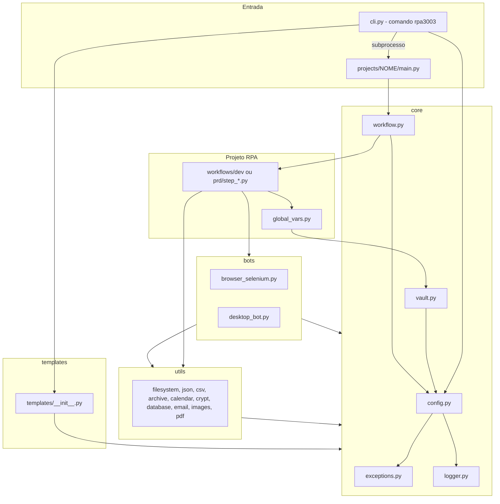
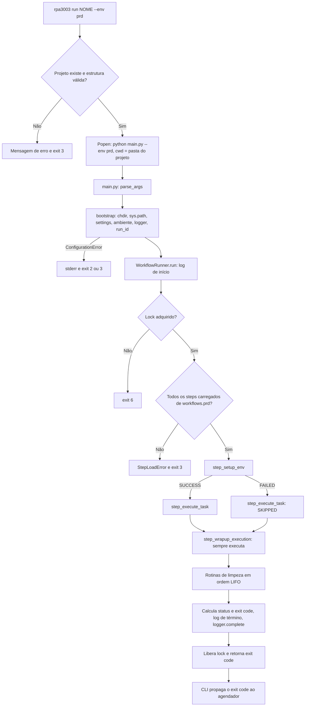
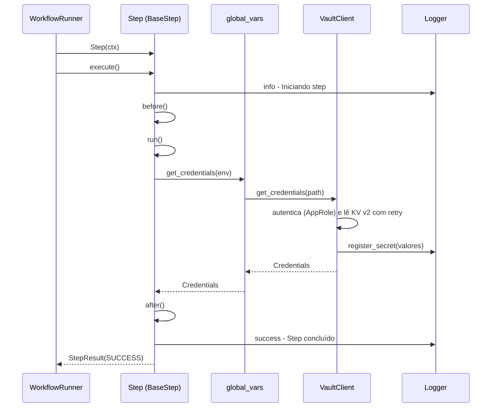
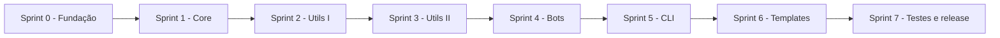

# PRD — Framework RPA `rpa_3003`

| Campo | Valor |
|---|---|
| Documento | `PRD.md` — Product Requirements Document |
| Produto | Pacote Python `rpa_3003` (distribuição `rpa-3003`, comando de terminal `rpa3003`) |
| Versão do documento | 1.1.0 |
| Versão alvo do framework | 1.0.0 |
| Data | 01/11/2026 |
| Status | Aprovado para implementação |
| Consumidor principal | Agente de IA de programação (agentic coding) |
| Idioma | Português (Brasil) — identificadores de código em inglês |

| Versão | Data | Alteração |
|---|---|---|
| 1.0.0 | 31/10/2026 | Versão aprovada para implementação. |
| 1.1.0 | 01/11/2026 | Acesso a bancos de dados somente leitura, por segurança: premissa P-24, RF-043, seção 8.15, ADR-18 e risco R-20. `database_utils` deixa de ter `execute`, `executemany` e `transaction`. O UC-03 passa a registrar o controle de boletos processados em CSV. |

> **Convenções deste documento.** As palavras **DEVE / OBRIGATÓRIO** indicam requisito mandatório; **NÃO DEVE / PROIBIDO** indicam proibição; **DEVERIA** indica recomendação forte; **PODE** indica opção. "Framework" designa o pacote `rpa_3003`. "Projeto" designa uma pasta RPA dentro de `projects/`. "Workspace" designa a raiz `rpa-framework/`. Todos os caminhos relativos partem do workspace, salvo indicação contrária. Trechos de código são **contratos de interface** (assinaturas e comportamento esperado), não implementação completa.

---

## 1. Visão Geral

### 1.1 Propósito

O `rpa_3003` é um framework interno, modular e extensível, em Python 3.12+, que padroniza a construção, a execução e a operação de automações RPA em estações e servidores Windows. Ele fornece, em um único pacote instalável: estrutura padronizada de projetos, orquestração de workflows em steps, separação de ambientes `dev`/`prd`, logging centralizado com `loguru`, integração com HashiCorp Vault, automação web multi-browser via Selenium (Chrome, Edge e Edge em modo IE), automação desktop por visão computacional, teclado, mouse e controle de janelas, além de utilitários prontos para arquivos, dados, bancos (somente leitura), e-mail, imagens e PDF.

### 1.2 Problema

A equipe mantém dezenas de automações construídas de forma heterogênea:

- Cada robô reimplementa logging, leitura de configuração, abertura de navegador e tratamento de erros, com formatos de log diferentes, o que torna o diagnóstico em produção lento.
- Credenciais aparecem em arquivos `.py`, `.ini` ou variáveis soltas, sem rastreabilidade e com risco de vazamento em logs.
- Não existe separação formal entre código em desenvolvimento e código em produção dentro do mesmo projeto.
- Criar um projeto novo exige copiar manualmente um robô antigo e remover código irrelevante.
- Falhas de navegador (drivers desatualizados, modo IE do Edge) e de automação desktop (escala de DPI, textos com acentuação) são resolvidas caso a caso.

### 1.3 Solução proposta

Um pacote `rpa_3003` com quatro camadas (`core`, `utils`, `bots`, `cli`/`templates`), um CLI `rpa3003` que cria projetos a partir de templates e os executa com seleção de ambiente, e um contrato único de projeto (`main.py` + `global_vars.py` + `workflows/dev|prd/step_*.py`). O framework impõe convenções (formato de log, códigos de saída, ciclo de vida de steps, origem de credenciais) e oferece pontos de extensão explícitos (novos navegadores, novos bancos, novos templates, novos provedores de segredo).

### 1.4 Público-alvo

| Público | Uso |
|---|---|
| Desenvolvedores RPA Python | Criam e mantêm projetos usando CLI, steps e utilitários. |
| Tech leads e arquitetos | Definem padrões, revisam projetos e estendem o framework. |
| Sustentação e operação | Agendam e executam robôs em produção, diagnosticam falhas via logs. |
| Segurança da informação e infraestrutura | Administram o Vault, políticas AppRole e as máquinas dos robôs. |
| Agente de IA de programação | Implementa o framework a partir exclusivamente deste PRD. |

### 1.5 Premissas Assumidas

As ambiguidades do enunciado foram resolvidas pelas premissas abaixo. O agente implementador DEVE segui-las literalmente.

| ID | Premissa | Justificativa |
|---|---|---|
| P-01 | Pacote `rpa_3003`; distribuição `rpa-3003`; comando de terminal `rpa3003`; versão inicial `1.0.0`, definida somente em `rpa_3003/_version.py`. | Nome do pacote exigido; comando conforme exemplos do enunciado; versão em arquivo isolado evita import circular. |
| P-02 | O CLI é executado a partir do workspace; o diretório de projetos padrão é `./projects`, sobrescrito por `--projects-dir` ou `RPA3003_PROJECTS_DIR`. | Permite instalar o framework com `pip install -e .` e manter projetos em outra pasta quando necessário. |
| P-03 | O campo `nome_script` do log é o nome do arquivo-fonte que emitiu a mensagem, com extensão (token `{file.name}` do loguru). Ex.: `step_execute_task.py`. | "Script" no Windows é o arquivo `.py`; o nome do arquivo é inequívoco para quem lê o log. |
| P-04 | Arquivo de log diário: `<pasta logs>/<prefixo>_<AAAA-MM-DD>.log`; prefixo = nome do projeto (ou `rpa3003` fora de projetos); retenção padrão de 30 dias; codificação UTF-8. | Nome datado elimina a renomeação de arquivos na rotação, causa principal de erros de lock no Windows. |
| P-05 | Ambiente padrão quando não informado: `dev`. | Falha segura: produção nunca é executada por omissão. |
| P-06 | Via CLI, cada execução roda em um processo Python separado (`python main.py ...`) com diretório de trabalho na pasta do projeto. | Isolamento de estado global, `sys.path`, handlers de log e permite encerrar a árvore de processos em caso de timeout. |
| P-07 | Vault: secrets engine KV versão 2 montado em `secret`; autenticação padrão AppRole; convenção de caminho `rpa/<projeto>/<ambiente>/<sistema>`; o framework apenas lê segredos. | Padrão de mercado para robôs não assistidos; escrita de segredos é responsabilidade da equipe de segurança. |
| P-08 | PostgreSQL e Denodo são acessados com `psycopg2-binary`; Denodo pela interface compatível com o protocolo PostgreSQL do Virtual DataPort (porta padrão 9996). | Driver gratuito, com wheels para Windows e Python 3.12, e compatível com Denodo sem driver ODBC adicional. |
| P-09 | CSV padrão: delimitador `;` e codificação `utf-8-sig`. | Compatibilidade com o Excel em português do Brasil. |
| P-10 | Fuso horário padrão `America/Sao_Paulo`; feriados nacionais do Brasil via biblioteca `holidays`, com UF opcional; pacote `tzdata` obrigatório. | Equipe brasileira; o Windows não possui a base IANA de fusos exigida por `zoneinfo`. |
| P-11 | Números de página na API pública de PDF começam em 1. | Coerência com a numeração que o usuário vê no leitor de PDF. |
| P-12 | Imagens de referência para visão computacional ficam em `data/images/` do projeto, em PNG. | A estrutura obrigatória não prevê pasta de recursos; `data/` é a pasta de dados do projeto. |
| P-13 | Um projeto admite apenas uma execução ativa por máquina, garantida por lock em `<projeto>/.rpa3003.lock`. | Evita concorrência em arquivos de log, arquivos de dados e janelas da sessão. |
| P-14 | Identificadores (classes, funções, variáveis) em inglês; docstrings (estilo Google), mensagens de log, mensagens do CLI e textos de templates em pt-BR. | Convenção usual; logs legíveis para a operação. |
| P-15 | Plataformas suportadas: Windows 10 21H2+, Windows 11 e Windows Server 2019+, x64, Python 64 bits. No modo IE usa-se o IEDriverServer 32 bits. | O IEDriverServer 64 bits tem problema conhecido de digitação lenta. |
| P-16 | E-mail: envio via SMTP e leitura via IMAP são obrigatórios; Outlook desktop via COM (pywin32) é desejável; Microsoft Graph está fora do escopo. | Biblioteca padrão e pywin32 são gratuitos e funcionam no Windows. |
| P-17 | Templates usam `string.Template` (biblioteca padrão), arquivos com sufixo `.tpl` e prefixo `dot_` para arquivos ocultos. | Sem dependência extra; `.tpl` impede que arquivos do template sejam importados ou coletados pelo pytest; `dot_` contorna a exclusão de arquivos ocultos no empacotamento. |
| P-18 | OCR não faz parte da versão 1.0. | Exigiria binário externo (Tesseract) não instalável via pip. |
| P-19 | Drivers de navegador são resolvidos pelo Selenium Manager (embutido no Selenium 4); um caminho manual configurado tem precedência. | Elimina dependências como `webdriver-manager`; o caminho manual atende redes sem acesso à internet. |
| P-20 | Cada módulo de step DEVE definir uma classe chamada `Step`, subclasse de `BaseStep`. | Contrato simples e verificável estaticamente para o carregamento dinâmico. |
| P-21 | `stdout` e `stderr` são reconfigurados para UTF-8 com `errors="replace"` no bootstrap e no CLI. | Consoles Windows em cp850/cp1252 lançam `UnicodeEncodeError` com acentos. |
| P-22 | Testes unitários executam também fora do Windows; testes de GUI, navegador e APIs exclusivas do Windows são marcados e pulados quando a plataforma não é Windows. | Permite pipeline rápido sem perder cobertura das funcionalidades Windows. |
| P-23 | Arquivos complementares à arquitetura obrigatória são permitidos e estão listados na seção 7.1, cada um com justificativa. | O enunciado autoriza adições justificadas. |
| P-24 | Bancos de dados são acessados somente para leitura. O framework não oferece inclusão, alteração, exclusão, DDL nem controle de transações. O usuário de banco de cada robô DEVE ter apenas privilégio de consulta (por exemplo, `SELECT`), concedido pela equipe responsável pelo banco. O que o robô precisar registrar (controle de itens processados, relatórios) vai para arquivos em `data/` do projeto ou para o sistema de destino, pela interface do próprio sistema. | Princípio do menor privilégio: um robô com credencial de escrita pode corromper dados corporativos por erro de código ou credencial vazada. A leitura atende aos casos de consulta e conciliação. |

---

## 2. Objetivos e Métricas de Sucesso

| ID | Objetivo | Métrica | Meta | Forma de medição |
|---|---|---|---|---|
| OBJ-01 | Padronizar a estrutura dos projetos | Percentual de projetos criados por `rpa3003 create` aprovados por `rpa3003 validate` | 100% | Teste E2E e execução de `rpa3003 validate` no pipeline |
| OBJ-02 | Reduzir o tempo de criação de projetos | Tempo de execução de `rpa3003 create <nome>` | ≤ 5 s | Teste automatizado com `time.perf_counter` |
| OBJ-03 | Acelerar o onboarding | Tempo para um desenvolvedor novo, seguindo apenas o README, ir do clone à primeira execução `dev` com sucesso | ≤ 15 min | Teste de aceitação com usuário |
| OBJ-04 | Garantir rastreabilidade | Percentual de linhas de log aderentes à expressão regular da seção 10.4 | 100% | Teste E2E valida todas as linhas geradas |
| OBJ-05 | Eliminar credenciais expostas | Ocorrências de segredos em código, templates ou logs | 0 | Teste de mascaramento e varredura `detect-secrets` no pipeline |
| OBJ-06 | Garantir encerramento controlado | Percentual de execuções (inclusive com falha) em que o step de wrapup executa | 100% | Testes do `WorkflowRunner` com falhas injetadas em cada step |
| OBJ-07 | Evitar processos órfãos | Processos `chromedriver.exe`, `msedgedriver.exe` ou `IEDriverServer.exe` remanescentes após o fim da execução | 0 | Teste de integração com `psutil` |
| OBJ-08 | Qualidade de código | Cobertura de linhas e branches do pacote | ≥ 85% global | `pytest --cov` com `fail_under = 85` |
| OBJ-09 | Qualidade estática | Erros de `ruff check` e `mypy --strict` no pacote | 0 | Pipeline |
| OBJ-10 | Baixo overhead | Tempo entre o início de `main.py` e o início do primeiro step, sem acesso ao Vault | ≤ 2 s | Teste E2E comparando timestamps de log |

---

## 3. Escopo

### 3.1 Dentro do escopo

1. Pacote `rpa_3003` instalável com `pip install -e .`, exigindo Python 3.12+, com execução em Windows.
2. Camada `core`: logger centralizado (`loguru`), configurações (`pydantic-settings`), exceções com códigos de saída, cliente Vault e motor de workflow.
3. Camada `utils`: filesystem e TXT, JSON, CSV, TAR/ZIP, datas e dias úteis, criptografia, bancos em modo somente leitura (PostgreSQL, SQLite, DuckDB, Denodo; P-24), e-mail (SMTP, IMAP, Outlook), imagens e PDF.
4. Camada `bots`: classe única `Browser` para Chrome, Edge e Edge em modo IE; classe `DesktopBot` para visão computacional, mouse, teclado, janelas e processos.
5. CLI `rpa3003` com os comandos `create`, `run`, `list`, `templates` e `validate`.
6. Template `example` completo e motor de renderização de templates.
7. Separação de ambientes `dev`/`prd` por projeto, selecionável em tempo de execução.
8. Testes unitários, de integração e ponta a ponta; README do framework e guia do desenvolvedor (`docs/GUIA_DO_DESENVOLVEDOR.md`).

### 3.2 Fora do escopo (explícito)

| Item fora do escopo | Alternativa recomendada |
|---|---|
| Orquestrador ou agendador de execuções | Agendador de Tarefas do Windows ou ferramenta corporativa chamando `rpa3003 run` |
| Filas de trabalho, painel web, API REST, dashboards | Evolução futura; logs e arquivos de status JSON servem de integração |
| Execução paralela de steps ou de vários robôs no mesmo processo | Um processo por execução (P-06) |
| Execução de robôs em Linux ou macOS | Apenas testes unitários rodam fora do Windows (P-22) |
| Firefox, Safari, Internet Explorer standalone (`iexplore.exe`), Playwright | Ponto de extensão `BrowserFactory.register` (RF-033) |
| OCR e reconhecimento de texto em imagens | Evolução futura (P-18) |
| SAP GUI Scripting, Citrix, emuladores de terminal 3270, automação mobile | Projetos podem integrar bibliotecas próprias |
| Utilitário dedicado a planilhas Excel (`.xlsx`) | Projetos podem usar `openpyxl` diretamente |
| Escrita, rotação de segredos e secrets engines dinâmicos no Vault | Responsabilidade da equipe de segurança |
| Escrita em bancos de dados (`INSERT`, `UPDATE`, `DELETE`, `MERGE`), DDL e controle de transações | Registro em arquivos de `data/` (CSV ou JSON) ou na interface do sistema de destino; alteração de dados feita pela equipe responsável pelo sistema (P-24) |
| Microsoft Graph e OAuth2 para e-mail | Ponto de extensão via `EmailSender` (seção 8.16) |
| Empacotamento em executável (PyInstaller) e instalador MSI | Instalação via `pip` em ambiente virtual |
| Promoção automatizada de código `dev` para `prd` | Processo manual documentado no README do projeto |
| Envio de logs a plataformas externas (ELK, Splunk) | Sink adicional do loguru adicionado pelo projeto após `setup_logger` |

### 3.3 Restrições

- Python 3.12 ou superior; Windows como sistema operacional alvo.
- `loguru` é a única interface pública de logging.
- Selenium WebDriver é a única tecnologia de automação web.
- Somente bibliotecas gratuitas, com licença compatível com uso corporativo interno (seção 7.6) e com wheels para Windows.
- O formato de log da seção 10 é imutável.
- A estrutura de diretórios da seção 7.1 é imutável quanto aos itens obrigatórios.

---

## 4. Personas e Casos de Uso

### 4.1 Personas

| Persona | Perfil | Objetivos | Dores atuais |
|---|---|---|---|
| **Ana** — Desenvolvedora RPA | Python intermediário, cria 2 a 3 robôs por mês | Criar projetos rapidamente, reutilizar utilitários, depurar em `dev` | Copiar boilerplate, reescrever login em sistemas web, drivers quebrando |
| **Carlos** — Tech Lead | Python avançado, revisa código e define padrões | Padronização, extensibilidade, qualidade | Cada robô com uma arquitetura diferente |
| **Marcos** — Sustentação | Opera robôs em produção, conhecimento básico de Python | Executar, agendar e diagnosticar falhas rapidamente | Logs sem padrão, ausência de evidências de erro |
| **Sofia** — Segurança e infraestrutura | Administra o Vault e as máquinas dos robôs | Zero segredo em código, acesso auditável | Senhas em arquivos de configuração |

### 4.2 Casos de uso

#### UC-01 — Criar um novo projeto e executá-lo em `dev`

- **Ator:** Ana. **Pré-condições:** framework instalado no ambiente virtual; terminal aberto no workspace.
- **Fluxo principal:**
  1. Ana executa `rpa3003 create conciliacao_bancaria`.
  2. O CLI valida o nome contra `^[a-z][a-z0-9_]{2,49}$`.
  3. O CLI renderiza o template `example` em uma pasta temporária dentro de `projects/` e a renomeia para `projects/conciliacao_bancaria/`.
  4. O CLI imprime o caminho criado e os próximos passos; código de saída `0`.
  5. Ana copia arquivos CSV para `projects/conciliacao_bancaria/data/input/`.
  6. Ana executa `rpa3003 run conciliacao_bancaria` (ambiente `dev` por padrão, P-05).
  7. O CLI valida a estrutura do projeto e inicia `python main.py --env dev` com diretório de trabalho na pasta do projeto.
  8. `main.py` executa `bootstrap()`: carrega configurações, configura o logger em `logs/conciliacao_bancaria_2026-10-31.log` e gera o `run_id`.
  9. O `WorkflowRunner` adquire o lock e executa `step_setup_env`, `step_execute_task` e `step_wrapup_execution` de `workflows/dev/`.
  10. O step de execução grava `data/output/relatorio_<run_id>.json`; o wrapup grava `data/output/status_<run_id>.json`.
  11. O processo filho termina com código `0`, que o CLI propaga.
- **Fluxos alternativos:**
  - A1 — Nome inválido (ex.: `Conciliação`): o CLI imprime a regra de nomenclatura e termina com código `2`.
  - A2 — Projeto já existe: o CLI termina com código `3`; com `--force`, a pasta existente é renomeada para `<nome>.bak-<AAAAMMDDHHMMSS>` antes da criação.
  - A3 — Exceção no step de execução: o wrapup executa mesmo assim, o resumo registra `status=FAILED` e o código de saída é `1`.
- **Pós-condições:** projeto válido segundo `rpa3003 validate`; log diário criado; arquivos de relatório e status gravados.
- **Requisitos relacionados:** RF-001 a RF-008, RF-010, RF-048, RF-049, RF-053.

#### UC-02 — Automação web em sistema legado no Edge modo IE com credenciais do Vault, em produção

- **Ator:** Marcos (agendamento) e robô. **Pré-condições:** projeto `emissao_notas` com `ENV_CONFIG[Environment.PRD]` definindo `browser="edge_ie"` e `vault_secret_path="rpa/emissao_notas/prd/sistema_legado"`; variáveis `RPA3003_VAULT_URL`, `RPA3003_VAULT_ROLE_ID` e `RPA3003_VAULT_SECRET_ID` definidas no nível da máquina; Edge instalado; zonas de segurança e zoom configurados conforme seção 14.
- **Fluxo principal:**
  1. O Agendador de Tarefas executa `rpa3003 run emissao_notas --env prd --timeout 3600` às 07:00.
  2. `bootstrap()` configura o logger e o `WorkflowRunner` adquire o lock.
  3. `step_setup_env` chama `global_vars.get_credentials(Environment.PRD)`; o `VaultClient` autentica via AppRole, lê o segredo KV v2 e registra os valores no mascaramento de log.
  4. `step_setup_env` cria `Browser("edge_ie", options)`, inicia o navegador e registra `browser.quit` como rotina de limpeza.
  5. `step_execute_task` abre a URL, digita o usuário, digita a senha com `sensitive=True` (o log exibe `********`), clica em "Entrar", aguarda o menu e baixa os PDFs com `expect_download`.
  6. `step_wrapup_execution` grava o status e envia e-mail de resumo via SMTP.
  7. As rotinas de limpeza encerram o navegador e o IEDriverServer.
  8. O processo termina com código `0`.
- **Fluxos alternativos:**
  - A1 — Vault indisponível: 3 tentativas com espera de 1 s e 2 s entre elas; se o cache offline estiver habilitado e válido, o valor em cache é usado com log `WARNING`; caso contrário, `VaultUnavailableError` encerra o setup, o step de execução é ignorado, o wrapup executa e o código de saída é `3`.
  - A2 — Elemento não encontrado: `ElementNotFoundError`; o hook `on_error` salva screenshot em `logs/screenshots/`; código de saída `1`.
  - A3 — Tempo limite do CLI excedido: o CLI encerra a árvore de processos (Python, driver, navegador) e termina com código `5`.
- **Pós-condições:** nenhuma senha em texto claro no log; nenhum processo de driver remanescente.
- **Requisitos relacionados:** RF-018, RF-020 a RF-022, RF-025, RF-026, RF-029 a RF-032, RF-049, RF-052.

#### UC-03 — Processamento de boletos recebidos por e-mail com lançamento em ERP desktop

- **Ator:** robô agendado. **Pré-condições:** caixa IMAP acessível; ERP desktop instalado; imagens de referência em `data/images/` (`tela_login.png`, `botao_salvar.png`); usuário do robô no PostgreSQL com privilégio somente de consulta ao cadastro de fornecedores (P-24).
- **Fluxo principal:**
  1. `step_setup_env` busca e-mails não lidos dos últimos 2 dias com assunto contendo "Boleto" e baixa os anexos PDF para `data/input/`.
  2. `step_setup_env` lê os boletos já processados em `data/output/processados.csv` com `csv_utils.read_csv` (arquivo inexistente equivale a controle vazio). Também consulta os fornecedores ativos no PostgreSQL com `database_utils.connect(...).fetch_all`, em modo somente leitura.
  3. `step_execute_task`, para cada PDF ainda não processado: extrai o texto com `pdf_utils.extract_text`, obtém valor e vencimento com expressões regulares e valida as regras de negócio (inclusive se o fornecedor está cadastrado).
  4. `DesktopBot.start_application` abre o ERP; `wait_image("tela_login")` aguarda a tela; `type_text` digita credenciais (sensíveis mascaradas) e dados com acentuação; `click_image("botao_salvar")` confirma.
  5. O boleto é acrescentado a `data/output/processados.csv` com `csv_utils.write_csv(..., append=True)`; o e-mail é marcado como lido.
  6. `step_wrapup_execution` gera relatório CSV, compacta os PDFs processados com `archive_utils.create_zip` e envia o resumo por SMTP.
- **Fluxos alternativos:**
  - A1 — Imagem não encontrada no tempo limite: `ImageNotFoundError` com screenshot da tela; código `1`.
  - A2 — Valor do boleto inválido: o step lança `BusinessRuleError`; o wrapup envia e-mail de "pendência de negócio"; código `4`.
- **Requisitos relacionados:** RF-034 a RF-036, RF-039, RF-040, RF-043, RF-044, RF-047.

#### UC-04 — Diagnóstico de falha em produção

- **Ator:** Marcos. **Pré-condições:** o agendador reportou código de saída diferente de `0`.
- **Fluxo principal:**
  1. Marcos abre `projects/emissao_notas/logs/emissao_notas_2026-10-31.log`.
  2. Localiza a linha `Execução finalizada | status=FAILED | exit_code=1 | ...` e copia o `run_id`.
  3. Filtra as linhas do `run_id` a partir de `Iniciando execução` e encontra a linha `[ERROR]` com nome do script e número da linha, seguida do traceback.
  4. Abre a evidência em `logs/screenshots/<timestamp>_erro.png`.
  5. Reexecuta com `rpa3003 run emissao_notas --env prd --user marcos.op`; as novas linhas exibem `[marcos.op]` no campo de usuário.
- **Pós-condições:** causa raiz identificada sem acesso ao código-fonte.
- **Requisitos relacionados:** RF-008, RF-015, RF-016, RF-032.

#### UC-05 — Estender o framework com novo navegador e novo banco de dados

- **Ator:** Carlos.
- **Fluxo principal:**
  1. Carlos cria `FirefoxDriverBuilder` implementando o protocolo `DriverBuilder` (`build(options) -> WebDriver`).
  2. Registra o builder com `BrowserFactory.register("firefox", FirefoxDriverBuilder())`.
  3. `Browser("firefox")` passa a funcionar sem nenhuma alteração na classe `Browser`.
  4. Para MySQL, cria `MySQLDatabase(Database)` implementando `_connect` (conexão em modo somente leitura, P-24), `paramstyle` e `table_exists`, e registra com `register_engine("mysql", MySQLDatabase)`.
  5. `create_database(DatabaseConfig(engine="mysql", ...))` retorna a nova implementação, que herda da classe base a validação de instruções somente leitura.
- **Requisitos relacionados:** RF-033, RF-043, RF-055.

---

## 5. Requisitos Funcionais

### 5.1 Matriz de rastreabilidade (recursos do enunciado → requisitos)

| # | Recurso exigido | Requisitos funcionais |
|---|---|---|
| 1 | Estrutura de Projetos Organizada | RF-001 a RF-009 |
| 2 | Suporte Multi-Browser | RF-026 a RF-033 |
| 3 | Utilitários Prontos (JSON, CSV, TXT, filesystem, TAR/ZIP, datas, criptografia, bancos somente leitura, e-mail, imagens, PDF) | RF-037 a RF-047 (automação desktop: RF-034 a RF-036) |
| 4 | Logging Centralizado | RF-014 a RF-019 |
| 5 | Interface CLI | RF-048 a RF-052 |
| 6 | Templates Prontos | RF-053 a RF-055 |
| 7 | Separação de Ambientes | RF-010 a RF-013 |
| 8 | Integração com HashiCorp Vault | RF-020 a RF-025 |

**Prioridade (MoSCoW):** **Must** = obrigatório na v1.0; **Should** = importante, entregue na v1.0 salvo bloqueio técnico documentado; **Could** = desejável, entregue na v1.0 após os demais; **Won't** = não se aplica a nenhum requisito desta versão.

### 5.2 Estrutura de projetos e orquestração

#### RF-001 — Estrutura padrão de projeto RPA
- **Prioridade:** Must
- **Descrição:** Todo projeto em `projects/<nome>/` DEVE conter os 13 itens obrigatórios definidos na constante `REQUIRED_PROJECT_ITEMS` de `rpa_3003/core/config.py` (fonte única da verdade): `main.py`, `global_vars.py`, `logs/`, `data/`, `workflows/__init__.py`, `workflows/dev/__init__.py`, `workflows/dev/step_setup_env.py`, `workflows/dev/step_execute_task.py`, `workflows/dev/step_wrapup_execution.py`, `workflows/prd/__init__.py`, `workflows/prd/step_setup_env.py`, `workflows/prd/step_execute_task.py`, `workflows/prd/step_wrapup_execution.py`. Entradas terminadas em `/` são diretórios. Itens adicionais são permitidos.
- **Critérios de aceitação:**
  - [ ] Dado um projeto criado por `rpa3003 create x`, Quando sua árvore é listada, Então todos os 13 itens de `REQUIRED_PROJECT_ITEMS` existem com o tipo correto (arquivo ou diretório).
  - [ ] Dado o módulo `rpa_3003.core.config`, Quando `REQUIRED_PROJECT_ITEMS` é inspecionada, Então é uma `tuple[str, ...]` com exatamente 13 entradas na ordem acima.

#### RF-002 — Resolução de caminhos do projeto
- **Prioridade:** Must
- **Descrição:** `ProjectPaths.from_root(root)` DEVE resolver caminhos absolutos para raiz, `workflows/`, `logs/`, `logs/screenshots/`, `data/`, `main.py`, `global_vars.py` e arquivo de lock. `ensure_runtime_dirs()` DEVE criar `logs/`, `logs/screenshots/` e `data/` quando ausentes, de forma idempotente.
- **Critérios de aceitação:**
  - [ ] Dado `root = Path("projects/meu projeto")` (com espaço), Quando `from_root` é chamado, Então todos os atributos são `Path` absolutos e `screenshots_dir == logs_dir / "screenshots"`.
  - [ ] Dado um projeto sem `logs/`, Quando `ensure_runtime_dirs()` é chamado duas vezes, Então os diretórios existem e nenhuma exceção é lançada.

#### RF-003 — Validação de estrutura de projeto
- **Prioridade:** Must
- **Descrição:** `validate_project_structure(root) -> list[str]` DEVE retornar a lista de problemas (vazia quando válido): itens obrigatórios ausentes; módulos de step com erro de sintaxe; módulos de step sem classe `Step` no nível superior; módulos em `workflows/prd/` que importem `workflows.dev`. A verificação DEVE ser estática (módulo `ast`), sem importar o código do projeto.
- **Critérios de aceitação:**
  - [ ] Dado um projeto sem `workflows/prd/step_execute_task.py`, Quando validado, Então o retorno contém `"ausente: workflows/prd/step_execute_task.py"`.
  - [ ] Dado um step com erro de sintaxe na linha 7, Quando validado, Então o retorno contém `"workflows/dev/step_setup_env.py: erro de sintaxe na linha 7"`.
  - [ ] Dado um step sem `class Step`, Quando validado, Então o retorno contém `"<arquivo>: classe 'Step' não encontrada"`.
  - [ ] Dado `workflows/prd/step_execute_task.py` contendo `from workflows.dev import x`, Quando validado, Então o retorno contém `"<arquivo>: importação proibida de workflows.dev em prd"`.
  - [ ] Dado um projeto recém-criado, Quando validado, Então o retorno é `[]`.

#### RF-004 — Execução em instância única por projeto
- **Prioridade:** Should
- **Descrição:** O `WorkflowRunner` DEVE adquirir lock exclusivo em `<projeto>/.rpa3003.lock` com `filelock.FileLock` (timeout 0) antes de qualquer step. Lock ocupado DEVE gerar `ProjectAlreadyRunningError` (código `6`) sem executar steps. O lock DEVE ser liberado ao final, inclusive em falha; se o processo morrer, o sistema operacional libera o lock.
- **Critérios de aceitação:**
  - [ ] Dado um processo segurando o lock, Quando uma segunda execução inicia, Então ela termina em até 2 s com código `6` e log `ERROR` contendo `Projeto já está em execução`.
  - [ ] Dada uma execução que terminou com falha, Quando uma nova execução inicia, Então o lock é adquirido normalmente.
  - [ ] Dado `WorkflowRunner(ctx, use_lock=False)`, Quando executado, Então nenhum arquivo de lock é criado.

#### RF-005 — Contrato de step (Template Method)
- **Prioridade:** Must
- **Descrição:** `BaseStep` (abstrata) DEVE expor `execute()` final que: registra início; chama `before()`; chama `run()` com até `retries` novas tentativas (espera `retry_delay` segundos) para exceções que não sejam `BusinessRuleError`; chama `after()`; registra término e duração; em falha definitiva chama `on_error(error)` e retorna `StepResult` com status `FAILED` sem propagar a exceção. `KeyboardInterrupt` DEVE ser propagado. Cada módulo de step DEVE definir `class Step(BaseStep)` (P-20).
- **Critérios de aceitação:**
  - [ ] Dada uma subclasse sem `run()`, Quando instanciada, Então ocorre `TypeError`.
  - [ ] Dado um step bem-sucedido, Quando `execute()` é chamado, Então retorna `StepResult(status=SUCCESS)` com `duration_seconds > 0` e registra `>>> Iniciando step '<nome>'` e `<<< Step '<nome>' concluído em <N.NN>s`.
  - [ ] Dado `run()` que lança `ValueError`, Quando `execute()` é chamado, Então `on_error` é chamado uma única vez com a exceção, o resultado é `FAILED` e nenhuma exceção é propagada.
  - [ ] Dado `retries = 2` e `run()` que falha duas vezes e depois funciona, Quando executado, Então o resultado é `SUCCESS` e há 2 logs `WARNING` de nova tentativa.
  - [ ] Dado `run()` que lança `BusinessRuleError` com `retries = 2`, Quando executado, Então não há novas tentativas.
  - [ ] Dado `on_error()` que lança exceção, Quando executado, Então um `WARNING` é registrado e o `StepResult.error` mantém a exceção original.

#### RF-006 — Orquestração sequencial com wrapup garantido
- **Prioridade:** Must
- **Descrição:** O `WorkflowRunner` DEVE carregar, antes de executar qualquer step, todos os módulos `workflows.<env>.<step>` da sequência (padrão: `step_setup_env`, `step_execute_task`, `step_wrapup_execution`). Falha de carregamento gera `StepLoadError` (código `3`) sem executar steps. Após a primeira falha, steps com `always_run = False` recebem status `SKIPPED`; steps com `always_run = True` (o wrapup) executam sempre.
- **Critérios de aceitação:**
  - [ ] Dado setup que falha, Quando executado, Então execute fica `SKIPPED`, wrapup fica `SUCCESS` e o código de saída corresponde ao erro do setup.
  - [ ] Dado um módulo de step sem classe `Step`, Quando o runner inicia, Então nenhum step executa e o código é `3`.
  - [ ] Dado `env=dev`, Quando a execução termina, Então nenhum módulo `workflows.prd*` está em `sys.modules`.

#### RF-007 — Contexto de execução compartilhado e rotinas de limpeza
- **Prioridade:** Must
- **Descrição:** Uma única instância de `ExecutionContext` DEVE ser compartilhada entre os steps, com `state: dict[str, Any]` para dados entre steps e `register_cleanup(func)` para rotinas executadas em ordem LIFO após todos os steps. Erros em rotinas de limpeza DEVEM ser registrados como `WARNING` sem interromper as demais nem alterar o código de saída.
- **Critérios de aceitação:**
  - [ ] Dado `ctx.state["total"] = 10` no setup, Quando o step de execução lê `ctx.state["total"]`, Então obtém `10`.
  - [ ] Dadas as rotinas A e B registradas nessa ordem, Quando a execução termina, Então B executa antes de A.
  - [ ] Dada uma rotina que lança exceção, Quando a execução termina, Então as demais executam e o código de saída não muda.

#### RF-008 — Códigos de saída padronizados e resumo de execução
- **Prioridade:** Must
- **Descrição:** Toda execução DEVE terminar com um código de `ExitCode` (seção 9.5), registrar a linha de início `Iniciando execução | ...` e a de término `Execução finalizada | status=<STATUS> | exit_code=<N> | duracao=<S>s | run_id=<ID>`, e retornar o código ao sistema operacional via `sys.exit(main())`.
- **Critérios de aceitação:**
  - [ ] Dada execução sem erros, Então o código é `0` e o status é `SUCCESS`.
  - [ ] Dado `BusinessRuleError` em qualquer step, Então o código é `4` e o status é `BUSINESS_ERROR`.
  - [ ] Dada uma exceção genérica (`RuntimeError`), Então o código é `1` e o status é `FAILED`.
  - [ ] Dado `VaultUnavailableError`, Então o código é `3`.
  - [ ] Dado `KeyboardInterrupt` durante o step de execução, Então o wrapup executa e o código é `130`.

#### RF-009 — Hierarquia de exceções customizadas
- **Prioridade:** Must
- **Descrição:** `rpa_3003/core/exceptions.py` DEVE definir a hierarquia da seção 8.6, com raiz `RPAError`, atributo de classe `exit_code: ExitCode`, atributos `message` e `details`, e a função `exit_code_for(error)`.
- **Critérios de aceitação:**
  - [ ] `str(RPAError("Falha", details={"arquivo": "a.csv"}))` retorna `"Falha | arquivo=a.csv"`.
  - [ ] Todas as exceções da seção 8.6 são subclasses de `RPAError`.
  - [ ] `exit_code_for(KeyboardInterrupt())` retorna `ExitCode.INTERRUPTED`; `exit_code_for(ValueError())` retorna `ExitCode.TECHNICAL_ERROR`.

### 5.3 Separação de ambientes

#### RF-010 — Seleção de ambiente em tempo de execução
- **Prioridade:** Must
- **Descrição:** O ambiente DEVE ser resolvido nesta precedência: argumento `--env` (CLI ou `main.py`) → variável de ambiente `RPA3003_ENV` → arquivo `.env` do projeto → padrão `dev`. Valores aceitos: `dev` e `prd`, sem diferenciar maiúsculas e ignorando espaços. Valor inválido gera `InvalidEnvironmentError` (código `2`).
- **Critérios de aceitação:**
  - [ ] Dado `RPA3003_ENV=prd` e `--env dev`, Então o ambiente é `dev`.
  - [ ] Dado apenas `RPA3003_ENV=PRD`, Então o ambiente é `prd`.
  - [ ] Dado nenhum valor informado, Então o ambiente é `dev`.
  - [ ] Dado `--env hml`, Então o código é `2` e a mensagem lista `dev, prd`.

#### RF-011 — Isolamento entre `dev` e `prd`
- **Prioridade:** Must
- **Descrição:** O runner DEVE importar somente módulos do pacote `workflows.<env>` selecionado. As pastas `dev/` e `prd/` são cópias independentes; código de `prd` NÃO DEVE importar `workflows.dev` (verificado por RF-003).
- **Critérios de aceitação:**
  - [ ] Dado `env=prd`, Quando a execução termina, Então `sys.modules` não contém `workflows.dev` nem submódulos.
  - [ ] Dado um arquivo de `prd` que importa `workflows.dev`, Quando `rpa3003 validate` executa, Então o problema é reportado e o código é `3`.

#### RF-012 — Configuração não sensível por ambiente em `global_vars.py`
- **Prioridade:** Must
- **Descrição:** `global_vars.py` DEVE definir a dataclass `EnvConfig`, o dicionário `ENV_CONFIG: dict[Environment, EnvConfig]` com entradas para todos os membros de `Environment` e a função `get_env_config(env)`. O arquivo NÃO DEVE conter segredos nem realizar I/O de rede ao ser importado.
- **Critérios de aceitação:**
  - [ ] Dado um projeto gerado, Quando `global_vars` é importado com sockets bloqueados por mock, Então nenhuma conexão é tentada.
  - [ ] `set(ENV_CONFIG) == set(Environment)`.

#### RF-013 — Configuração do framework por variáveis de ambiente e `.env`
- **Prioridade:** Must
- **Descrição:** `FrameworkSettings` e `VaultSettings` (pydantic-settings) DEVEM ler variáveis com prefixo `RPA3003_` (tabela na seção 8.5) e o arquivo `.env` da pasta do projeto. Precedência: argumentos explícitos → variáveis de ambiente → `.env` → padrão. Valores inválidos geram `ConfigurationError` com o nome do campo.
- **Critérios de aceitação:**
  - [ ] Dado `RPA3003_LOG_LEVEL=DEBUG`, Então `get_settings().log_level == "DEBUG"`.
  - [ ] Dado `RPA3003_LOG_RETENTION_DAYS=0`, Então `load_settings()` lança `ConfigurationError` cuja mensagem contém `log_retention_days`.
  - [ ] Duas chamadas a `get_settings()` retornam o mesmo objeto; após `reset_settings_cache()`, um novo objeto.

### 5.4 Logging centralizado

#### RF-014 — Logger único e centralizado
- **Prioridade:** Must
- **Descrição:** `rpa_3003/core/logger.py` DEVE ser o único ponto de configuração de logging. `setup_logger()` configura a instância global do loguru de forma idempotente (cada chamada substitui os handlers anteriores). `get_logger()` retorna o logger do loguru. Framework e projetos DEVEM usar `get_logger()`; nenhum outro módulo do framework adiciona sinks. `import logging` só é permitido em `core/logger.py`.
- **Critérios de aceitação:**
  - [ ] Dado `setup_logger()` chamado duas vezes com a mesma pasta, Quando uma mensagem é registrada, Então o arquivo contém exatamente uma linha para ela.
  - [ ] Uma busca por `import logging` em `rpa_3003/` encontra ocorrência apenas em `core/logger.py`.
  - [ ] `get_logger()` retorna objeto com os métodos `info`, `bind`, `opt` e `exception` do loguru.

#### RF-015 — Formato obrigatório de log
- **Prioridade:** Must
- **Descrição:** Cada linha DEVE seguir exatamente `[YYYY-MM-DD HH:MM:SS] [LEVEL] [nome_script] [linha] [user] mensagem`, implementado pela constante `LOG_FORMAT` (seção 10.3), tanto no arquivo quanto no console (cores ANSI permitidas apenas no console).
- **Critérios de aceitação:**
  - [ ] Dado `get_logger().info("Olá")` na linha 10 de `main.py`, às 08:00:00 de 31/10/2026, com usuário `ana`, Então a linha gravada é `[2026-10-31 08:00:00] [INFO] [main.py] [10] [ana] Olá`.
  - [ ] Dado o log de uma execução E2E, Então 100% das linhas que não são traceback casam com a regex da seção 10.4.

#### RF-016 — Usuário parametrizável
- **Prioridade:** Must
- **Descrição:** O campo `user` DEVE ser resolvido nesta precedência: `get_logger(user=...)` (apenas para o logger retornado) → `setup_logger(user=...)` (recebe `--user` do CLI ou `RPA3003_LOG_USER`) → `getpass.getuser()` → variável `USERNAME` → literal `desconhecido`.
- **Critérios de aceitação:**
  - [ ] Dado `setup_logger()` sem usuário e `getpass.getuser()` retornando `joao.silva`, Então as linhas contêm `[joao.silva]`.
  - [ ] Dado `setup_logger(user="robo01")`, Então as linhas contêm `[robo01]`.
  - [ ] Dado `get_logger(user="auditoria").info("x")`, Então somente essa linha contém `[auditoria]`; as demais mantêm o usuário padrão.
  - [ ] Dado `getpass.getuser()` lançando `OSError` e `USERNAME=svc_rpa`, Então as linhas contêm `[svc_rpa]`.

#### RF-017 — Rotação diária e retenção
- **Prioridade:** Must
- **Descrição:** O sink de arquivo DEVE usar caminho `<logs_dir>/<prefixo>_{time:YYYY-MM-DD}.log`, `rotation="00:00"`, `retention="<N> days"` (padrão 30), `encoding="utf-8"`, `enqueue=True` e compressão `zip` opcional dos arquivos rotacionados.
- **Critérios de aceitação:**
  - [ ] Dadas mensagens às 23:59:59 de 31/10/2026 e às 00:00:01 de 01/11/2026 (tempo simulado com `time-machine`), Então existem `<prefixo>_2026-10-31.log` e `<prefixo>_2026-11-01.log`, cada um com sua mensagem.
  - [ ] O arquivo do dia anterior mantém o nome original (nenhuma renomeação na rotação).
  - [ ] Dado `retention_days=1` e um arquivo de log com data de modificação de 3 dias atrás, Quando ocorre rotação, Então o arquivo antigo é removido.

#### RF-018 — Mascaramento de segredos
- **Prioridade:** Must
- **Descrição:** `register_secret(value)` DEVE adicionar o valor (com 4 ou mais caracteres) a um conjunto global; um patcher do loguru DEVE substituir toda ocorrência por `********` na mensagem. Valores com menos de 4 caracteres geram `WARNING` e não são registrados. O `VaultClient` registra automaticamente todos os valores lidos. Os sinks DEVEM usar `diagnose=False`.
- **Critérios de aceitação:**
  - [ ] Dado `register_secret("S3nh@Forte")`, Quando `logger.info("senha=S3nh@Forte")`, Então a linha contém `senha=********`.
  - [ ] Dado um segredo lido por `VaultClient` (mock), Quando o valor aparece em uma mensagem, Então é mascarado.
  - [ ] Dado `Browser.type_text(..., sensitive=True)`, Então o log mostra `********` no lugar do texto.

#### RF-019 — Interceptação do `logging` padrão
- **Prioridade:** Should
- **Descrição:** `setup_logger()` DEVE instalar `InterceptHandler` no logger raiz do módulo `logging` (nível padrão `WARNING`), redirecionando mensagens de bibliotecas (selenium, urllib3, hvac) ao loguru, preservando o arquivo e a linha de origem.
- **Critérios de aceitação:**
  - [ ] Dado `logging.getLogger("teste").warning("x")` em `test_logger.py`, Então o arquivo contém linha `[WARNING] [test_logger.py] [<linha>]` com a mensagem `x`.
  - [ ] Dado `logging.getLogger("urllib3").debug("y")`, Então nada é registrado (abaixo de `WARNING`).

### 5.5 Integração com HashiCorp Vault

#### RF-020 — Cliente Vault com múltiplos métodos de autenticação
- **Prioridade:** Must
- **Descrição:** `HashiCorpVaultProvider` DEVE suportar `token`, `approle`, `ldap` e `userpass`, selecionados por `RPA3003_VAULT_AUTH_METHOD` (padrão `approle`), autenticando de forma preguiçosa na primeira leitura, com verificação TLS ativa por padrão (ou caminho de CA) e namespace opcional. Parâmetros obrigatórios ausentes geram `ConfigurationError` listando as variáveis faltantes.
- **Critérios de aceitação:**
  - [ ] Dado AppRole com `role_id` e `secret_id`, Quando três segredos são lidos, Então `auth.approle.login` é chamado uma única vez.
  - [ ] Dado token inválido, Então ocorre `VaultAuthenticationError` (código `3`).
  - [ ] Dado `auth_method=approle` sem `secret_id`, Então a mensagem de `ConfigurationError` contém `RPA3003_VAULT_SECRET_ID`.

#### RF-021 — Leitura de segredos KV v1 e v2
- **Prioridade:** Must
- **Descrição:** `read_secret(path)` DEVE retornar `dict[str, str]` (valores convertidos com `str()`); KV v2 usa `read_secret_version(..., raise_on_deleted_version=True)`; KV v1 usa `read_secret`. `get_secret(path, key)` retorna um valor; `get_credentials(path)` retorna `Credentials(username, password: SecretStr)`.
- **Critérios de aceitação:**
  - [ ] Dado caminho inexistente, Então ocorre `SecretNotFoundError` com o caminho em `details` e nenhum valor de segredo.
  - [ ] Dada chave inexistente, Então a mensagem lista apenas os nomes das chaves disponíveis.
  - [ ] `repr(credentials)` não contém a senha.

#### RF-022 — Resiliência: retentativas, backoff e cache em memória
- **Prioridade:** Must
- **Descrição:** Erros de conexão, timeout e HTTP 5xx DEVEM ser retentados até `max_retries` tentativas totais (padrão 3), com espera `backoff_base * 2 ** (tentativa - 1)` segundos entre elas (padrão 1 s e 2 s). Erro 403 com token expirado provoca uma única reautenticação. Leituras bem-sucedidas ficam em cache em memória por `cache_ttl` segundos (padrão 300) por par (mount, caminho). Esgotadas as tentativas: `VaultUnavailableError`.
- **Critérios de aceitação:**
  - [ ] Dado mock que falha 2 vezes e depois responde, Então o resultado é retornado após esperas de 1 s e 2 s (`time.sleep` simulado).
  - [ ] Dado mock que sempre falha, Então ocorre `VaultUnavailableError` após 3 tentativas.
  - [ ] Dada uma segunda leitura dentro do TTL, Então nenhuma chamada de rede ocorre; após o TTL, uma nova chamada ocorre.

#### RF-023 — Cache offline criptografado com DPAPI
- **Prioridade:** Could
- **Descrição:** Com `RPA3003_VAULT_OFFLINE_CACHE=true`, cada leitura bem-sucedida DEVE ser persistida cifrada com DPAPI (escopo do usuário Windows) em `%LOCALAPPDATA%\rpa_3003\vault_cache\<sha256(mount + "/" + caminho)>.bin` com timestamp. O cache é usado somente quando o Vault está indisponível e a idade é ≤ `offline_cache_ttl_hours` (padrão 24), com log `WARNING`. Nunca é usado em erro de autenticação ou segredo inexistente. Desabilitado por padrão.
- **Critérios de aceitação:**
  - [ ] Dado cache habilitado, Vault indisponível e cache com 2 h, Então o valor em cache é retornado e um `WARNING` contém `cache offline`.
  - [ ] Dado cache com idade acima do TTL, Então ocorre `VaultUnavailableError`.
  - [ ] O conteúdo do arquivo `.bin` não contém os bytes do segredo em texto claro.

#### RF-024 — Provedor local de segredos para `dev`
- **Prioridade:** Should
- **Descrição:** Com `RPA3003_VAULT_LOCAL_SECRETS_FILE` apontando para um JSON no formato `{"<caminho>": {"<chave>": "<valor>"}}`, o `VaultClient` DEVE usar `LocalFileSecretProvider` somente em `dev`, com log `WARNING`. Em `prd`, a presença da variável DEVE gerar `ConfigurationError`.
- **Critérios de aceitação:**
  - [ ] Dado `env=dev` e arquivo válido, Então os segredos são retornados e registrados para mascaramento.
  - [ ] Dado `env=prd` e a variável definida, Então `get_vault_client(Environment.PRD)` lança `ConfigurationError`.

#### RF-025 — Credenciais via `global_vars.py`
- **Prioridade:** Must
- **Descrição:** `global_vars.get_credentials(env)` DEVE usar `get_vault_client(env)` e `EnvConfig.vault_secret_path`, retornando `None` quando o caminho é `None`, sem I/O no import.
- **Critérios de aceitação:**
  - [ ] Dado `env=dev` com `vault_secret_path=None`, Então retorna `None` e nenhum cliente Vault é criado.
  - [ ] Dado `env=prd` com caminho definido e Vault simulado, Então retorna `Credentials` com usuário e senha esperados.

### 5.6 Automação web multi-browser

#### RF-026 — Classe única de abstração `Browser`
- **Prioridade:** Must
- **Descrição:** `Browser` DEVE ser a interface pública única para automação web, com os mesmos métodos para todos os tipos de navegador, suporte a gerenciador de contexto, `quit()` idempotente e propriedade `driver` para acesso ao `WebDriver` nativo.
- **Critérios de aceitação:**
  - [ ] Um mesmo roteiro de teste executa com `BrowserType.CHROME` e `BrowserType.EDGE` alterando apenas o argumento do construtor.
  - [ ] Dado `with Browser(...) as b:` com exceção interna, Então `driver.quit()` é chamado exatamente uma vez.
  - [ ] Dois `quit()` consecutivos não lançam exceção.

#### RF-027 — Suporte ao Chrome
- **Prioridade:** Must
- **Descrição:** `ChromeDriverBuilder` DEVE construir `webdriver.Chrome` com: `--headless=new` quando headless; tamanho de janela ou maximizado; preferências de download; argumentos extras; `user_data_dir`; aceitação de certificados inválidos; `page_load_timeout`. O driver vem do Selenium Manager ou de `chromedriver_path`.
- **Critérios de aceitação:**
  - [ ] Teste unitário com `webdriver.Chrome` simulado: as opções contêm `--headless=new` e `prefs["download.default_directory"]` igual ao caminho absoluto configurado.
  - [ ] Teste de integração (marcador `browser`): inicia headless, abre página local `file://` e lê o título.

#### RF-028 — Suporte ao Edge
- **Prioridade:** Must
- **Descrição:** `EdgeDriverBuilder` DEVE construir `webdriver.Edge` com as mesmas opções do RF-027, usando `msedgedriver` via Selenium Manager ou `edgedriver_path`.
- **Critérios de aceitação:**
  - [ ] Teste unitário equivalente ao RF-027 para `EdgeOptions`.
  - [ ] Teste de integração headless no Edge abre página local e lê o título.

#### RF-029 — Suporte ao Edge em modo IE via IEDriver
- **Prioridade:** Must
- **Descrição:** `EdgeIEDriverBuilder` DEVE construir `webdriver.Ie` com `IeOptions`: `attach_to_edge_chrome=True`, `edge_executable_path` (de `binary_path`, `RPA3003_EDGE_BINARY_PATH` ou detecção nos caminhos padrão), `ignore_zoom_level`, `introduce_flakiness_by_ignoring_security_domains`, `require_window_focus`, `ensure_clean_session` e `initial_browser_url`; serviço com `iedriver_path` ou Selenium Manager. `headless` e `download_dir` não são suportados: geram `WARNING` e são ignorados. `msedge.exe` não encontrado gera `DriverInitializationError` com os caminhos pesquisados.
- **Critérios de aceitação:**
  - [ ] Teste unitário: `IeOptions` recebe `attach_to_edge_chrome=True` e o caminho do Edge detectado.
  - [ ] Dado nenhum `msedge.exe` nos caminhos padrão, Então a mensagem de `DriverInitializationError` lista os caminhos pesquisados.
  - [ ] Teste de integração (Windows com modo IE): abre HTML local e `execute_script("return document.documentMode")` retorna número ≤ 11.

#### RF-030 — Interações com espera explícita
- **Prioridade:** Must
- **Descrição:** Métodos de interação DEVEM usar `WebDriverWait` com `timeout` (padrão `BrowserOptions.default_timeout`); espera implícita sempre `0`. `TimeoutException` é convertida em `ElementNotFoundError` com localizador, timeout e URL. `click` usa clique via JavaScript quando o clique nativo é interceptado e `js_fallback=True`. `select_option` exige exatamente um critério.
- **Critérios de aceitação:**
  - [ ] Dado elemento que aparece após 2 s e `timeout=5`, Então é encontrado.
  - [ ] Dado elemento inexistente e `timeout=1`, Então `ElementNotFoundError` ocorre em até 1,5 s e a mensagem contém o localizador.
  - [ ] Dado `select_option(loc, text="A", value="a")`, Então ocorre `ValueError`.

#### RF-031 — Gestão de downloads
- **Prioridade:** Should
- **Descrição:** `expect_download(timeout, pattern)` DEVE ser um gerenciador de contexto que registra os arquivos existentes em `download_dir`, e ao sair aguarda um arquivo novo que case com `pattern`, sem sufixo temporário (`.crdownload`, `.tmp`, `.partial`, `.part`, `.download`) e com tamanho estável por 1 s, preenchendo `DownloadResult.path`. Sem `download_dir`: `BrowserError`. Sem arquivo no prazo: `DownloadTimeoutError`.
- **Critérios de aceitação:**
  - [ ] Teste de integração com servidor HTTP local: após clicar no link dentro do bloco, `result.path` existe e tem o conteúdo esperado.
  - [ ] Dado nenhum download em `timeout=2`, Então ocorre `DownloadTimeoutError`.

#### RF-032 — Screenshots e evidência de falha
- **Prioridade:** Must
- **Descrição:** `screenshot(path=None, label="captura")` DEVE salvar PNG em `screenshots_dir` com nome `<AAAAMMDD_HHMMSS_fff>_<label>.png` e registrar o caminho em `INFO`. Ao sair do gerenciador de contexto com exceção, e com `screenshot_on_error=True`, o `Browser` salva screenshot com label `erro` antes de encerrar.
- **Critérios de aceitação:**
  - [ ] O arquivo gerado abre com `PIL.Image.open` e tem formato `PNG`.
  - [ ] Dada exceção dentro do `with`, Então existe um arquivo `*_erro.png` antes da chamada de `quit()`.

#### RF-033 — Extensibilidade de navegadores
- **Prioridade:** Should
- **Descrição:** `BrowserFactory.register(name, builder, overwrite=False)` DEVE registrar implementações do protocolo `DriverBuilder`. Nome duplicado sem `overwrite` gera `ValueError`; nome desconhecido gera `BrowserNotSupportedError` com a lista de nomes disponíveis.
- **Critérios de aceitação:**
  - [ ] Dado um builder falso registrado como `fake`, Então `Browser("fake").start()` usa esse builder.
  - [ ] `Browser("opera").start()` lança `BrowserNotSupportedError` cuja mensagem contém `chrome, edge, edge_ie`.

### 5.7 Automação desktop

#### RF-034 — Localização de imagens na tela
- **Prioridade:** Must
- **Descrição:** `DesktopBot` DEVE oferecer `find_image`, `wait_image`, `find_all_images` e `wait_image_vanish` usando OpenCV `TM_CCOEFF_NORMED` (confiança padrão 0,9; escala de cinza padrão), região opcional, captura multi-monitor via `mss` (tela virtual) e leitura de imagens com caminho Unicode (`numpy.fromfile` + `cv2.imdecode`). Retorna `Match` em coordenadas absolutas. Ativa DPI awareness por monitor na inicialização.
- **Critérios de aceitação:**
  - [ ] Dada captura sintética (array numpy) e template recortado dela na posição (120, 80), Então `find_image` retorna `Match(left=120, top=80, ...)`.
  - [ ] Dado template ausente, Então `find_image` retorna `None` e `wait_image(timeout=1)` lança `ImageNotFoundError` em até 1,5 s.
  - [ ] Dada imagem em `data/images/ação.png`, Então é carregada sem erro.
  - [ ] Dada região `(100, 100, 300, 200)`, Então as coordenadas retornadas incluem o deslocamento da região.

#### RF-035 — Mouse e teclado com suporte a Unicode
- **Prioridade:** Must
- **Descrição:** `DesktopBot` DEVE oferecer `click`, `double_click`, `right_click`, `move_to`, `drag_to`, `scroll`, `click_image` (com deslocamento), `type_text` (método `keys` com `pywinauto.keyboard.send_keys` e escape de `{}+^%~()`, ou método `clipboard`), `press` e `hotkey`. `type_text(..., sensitive=True)` registra `********`. FAILSAFE do pyautogui configurável.
- **Critérios de aceitação:**
  - [ ] `click_image` chama `pyautogui.click` no centro do `Match` somado ao deslocamento.
  - [ ] `type_text("Ação {x}+")` chama `send_keys` com `"Ação {{}x{}}{+}"`.
  - [ ] `type_text("abc", method="clipboard")` restaura o conteúdo anterior da área de transferência.

#### RF-036 — Gestão de janelas e processos
- **Prioridade:** Must
- **Descrição:** `DesktopBot` DEVE oferecer `start_application`, `connect_window`, `activate_window`, `wait_window`, `window_exists`, `close_window`, `kill_process` e `is_process_running` via `pywinauto` (backend `uia` padrão) e `psutil`.
- **Critérios de aceitação:**
  - [ ] Teste de integração (marcador `gui`): abre `notepad.exe`, conecta por `title_re=".*(Bloco de Notas|Notepad).*"`, digita texto com acentos e encerra o processo.
  - [ ] `window_exists` retorna `False` quando o pywinauto não encontra a janela.
  - [ ] `kill_process("inexistente.exe")` retorna `0`.

### 5.8 Utilitários

#### RF-037 — Filesystem e arquivos TXT
- **Prioridade:** Must
- **Descrição:** `filesystem_utils` DEVE implementar as funções da seção 8.10: diretórios, listagem, cópia, movimentação, exclusão (incluindo arquivos somente leitura), limpeza por idade, espera por arquivo estável, detecção de arquivo bloqueado, hash, nome de arquivo seguro, leitura e escrita de texto com fallback de codificação e escrita atômica.
- **Critérios de aceitação:**
  - [ ] `read_text` de arquivo em cp1252 com "ação" retorna `"ação"` sem informar a codificação.
  - [ ] `safe_filename('rel:2026/10?.csv')` retorna `'rel_2026_10_.csv'`; `safe_filename("CON")` retorna `"_CON"`.
  - [ ] `delete_dir` remove pasta com arquivo somente leitura.
  - [ ] `wait_for_file` ignora `arquivo.pdf.crdownload` e retorna `arquivo.pdf` quando o tamanho fica estável.

#### RF-038 — JSON
- **Prioridade:** Must
- **Descrição:** `json_utils` DEVE ler e gravar JSON (gravação atômica, `ensure_ascii=False`), serializar `datetime`, `date`, `Decimal`, `Path`, `UUID`, `Enum`, `set`, dataclasses, modelos pydantic, `bytes` e `SecretStr`, acessar e alterar valores por caminho pontuado, mesclar dicionários recursivamente e validar com pydantic.
- **Critérios de aceitação:**
  - [ ] `to_json({"d": date(2026, 10, 31), "v": Decimal("1.50")})` retorna `'{"d": "2026-10-31", "v": "1.50"}'`.
  - [ ] `get_value({"a": [{"b": 1}]}, "a.0.b")` retorna `1`; caminho inexistente retorna o padrão.
  - [ ] `deep_merge({"a": {"x": 1}}, {"a": {"y": 2}})` retorna `{"a": {"x": 1, "y": 2}}`.

#### RF-039 — CSV
- **Prioridade:** Must
- **Descrição:** `csv_utils` DEVE ler (lista ou iterador de dicionários), gravar (com modo de anexação sem BOM duplicado), detectar delimitador e converter CSV em JSON, com padrão `;` e `utf-8-sig` (P-09). Cabeçalhos duplicados geram `DataFormatError`.
- **Critérios de aceitação:**
  - [ ] Ida e volta `write_csv`/`read_csv` preserva acentos e o arquivo abre no Excel pt-BR em colunas.
  - [ ] Anexar duas vezes ao mesmo arquivo resulta em um único BOM e um único cabeçalho.
  - [ ] `detect_delimiter` retorna `","` para arquivo separado por vírgulas.

#### RF-040 — Arquivos compactados TAR e ZIP
- **Prioridade:** Must
- **Descrição:** `archive_utils` DEVE criar, listar, anexar e extrair ZIP; criar, listar e extrair TAR (`""`, `gz`, `bz2`, `xz`); detectar o formato automaticamente; bloquear path traversal (Zip Slip) e usar `filter="data"` na extração TAR.
- **Critérios de aceitação:**
  - [ ] ZIP com membro `../evil.txt` lança `ArchiveError` e nada é escrito fora do destino.
  - [ ] Ida e volta de diretório com subpastas preserva estrutura e conteúdo para ZIP e `tar.gz`.
  - [ ] `extract_archive` reconhece `.zip`, `.tar`, `.tar.gz`, `.tgz`, `.tar.bz2` e `.tar.xz`.

#### RF-041 — Datas e dias úteis
- **Prioridade:** Must
- **Descrição:** `calendar_utils` DEVE oferecer data e hora no fuso padrão, conversão e formatação no padrão brasileiro, nomes de meses e dias em português sem depender de `locale`, aritmética de meses e cálculo de dias úteis com feriados brasileiros via `HolidayCalendar`.
- **Critérios de aceitação:**
  - [ ] `parse_date("31/10/2026") == date(2026, 10, 31)`; `parse_date("31-13-2026")` lança `DataFormatError`.
  - [ ] `add_business_days(date(2026, 4, 2), 1) == date(2026, 4, 6)` (03/04/2026 é Sexta-feira Santa).
  - [ ] `add_months(date(2026, 1, 31), 1) == date(2026, 2, 28)`.
  - [ ] `format_date_long(date(2026, 10, 31)) == "31 de outubro de 2026"`.

#### RF-042 — Criptografia
- **Prioridade:** Must
- **Descrição:** `crypt_utils` DEVE oferecer criptografia simétrica Fernet (texto, bytes e arquivos), derivação de chave PBKDF2-HMAC-SHA256 com 600.000 iterações, DPAPI do Windows, hash, HMAC, token aleatório e Base64.
- **Critérios de aceitação:**
  - [ ] Ida e volta `encrypt`/`decrypt` retorna o texto original; chave errada lança `CryptoError`.
  - [ ] `derive_key` com mesma senha e sal gera a mesma chave; sal diferente gera chave diferente.
  - [ ] `dpapi_unprotect(dpapi_protect(b"x")) == b"x"` (marcador `windows`).
  - [ ] `hmac_verify` usa comparação em tempo constante (`hmac.compare_digest`).

#### RF-043 — Bancos de dados (somente leitura)
- **Prioridade:** Must
- **Descrição:** `database_utils` DEVE oferecer acesso somente leitura (P-24) por interface única (`Database`) para PostgreSQL, SQLite, DuckDB e Denodo. Isso inclui linhas como `dict`, consultas parametrizadas no paramstyle nativo de cada engine, leitura em lotes e registro de novas engines via `register_engine`. O módulo NÃO DEVE oferecer escrita (`INSERT`, `UPDATE`, `DELETE`, `MERGE`), DDL nem controle de transações. Instruções de escrita DEVEM ser bloqueadas antes do envio ao banco e, quando o driver permitir, também pela conexão aberta em modo somente leitura (seção 8.15).
- **Critérios de aceitação:**
  - [ ] SQLite e DuckDB (testes unitários reais em arquivo temporário, populado pelo próprio teste com `sqlite3`/`duckdb`): `fetch_all`, `fetch_one`, `fetch_scalar`, `iter_rows` e `table_exists`.
  - [ ] `INSERT`, `UPDATE`, `DELETE`, `CREATE TABLE`, `WITH ... DELETE ... RETURNING` e `SELECT 1; DROP TABLE t` lançam `DatabaseError` sem conectar nem chamar o driver, e o arquivo do banco permanece idêntico (mesmo hash).
  - [ ] Com a validação de instruções desativada no teste, as conexões SQLite e DuckDB recusam escrita com `DatabaseError`. No PostgreSQL simulado, `set_session(readonly=True, autocommit=False)` é chamado e `commit` nunca é chamado.
  - [ ] `Database` não expõe `execute`, `executemany` nem `transaction`, e `DatabaseConfig` não aceita campos fora do contrato.
  - [ ] PostgreSQL e Denodo (marcador `integration`, DSN por variável de ambiente): `fetch_all("SELECT 1 AS n")` retorna `[{"n": 1}]`. No PostgreSQL, `CREATE TEMP TABLE` com a validação desativada falha com SQLSTATE `25006` (transação somente leitura).
  - [ ] `create_database(DatabaseConfig(engine="postgresql"))` sem `host` e `create_database(DatabaseConfig(engine="sqlite"))` sem `path` lançam `ConfigurationError`.
  - [ ] `create_database(DatabaseConfig(engine="oracle"))` lança `ConfigurationError` listando as engines registradas.

#### RF-044 — E-mail via SMTP e IMAP
- **Prioridade:** Must
- **Descrição:** `email_utils` DEVE enviar e-mails via SMTP (STARTTLS ou SSL, texto ou HTML, anexos, CC, CCO) e ler via IMAP (filtros por não lidos, data, remetente e assunto; download de anexos; marcar como lido; mover).
- **Critérios de aceitação:**
  - [ ] Com `smtplib.SMTP` simulado, a mensagem enviada tem assunto, destinatários e anexo esperados.
  - [ ] Com `imaplib.IMAP4_SSL` simulado, a busca com `since=date(2026, 10, 31)` envia o critério `SINCE 31-Oct-2026`, independente do `locale` da máquina.
  - [ ] Anexos que somam mais que `max_attachments_mb` geram `EmailError` antes da conexão.

#### RF-045 — E-mail via Outlook desktop
- **Prioridade:** Should
- **Descrição:** `OutlookEmailClient` DEVE enviar e ler e-mails pelo Outlook instalado via COM (pywin32), com a mesma estrutura de dados do RF-044.
- **Critérios de aceitação:**
  - [ ] Com o objeto COM simulado, `send` preenche `To`, `CC`, `Subject`, `HTMLBody` e adiciona anexos.
  - [ ] Fora do Windows ou sem Outlook, a instância lança `EmailError` com mensagem explicativa.

#### RF-046 — Imagens
- **Prioridade:** Must
- **Descrição:** `images_utils` DEVE abrir, salvar, redimensionar, recortar, girar, converter formato, comprimir, converter para tons de cinza, comparar similaridade, gerar PDF a partir de imagens, converter de e para Base64 e escrever texto sobre imagens, usando Pillow.
- **Critérios de aceitação:**
  - [ ] `resize(img, width=100)` mantém a proporção.
  - [ ] `convert_format("a.png", "a.jpg")` com PNG transparente gera JPEG com fundo branco.
  - [ ] `compare_images(a, a) == 1.0`.

#### RF-047 — PDF
- **Prioridade:** Must
- **Descrição:** `pdf_utils` DEVE ler (texto, texto por página, tabelas, busca, metadados), editar (mesclar, dividir, extrair páginas, girar, cifrar com AES-256, decifrar, marca d'água, preencher formulário) e criar PDFs (texto e tabela) usando `pypdf`, `pdfplumber` e `reportlab`, com páginas numeradas a partir de 1.
- **Critérios de aceitação:**
  - [ ] Ida e volta `create_pdf_from_text` → `extract_text` contém o texto original com acentos.
  - [ ] `split_pdf` de PDF com 3 páginas gera 3 arquivos de 1 página.
  - [ ] `decrypt_pdf` com senha errada lança `PDFError`.
  - [ ] `pages=[0]` lança `ValueError` (páginas começam em 1).

### 5.9 Interface de linha de comando

#### RF-048 — Comando `create`
- **Prioridade:** Must
- **Descrição:** `rpa3003 create <nome> [--template NOME] [--projects-dir CAMINHO] [--author NOME] [--force]` DEVE criar o projeto a partir do template conforme seção 9.4.1.
- **Critérios de aceitação:**
  - [ ] Dado nome válido, Então o projeto é criado em ≤ 5 s, `validate` retorna `[]` e o código é `0`.
  - [ ] Dado projeto existente sem `--force`, Então o código é `3` e nada é alterado.
  - [ ] Dado `--force`, Então a pasta antiga vira `<nome>.bak-<AAAAMMDDHHMMSS>` e a nova é criada.
  - [ ] Dada falha durante a renderização, Então nenhuma pasta parcial permanece em `projects/`.

#### RF-049 — Comando `run`
- **Prioridade:** Must
- **Descrição:** `rpa3003 run <nome> [--env dev|prd] [--user U] [--log-level N] [--timeout S] [--projects-dir C] [-- ARGS...]` DEVE validar o projeto e executá-lo em subprocesso conforme seção 9.4.2, propagando o código de saída.
- **Critérios de aceitação:**
  - [ ] Dado projeto válido, Então o subprocesso recebe `cwd` igual à pasta do projeto e argumentos `main.py --env <env>`.
  - [ ] Dado projeto inexistente, Então o código é `3` e a mensagem lista os projetos disponíveis.
  - [ ] Dado `-- --data-ref 2026-10-31`, Então `ctx.extra_args == ["--data-ref", "2026-10-31"]`.
  - [ ] O código de saída do CLI é igual ao do subprocesso.

#### RF-050 — Comandos `list`, `templates` e `validate`
- **Prioridade:** Should
- **Descrição:** `list` exibe projetos e a situação da estrutura; `templates` exibe templates disponíveis com descrição e versão; `validate <nome>` exibe os problemas de RF-003.
- **Critérios de aceitação:**
  - [ ] `rpa3003 list` exibe uma linha por projeto com `OK` ou `INVÁLIDA`.
  - [ ] `rpa3003 templates` exibe `example` com sua descrição.
  - [ ] `rpa3003 validate x` retorna `0` para projeto válido e `3` para inválido.

#### RF-051 — Versão, ajuda e códigos de saída do CLI
- **Prioridade:** Must
- **Descrição:** `rpa3003 --version` imprime `rpa3003 1.0.0`; `-h/--help` em todos os níveis; `python -m rpa_3003` equivale a `rpa3003`; `main(argv) -> int` nunca chama `sys.exit` diretamente (exceto via argparse em erro de uso).
- **Critérios de aceitação:**
  - [ ] `rpa3003 --version` imprime `rpa3003 1.0.0` e retorna `0`.
  - [ ] `rpa3003 comando-inexistente` retorna `2`.
  - [ ] `cli.main(["list", "--projects-dir", tmp])` retorna `int` sem encerrar o processo de teste.

#### RF-052 — Tempo limite e encerramento da árvore de processos
- **Prioridade:** Should
- **Descrição:** Com `--timeout S` (ou `RPA3003_RUN_TIMEOUT`), o CLI DEVE encerrar toda a árvore de processos do filho (terminate, espera de 5 s, kill) ao exceder o prazo e retornar `5`. Em `Ctrl+C`, aguarda o filho por até 10 s e então encerra a árvore, retornando `130`.
- **Critérios de aceitação:**
  - [ ] Dado projeto cujo step dorme 60 s e `--timeout 2`, Então o CLI retorna `5` em até 10 s e nenhum processo filho permanece (verificado com `psutil`).

### 5.10 Templates

#### RF-053 — Template `example` completo
- **Prioridade:** Must
- **Descrição:** `rpa_3003/templates/example/` DEVE conter o template da seção 11 e gerar um projeto que executa com sucesso em `dev` sem Vault, sem navegador e sem rede.
- **Critérios de aceitação:**
  - [ ] Teste E2E: `create` seguido de `run --env dev` retorna `0` e gera `relatorio_<run_id>.json` e `status_<run_id>.json` em `data/output/`.
  - [ ] Todos os arquivos `.py` gerados passam em `ruff check` e compilam com `py_compile`.

#### RF-054 — Motor de renderização de templates
- **Prioridade:** Must
- **Descrição:** `rpa_3003/templates/__init__.py` DEVE renderizar arquivos `.tpl` com `string.Template.substitute` (variáveis da seção 8.23), remover o sufixo `.tpl`, converter o prefixo `dot_` em `.`, copiar arquivos sem `.tpl` byte a byte, ignorar `template.toml`, `__pycache__` e `*.pyc`, criar os diretórios de `ensure_dirs` com `.gitkeep`, e operar de forma atômica (pasta temporária + renomeação).
- **Critérios de aceitação:**
  - [ ] Variável inexistente em um `.tpl` gera `TemplateRenderError` com o nome do arquivo e da variável.
  - [ ] `dot_env.example.tpl` gera `.env.example`.
  - [ ] `$$` em um `.tpl` gera `$` no arquivo final.

#### RF-055 — Descoberta de múltiplos templates
- **Prioridade:** Should
- **Descrição:** Todo subdiretório de `rpa_3003/templates/` que contenha `template.toml` DEVE ser listado como template disponível, sem alteração de código.
- **Critérios de aceitação:**
  - [ ] Dado um novo diretório `templates/web_basico/` com `template.toml` válido, Então `list_templates()` o inclui e `rpa3003 create x --template web_basico` o utiliza.
  - [ ] Template inexistente gera `TemplateNotFoundError` (código `3`) listando os disponíveis.

---

## 6. Requisitos Não-Funcionais

#### RNF-001 — Plataforma Python 3.12+
- **Descrição:** O pacote DEVE declarar `python_requires=">=3.12"` e usar recursos modernos: type hints completos com sintaxe `X | Y`, `match`, `StrEnum`, `typing.Self`, `pathlib`, dataclasses com `slots=True` e pydantic v2.
- **Critérios de aceitação:**
  - [ ] `pip install -e .` em Python 3.11 falha com mensagem de versão; em 3.12 e 3.13 conclui.
  - [ ] Os testes passam em Python 3.12 e 3.13 no Windows.

#### RNF-002 — Compatibilidade com Windows
- **Descrição:** O framework DEVE funcionar em Windows 10 21H2+, Windows 11 e Windows Server 2019+ (x64), com caminhos contendo espaços e acentos, sem privilégios de administrador para instalação e execução (exceto configuração inicial do modo IE, seção 14).
- **Critérios de aceitação:**
  - [ ] A suíte completa (incluindo marcadores `windows`, `gui`, `browser`) passa em Windows 11 e Windows Server 2022.
  - [ ] O teste E2E passa com o workspace em `C:\Automação RPA\rpa-framework`.

#### RNF-003 — Tipagem estática
- **Descrição:** Toda função, método e atributo público DEVE ter type hints. O pacote inclui `py.typed`. Tipos do loguru (`Logger`, `Record`) são importados somente sob `TYPE_CHECKING` com `from __future__ import annotations`.
- **Critérios de aceitação:**
  - [ ] `mypy --strict rpa_3003` retorna zero erros (com `ignore_missing_imports = true` para bibliotecas sem stubs).

#### RNF-004 — Desempenho de inicialização
- **Descrição:** Importações pesadas (selenium, cv2, pyautogui, pywinauto, duckdb, reportlab) DEVEM ocorrer somente quando o módulo correspondente é usado.
- **Critérios de aceitação (máquina de referência: 4 vCPU, 8 GB RAM, SSD):**
  - [ ] `python -c "import rpa_3003"` ≤ 1,0 s.
  - [ ] `rpa3003 --help` ≤ 1,5 s.
  - [ ] `rpa3003 create` ≤ 5 s.
  - [ ] Overhead de bootstrap (início de `main.py` até `>>> Iniciando step`) ≤ 2 s sem Vault.

#### RNF-005 — Desempenho de logging
- **Descrição:** O sink de arquivo DEVE usar `enqueue=True`, sem bloquear o robô em I/O de disco.
- **Critérios de aceitação:**
  - [ ] Registrar 10.000 linhas `INFO` leva ≤ 3 s de tempo de parede, incluindo `logger.complete()`.

#### RNF-006 — Confiabilidade da execução
- **Descrição:** O wrapup DEVE executar em toda execução que tenha carregado os steps; rotinas de limpeza DEVEM executar sempre; navegadores e drivers DEVEM ser encerrados ao fim.
- **Critérios de aceitação:**
  - [ ] Para cada step, uma falha injetada resulta em wrapup executado e lock liberado.
  - [ ] Após teste de integração com navegador, `psutil` não encontra `chromedriver.exe`, `msedgedriver.exe` ou `IEDriverServer.exe` filhos do processo de teste.

#### RNF-007 — Resiliência a falhas externas
- **Descrição:** Integrações externas DEVEM ter timeout explícito: Vault 10 s por chamada com 3 tentativas; SMTP e IMAP 30 s; PostgreSQL e Denodo `connect_timeout` 10 s; Selenium `page_load_timeout` 60 s; gravações atômicas com 3 tentativas de 0,5 s em `PermissionError`.
- **Critérios de aceitação:**
  - [ ] Nenhuma chamada de rede do framework é feita sem timeout (revisão de código e testes com mocks verificando o parâmetro).

#### RNF-008 — Segurança: gestão de segredos
- **Descrição:** Segredos DEVEM vir do Vault (ou do provedor local apenas em `dev`). É proibido segredo em código, templates, `global_vars.py` ou logs. Segredos em memória usam `pydantic.SecretStr`. `.env` e arquivos `*.secrets.json` constam no `.gitignore`.
- **Critérios de aceitação:**
  - [ ] `detect-secrets scan` sobre o repositório não aponta achados fora de `tests/`.
  - [ ] Teste de mascaramento (RF-018) passa.
  - [ ] `repr()` de `Credentials`, `VaultSettings` e `DatabaseConfig` não exibe senhas.

#### RNF-009 — Segurança: criptografia
- **Descrição:** Somente primitivas da biblioteca `cryptography`, `hashlib`, `hmac`, `secrets` e DPAPI. Proibido algoritmo próprio, MD5 ou SHA-1 para segurança (permitidos apenas como checksum quando solicitados explicitamente). TLS com verificação de certificado ativa por padrão em Vault, SMTP, IMAP, PostgreSQL e Denodo.
- **Critérios de aceitação:**
  - [ ] `hash_text(..., algorithm="md5")` funciona apenas com `allow_insecure=True`; sem o parâmetro lança `CryptoError`.
  - [ ] Os padrões de `VaultSettings.verify` e `SMTPEmailClient` mantêm verificação TLS.

#### RNF-010 — Segurança: tratamento de entradas
- **Descrição:** Proteção contra path traversal em ZIP e TAR; SQL sempre parametrizado e restrito a consultas de leitura (P-24); nenhum uso de `eval`, `exec`, `pickle` com dados externos ou `subprocess` com `shell=True`.
- **Critérios de aceitação:**
  - [ ] Regras `S` (flake8-bandit) do ruff habilitadas sem violações no pacote, exceto as exceções justificadas em `per-file-ignores` do `pyproject.toml` (seção 8.31).
  - [ ] Testes de Zip Slip e de TAR malicioso passam.
  - [ ] Testes de bloqueio de escrita em banco de dados do RF-043 passam.

#### RNF-011 — Codificação de caracteres
- **Descrição:** UTF-8 em logs, JSON, templates e arquivos gerados; console reconfigurado para UTF-8 (P-21); leitura de TXT e CSV com fallback para cp1252.
- **Critérios de aceitação:**
  - [ ] Mensagem de log com "ção" e "€" é gravada corretamente e não gera erro no console cp850.

#### RNF-012 — Manutenibilidade e estilo
- **Descrição:** Código formatado e verificado com `ruff` (linha de 100 colunas, complexidade ciclomática máxima 10), docstrings no estilo Google em pt-BR para toda API pública, princípios SOLID e regras de dependência entre camadas da seção 7.2.
- **Critérios de aceitação:**
  - [ ] `ruff check .` e `ruff format --check .` sem apontamentos.
  - [ ] O teste `tests/unit/test_architecture.py` (análise de imports via `ast`) confirma as regras da seção 7.2.

#### RNF-013 — Testabilidade e cobertura
- **Descrição:** Cobertura mínima conforme seção 12.8; dependências externas isoladas por interfaces que permitem mocks.
- **Critérios de aceitação:**
  - [ ] `pytest --cov=rpa_3003` com `fail_under = 85` passa; os limites por pacote da seção 12.8 são atendidos.

#### RNF-014 — Licenciamento
- **Descrição:** Somente dependências gratuitas, com licenças permissivas ou LGPL (seção 7.6). Proibidas dependências pagas ou AGPL (por exemplo, PyMuPDF).
- **Critérios de aceitação:**
  - [ ] A tabela da seção 7.6 cobre 100% das linhas de `requirements.txt` e `requirements-dev.txt`.

#### RNF-015 — Observabilidade
- **Descrição:** Toda execução DEVE ter `run_id` (12 caracteres hexadecimais), registrado nas linhas de início e fim; cada step registra início, fim e duração; erros registram traceback; o wrapup grava `data/output/status_<run_id>.json`.
- **Critérios de aceitação:**
  - [ ] O teste E2E encontra o mesmo `run_id` na linha de início, na linha de término e no nome do arquivo de status.

#### RNF-016 — Portabilidade de caminhos
- **Descrição:** Uso exclusivo de `pathlib.Path`; nenhum caminho com separador fixo no código; mensagens exibem caminhos absolutos resolvidos.
- **Critérios de aceitação:**
  - [ ] Busca por `os.path.join` e por literais de string com `\\` usados como separador de caminho em `rpa_3003/` não encontra ocorrências; caminhos padrão do Windows são montados a partir das variáveis de ambiente `ProgramFiles`, `ProgramFiles(x86)` e `LOCALAPPDATA`.

#### RNF-017 — Isolamento de dependências pesadas
- **Descrição:** `rpa_3003/__init__.py`, `rpa_3003/core/__init__.py`, `rpa_3003/utils/__init__.py` e `rpa_3003/bots/__init__.py` NÃO DEVEM importar selenium, cv2, numpy, mss, pyautogui, pywinauto, win32com, duckdb, psycopg2, reportlab, pypdf ou pdfplumber no nível do módulo.
- **Critérios de aceitação:**
  - [ ] Após `import rpa_3003, rpa_3003.bots, rpa_3003.utils`, nenhum desses módulos está em `sys.modules`.

#### RNF-018 — Documentação
- **Descrição:** O README do workspace DEVE cobrir instalação, configuração do Vault, configuração do modo IE, uso do CLI, criação de steps, promoção de `dev` para `prd` e solução de problemas.
- **Critérios de aceitação:**
  - [ ] Um desenvolvedor sem contato prévio com o framework executa o UC-01 seguindo apenas o README em ≤ 15 min.

#### RNF-019 — Documentação para desenvolvedores do framework
- **Descrição:** O workspace DEVE conter `docs/GUIA_DO_DESENVOLVEDOR.md` (seção 8.33), que explique de forma simples e objetiva como o framework está organizado e como modificá-lo com segurança: arquitetura e regras de dependência, ciclo de execução, convenções de código, pontos de extensão, testes e fluxo de contribuição. O README (RNF-018) continua sendo a referência de uso; o guia aponta para ele em vez de repetir seu conteúdo.
- **Critérios de aceitação:**
  - [ ] O guia contém as seções obrigatórias da seção 8.33, na ordem, e o README aponta para ele na seção `Visão geral`.
  - [ ] Cada ponto de extensão da seção 7.5.4 tem um roteiro com os arquivos a criar ou alterar, um exemplo de código e o teste correspondente.
  - [ ] Os comandos e exemplos de código do guia executam sem erro no workspace da versão 1.0.0, e os links relativos apontam para arquivos existentes.
  - [ ] Um desenvolvedor sem contato prévio com o framework, seguindo apenas o guia, implementa uma das extensões do UC-05 (novo navegador ou novo banco de dados) com teste unitário e os itens 1 a 3 do gate de qualidade (seção 12.10) aprovados em ≤ 60 min.

---

## 7. Arquitetura e Decisões Técnicas

### 7.1 Estrutura de pastas completa

Itens marcados com **(adicional)** complementam a estrutura obrigatória do enunciado, sem renomear, omitir ou reorganizar nenhum item obrigatório.

```text
rpa-framework/
├── rpa_3003/                          # Pacote principal
│   ├── __init__.py                    # Exporta __version__, Environment, get_logger, setup_logger
│   ├── __main__.py                    # (adicional) Permite `python -m rpa_3003`
│   ├── _version.py                    # (adicional) Fonte única da versão
│   ├── py.typed                       # (adicional) Marcador PEP 561
│   ├── cli.py                         # Interface de linha de comando
│   ├── core/
│   │   ├── __init__.py
│   │   ├── logger.py                  # Sistema de logging centralizado (loguru)
│   │   ├── config.py                  # Gerenciamento de configurações
│   │   ├── exceptions.py              # Exceções customizadas
│   │   ├── vault.py                   # (adicional) Cliente HashiCorp Vault
│   │   └── workflow.py                # (adicional) BaseStep, WorkflowRunner, bootstrap
│   ├── utils/
│   │   ├── __init__.py
│   │   ├── filesystem_utils.py        # Manipulação de arquivos, diretórios e TXT
│   │   ├── json_utils.py              # Manipulação de JSON
│   │   ├── archive_utils.py           # TAR e ZIP
│   │   ├── calendar_utils.py          # Datas
│   │   ├── crypt_utils.py             # Criptografia
│   │   ├── database_utils.py          # PostgreSQL, SQLite, DuckDB, Denodo (somente leitura)
│   │   ├── email_utils.py             # E-mails
│   │   ├── images_utils.py            # Imagens
│   │   ├── pdf_utils.py               # Leitura, criação e edição de PDFs
│   │   └── csv_utils.py               # CSV
│   ├── bots/
│   │   ├── __init__.py
│   │   ├── browser_selenium.py        # Automação web via Selenium
│   │   └── desktop_bot.py             # Automação GUI: visão computacional, teclado e mouse
│   └── templates/
│       ├── __init__.py                # Motor de descoberta e renderização de templates
│       └── example/                   # Template de projeto
│           ├── template.toml          # (adicional) Metadados do template
│           ├── main.py.tpl
│           ├── global_vars.py.tpl
│           ├── README.md.tpl          # (adicional) README do projeto gerado
│           ├── dot_env.example.tpl    # (adicional) Gera .env.example
│           └── workflows/
│               ├── __init__.py.tpl
│               ├── dev/
│               │   ├── __init__.py.tpl
│               │   ├── step_setup_env.py.tpl
│               │   ├── step_execute_task.py.tpl
│               │   └── step_wrapup_execution.py.tpl
│               └── prd/
│                   ├── __init__.py.tpl
│                   ├── step_setup_env.py.tpl
│                   ├── step_execute_task.py.tpl
│                   └── step_wrapup_execution.py.tpl
├── projects/                          # Projetos RPA
│   └── .gitkeep                       # (adicional) Mantém a pasta versionada
├── tests/                             # Testes (estrutura detalhada na seção 12.3)
├── docs/                              # (adicional) Documentação para desenvolvedores
│   ├── DESVIOS.md                     # (adicional) Desvios técnicos em relação ao PRD
│   └── GUIA_DO_DESENVOLVEDOR.md       # (adicional) Como entender e modificar o framework
├── .gitignore                         # (adicional)
├── MANIFEST.in                        # (adicional) Inclui templates no sdist
├── pyproject.toml                     # (adicional) build-system e configuração de ferramentas
├── requirements.txt
├── requirements-dev.txt               # (adicional) Dependências de teste e qualidade
├── setup.py
└── README.md
```

Estrutura de cada projeto gerado (itens obrigatórios em negrito na especificação RF-001; demais são adicionais do template):

```text
projects/
└── meu_projeto/
    ├── workflows/
    │   ├── __init__.py
    │   ├── dev/
    │   │   ├── __init__.py
    │   │   ├── step_setup_env.py
    │   │   ├── step_execute_task.py
    │   │   └── step_wrapup_execution.py
    │   └── prd/
    │       ├── __init__.py
    │       ├── step_setup_env.py
    │       ├── step_execute_task.py
    │       └── step_wrapup_execution.py
    ├── logs/
    │   ├── .gitkeep                   # (adicional)
    │   └── screenshots/               # (adicional, criado em runtime)
    ├── data/
    │   ├── .gitkeep                   # (adicional)
    │   ├── input/                     # (adicional)
    │   ├── output/                    # (adicional)
    │   └── images/                    # (adicional) Imagens de referência (P-12)
    ├── main.py                        # Orquestrador da execução dos steps do workflow
    ├── global_vars.py                 # Variáveis globais e credenciais via HashiCorp Vault
    ├── README.md                      # (adicional)
    ├── .env.example                   # (adicional) Modelo de variáveis; .env real não é versionado
    └── .rpa3003.lock                  # (adicional, criado em runtime) Lock de instância única
```

| Arquivo adicional | Justificativa técnica |
|---|---|
| `rpa_3003/__main__.py` | Permite `python -m rpa_3003` quando o diretório `Scripts` do ambiente virtual não está no `PATH` (comum em agendadores). |
| `rpa_3003/_version.py` | Fonte única da versão, lida por `setup.py` sem importar o pacote e por `workflow.py` sem import circular. |
| `rpa_3003/py.typed` | Habilita checagem de tipos pelos projetos que consomem o framework (PEP 561). |
| `rpa_3003/core/vault.py` | Isola a integração com Vault (recurso 8) em módulo coeso e testável; `config.py` permanece apenas com configurações. |
| `rpa_3003/core/workflow.py` | Concentra o contrato de steps e o orquestrador reutilizado por todos os `main.py`, evitando duplicação em cada projeto. |
| `templates/example/template.toml` | Metadados (descrição, versão, diretórios garantidos) para descoberta de múltiplos templates (RF-055). |
| `templates/example/README.md.tpl` e `dot_env.example.tpl` | Documentação e modelo de configuração por projeto, sem segredos. |
| `projects/.gitkeep` | Mantém a pasta obrigatória no controle de versão. |
| `.gitignore` | Impede versionar `.env`, logs, saídas, locks e caches. |
| `MANIFEST.in` | Garante templates no pacote fonte (sdist). |
| `pyproject.toml` | `build-system` (PEP 517/518) e configuração de pytest, coverage, ruff e mypy; não contém a tabela `[project]`, pois os metadados ficam em `setup.py`. |
| `requirements-dev.txt` | Separa ferramentas de teste e qualidade das dependências de runtime. |
| `docs/DESVIOS.md` | Registro dos desvios técnicos inevitáveis em relação a este PRD (seção 13.1, instrução 7). |
| `docs/GUIA_DO_DESENVOLVEDOR.md` | Explica arquitetura, convenções, pontos de extensão, testes e fluxo de contribuição para quem vai modificar o framework (RNF-019); o README fica restrito ao uso. |

### 7.2 Camadas e regras de dependência



| Módulo de origem | Pode importar | NÃO PODE importar |
|---|---|---|
| `core/exceptions.py` | biblioteca padrão | qualquer outro módulo do framework |
| `core/logger.py` | biblioteca padrão, `loguru` | qualquer outro módulo do framework |
| `core/config.py` | `exceptions`, `logger`, `pydantic`, `pydantic_settings` | `vault`, `workflow`, `utils`, `bots`, `cli`, `templates` |
| `core/vault.py` | `exceptions`, `logger`, `config`, `hvac`, `pywin32` | `workflow`, `utils`, `bots`, `cli`, `templates` |
| `core/workflow.py` | `exceptions`, `logger`, `config`, `_version`, `filelock` | `vault`, `utils`, `bots`, `cli`, `templates` |
| `utils/*` | `core` (exceto `workflow`), bibliotecas externas, outros `utils` | `bots`, `cli`, `templates` |
| `bots/*` | `core` (exceto `workflow`), `utils` | `cli`, `templates` |
| `templates/__init__.py` | `core` (exceto `workflow` e `vault`), `_version` | `utils`, `bots`, `cli` |
| `cli.py` | `core`, `templates`, `_version`, `psutil` | `bots`, `utils` |
| Projetos | qualquer módulo público do framework | módulos privados (prefixo `_`) |

### 7.3 Padrões de projeto por módulo

| Módulo | Padrão(ões) | Justificativa | Trade-off aceito |
|---|---|---|---|
| `core/logger.py` | Singleton (instância global do loguru), Facade, Factory Function (`get_logger`) | O loguru já é um singleton de processo; uma fachada garante formato, sinks e mascaramento únicos. | Estado global dificulta testes paralelos; mitigado por `reset_logger()` em fixture `autouse`. |
| `core/config.py` | Settings Object (pydantic-settings), Singleton por cache (`lru_cache`), Value Object (`ProjectPaths`) | Validação tipada e precedência padronizada de fontes de configuração. | Dependência de pydantic-settings; compensada pela validação gratuita. |
| `core/exceptions.py` | Hierarquia de exceções com código de saída por classe | Mapeamento determinístico de erro para código de saída, consumível por agendadores. | Exige disciplina para escolher a classe certa. |
| `core/vault.py` | Facade (`VaultClient`), Strategy (`SecretProvider`), Proxy de cache (memória e offline), Retry com backoff | Troca de provedor (Vault, arquivo local) sem impacto nos projetos; resiliência centralizada. | Cache offline amplia a superfície de ataque; mitigado por DPAPI, TTL e desativado por padrão. |
| `core/workflow.py` | Template Method (`BaseStep.execute`), Pipeline (`WorkflowRunner`), Context Object (`ExecutionContext`) | Ciclo de vida uniforme de steps com logging, retentativas e tratamento de erro em um único ponto. | Steps ficam acoplados a `BaseStep`; aceitável por ser o contrato do framework. |
| `bots/browser_selenium.py` | Facade (`Browser`), Abstract Factory com registro (`BrowserFactory`), Strategy (`DriverBuilder` por navegador) | Uma API para todos os navegadores; novos navegadores entram por registro (Open/Closed). | A fachada não cobre todo o Selenium; a propriedade `driver` expõe o objeto nativo. |
| `bots/desktop_bot.py` | Facade sobre pyautogui, pywinauto, OpenCV e mss | Esconde diferenças entre bibliotecas e problemas de DPI e Unicode. | Diversas dependências pesadas; mitigado por importação preguiçosa. |
| `utils/database_utils.py` | Strategy (engines), Template Method (base `Database` com validação somente leitura, encerramento da leitura e conversão para `dict`), Factory com registro | Interface única para quatro engines, extensão para novas e bloqueio de escrita centralizado na classe base (P-24). | Paramstyle nativo por engine (não unificado) para evitar reescrita frágil de SQL. A validação de instruções protege contra erros de programação, mas não substitui o privilégio somente leitura no banco. |
| `utils/email_utils.py` | Strategy via `Protocol` (`EmailSender`, `EmailReader`) | SMTP, IMAP e Outlook intercambiáveis. | Outlook só funciona em sessão interativa. |
| Demais `utils` | Módulos funcionais sem estado (Facade sobre a biblioteca padrão) | Simplicidade e testabilidade; não há estado a encapsular. | Sem polimorfismo; desnecessário nesses casos. |
| `cli.py` | Command (um handler por subcomando) | Cada comando testável isoladamente via `main(argv)`. | `argparse` é menos ergonômico que bibliotecas externas, porém sem dependências. |
| `templates/__init__.py` | Prototype (cópia do template) + Builder atômico (pasta temporária e renomeação) | Projetos nascem completos ou não nascem. | Renomeação exige a pasta temporária no mesmo volume de `projects/`. |

### 7.4 Fluxo de execução





### 7.5 Decisões Arquiteturais

Esta seção resume o raciocínio que orientou o desenho: decisões e trade-offs (7.5.1), contratos de interface (7.5.2), fluxo de execução (7.5.3), pontos de extensibilidade (7.5.4) e riscos técnicos (7.5.5).

#### 7.5.1 Decisões e trade-offs

| ID | Decisão | Alternativas consideradas | Justificativa e trade-off |
|---|---|---|---|
| ADR-01 | Execução via CLI em subprocesso (`python main.py`) | Execução no mesmo processo via `importlib` | O subprocesso isola `sys.modules`, `sys.path`, handlers de log e estado global, e permite encerrar toda a árvore em timeout. Custo: ~150 ms de inicialização do interpretador, desprezível para RPA. |
| ADR-02 | `main.py` autossuficiente e enxuto, delegando a `bootstrap()` e `WorkflowRunner` | Toda a orquestração dentro de cada `main.py` | O agendador pode chamar `python main.py --env prd` diretamente com o mesmo comportamento do CLI; correções no orquestrador chegam a todos os projetos por atualização do pacote. |
| ADR-03 | Template Method em `BaseStep` com wrapup `always_run` | Funções soltas `run(ctx)` por módulo | Garante log, duração, retentativas e tratamento de erro idênticos em todos os steps; o wrapup funciona como `finally` do workflow. |
| ADR-04 | Logger global do loguru configurado por fachada | Uma instância de logger por projeto | O loguru é desenhado como singleton; uma fachada única garante o formato obrigatório em framework e projetos. |
| ADR-05 | Arquivo de log com data no nome e rotação à meia-noite | Arquivo fixo `rpa.log` renomeado na rotação | Renomear arquivo aberto falha no Windows (`PermissionError`); com data no nome, o loguru apenas abre o novo arquivo. |
| ADR-06 | `pydantic-settings` para configuração | `configparser`, YAML, TOML | Tipagem, validação e precedência de fontes (argumentos, ambiente, `.env`) prontas; erros apontam o campo exato. |
| ADR-07 | `hvac` com AppRole e `SecretProvider` plugável | Chamadas HTTP manuais via `requests` | Biblioteca oficial da comunidade, cobre KV v1/v2 e métodos de autenticação; a Strategy permite o provedor local em `dev`. |
| ADR-08 | Selenium Manager para drivers, com caminho manual opcional | `webdriver-manager` | Embutido no Selenium 4, sem dependência extra; o caminho manual cobre redes sem internet ou com proxy restritivo. |
| ADR-09 | Fachada `Browser` + registro de `DriverBuilder` | Herança `ChromeBrowser`, `EdgeBrowser` | Composição evita hierarquias paralelas; o projeto troca de navegador alterando um argumento. |
| ADR-10 | OpenCV + mss para visão computacional | `pyautogui.locateOnScreen` | Controle de confiança, multi-monitor, regiões e caminhos Unicode; pyautogui mantido apenas para mouse e teclado. |
| ADR-11 | `pywinauto.keyboard.send_keys` para digitação | `pyautogui.write` | `pyautogui.write` não digita caracteres fora do ASCII (ç, ã, é), essenciais em pt-BR. |
| ADR-12 | `psycopg2-binary` para PostgreSQL e Denodo | `psycopg` 3; ODBC com `pyodbc` | Compatibilidade conhecida com a interface PostgreSQL do Denodo e wheels para Windows; ODBC exigiria driver instalado em cada máquina. O psycopg2 está em modo de manutenção, aceito pela estabilidade. |
| ADR-13 | Paramstyle nativo por engine | Placeholder unificado com reescrita de SQL | Reescrever SQL quebra com literais que contêm `:` ou `?`; o paramstyle fica exposto em `Database.paramstyle`. |
| ADR-14 | `argparse` no CLI | `typer`, `click` | Biblioteca padrão, sem dependências, `main(argv)` testável; ergonomia suficiente para cinco comandos. |
| ADR-15 | `string.Template` com arquivos `.tpl` | Jinja2, cookiecutter | Sem dependência; substituição estrita detecta variáveis faltantes; `.tpl` impede import e coleta acidental. |
| ADR-16 | `pypdf` + `pdfplumber` + `reportlab` para PDF | PyMuPDF | PyMuPDF é AGPL (restrição corporativa); a combinação escolhida é BSD/MIT e cobre leitura, edição e criação. |
| ADR-17 | Lock de instância única com `filelock` | Arquivo PID manual | `filelock` usa `msvcrt.locking`; o sistema operacional libera o lock se o processo morrer, sem locks órfãos. |
| ADR-18 | Acesso somente leitura a bancos de dados (P-24), sem `execute`, `executemany` e `transaction` | API completa com escrita e transações | Menor privilégio. São quatro camadas de proteção: privilégio de consulta no banco, conexão em modo somente leitura, API sem escrita e validação das instruções antes do envio. O robô registra o próprio controle em arquivos de `data/`. Trade-off: gravar em banco fica fora do escopo do framework (seção 3.2). |

#### 7.5.2 Contratos de interface

Os contratos públicos estão na seção 8, com assinaturas Python tipadas. Contratos estruturais que os projetos DEVEM respeitar:

1. Cada módulo de step define `class Step(BaseStep)` com `run(self) -> None`.
2. `global_vars.py` define `EnvConfig`, `ENV_CONFIG`, `get_env_config(env)` e `get_credentials(env)`.
3. `main.py` define `main(argv: Sequence[str] | None = None) -> int` e termina com `sys.exit(main())`.
4. Erros de regra de negócio são sinalizados com `BusinessRuleError`; os demais com exceções técnicas.
5. Recursos que precisam ser liberados são registrados com `ctx.register_cleanup(func)`.

#### 7.5.3 Fluxo de execução completo

CLI (`rpa3003 run`) → resolve diretório de projetos e projeto → valida estrutura (RF-003) → monta comando `python main.py --env <env> [--user] [--log-level] [-- extras]` → `subprocess.Popen` com `cwd` na pasta do projeto e variáveis `PYTHONUTF8=1` e `PYTHONIOENCODING=utf-8` → `main.py` separa argumentos extras, interpreta `--env` → `bootstrap()` muda o diretório de trabalho para a raiz do projeto, insere a raiz em `sys.path`, limpa entradas antigas de `workflows*` e `global_vars` em `sys.modules`, carrega settings, resolve ambiente e usuário, cria diretórios de runtime, configura o logger e gera `run_id` → `WorkflowRunner.run()` registra início, adquire lock, carrega steps, executa setup, execute e wrapup, executa rotinas de limpeza, calcula status e código, registra término, chama `logger.complete()` e libera o lock → `main()` retorna o código → `sys.exit` → CLI aguarda o filho (com timeout opcional) e propaga o código.

#### 7.5.4 Pontos de extensibilidade

| Extensão | Mecanismo | Alteração no framework |
|---|---|---|
| Novo navegador | Implementar `DriverBuilder` e chamar `BrowserFactory.register("nome", builder)` | Nenhuma |
| Novo banco de dados | Subclasse de `Database` com `_connect` em modo somente leitura e `register_engine("nome", Classe)`; a validação de instruções é herdada (P-24) | Nenhuma |
| Novo provedor de segredos | Implementar `SecretProvider` e passar `VaultClient(provider=...)` | Nenhuma |
| Novo canal de e-mail (ex.: Graph) | Implementar os protocolos `EmailSender`/`EmailReader` | Nenhuma |
| Novo template | Nova pasta em `rpa_3003/templates/` com `template.toml` | Nenhuma (apenas adicionar arquivos) |
| Novo utilitário | Novo módulo `rpa_3003/utils/<nome>_utils.py` seguindo as regras da seção 7.2 | Adicionar o nome em `utils/__init__.__all__` |
| Novo step em um projeto | Novo arquivo `step_<nome>.py` e inclusão em `STEPS` do `main.py` do projeto | Nenhuma |
| Novo destino de log | `logger.add(...)` no projeto após `setup_logger`, usando `LOG_FORMAT` | Nenhuma |

#### 7.5.5 Riscos técnicos considerados

Os riscos com maior influência no desenho foram: instabilidade do IEDriver (ADR-08, opções `IeOptions` e IEDriverServer 32 bits), indisponibilidade do Vault (ADR-07, retentativas, cache em memória, cache offline opcional e falha rápida com código `3`), locks de arquivo de log no Windows (ADR-05, `enqueue=True` e lock de instância única), escala de DPI e Unicode na automação desktop (ADR-10 e ADR-11) e processos órfãos de driver (ADR-01 e rotinas de limpeza). A análise completa está na seção 14.

### 7.6 Dependências externas

| Biblioteca | Versão | Licença | Uso | Windows |
|---|---|---|---|---|
| `loguru` | `>=0.7.2,<1.0` | MIT | Logging | Sim |
| `selenium` | `>=4.25,<5.0` | Apache-2.0 | Automação web, Selenium Manager | Sim |
| `pydantic` | `>=2.8,<3.0` | MIT | Modelos e validação | Sim |
| `pydantic-settings` | `>=2.4,<3.0` | MIT | Configuração por ambiente e `.env` | Sim |
| `hvac` | `>=2.3,<3.0` | Apache-2.0 | Cliente Vault | Sim |
| `filelock` | `>=3.15,<4.0` | Unlicense | Lock de instância única | Sim |
| `psutil` | `>=6.0,<8.0` | BSD-3-Clause | Processos e árvore de processos | Sim |
| `cryptography` | `>=43.0` | Apache-2.0 ou BSD | Fernet, PBKDF2, AES do pypdf | Sim |
| `psycopg2-binary` | `>=2.9.9,<3.0` | LGPL-3.0 com exceções | PostgreSQL e Denodo | Sim |
| `duckdb` | `>=1.1,<2.0` | MIT | DuckDB | Sim |
| `holidays` | `>=0.58,<1.0` | MIT | Feriados | Sim |
| `tzdata` | `>=2024.1` | Apache-2.0 | Base IANA de fusos para `zoneinfo` | Obrigatório no Windows |
| `Pillow` | `>=10.4` | MIT-CMU (HPND) | Imagens | Sim |
| `opencv-python-headless` | `>=4.10,<5.0` | Apache-2.0 | Visão computacional | Sim |
| `numpy` | `>=1.26` | BSD-3-Clause | Matrizes de imagem | Sim |
| `mss` | `>=9.0` | MIT | Captura de tela multi-monitor | Sim |
| `pyautogui` | `>=0.9.54` | BSD-3-Clause | Mouse e teclas | Sim |
| `pywinauto` | `>=0.6.8` (marcador `sys_platform == "win32"`) | BSD-3-Clause | Janelas e digitação Unicode | Sim |
| `pywin32` | `>=306` (marcador `sys_platform == "win32"`) | PSF | DPAPI e Outlook COM | Sim |
| `pyperclip` | `>=1.9` | BSD-3-Clause | Área de transferência | Sim |
| `pypdf` | `>=5.0` | BSD-3-Clause | Edição e leitura de PDF | Sim |
| `pdfplumber` | `>=0.11` | MIT | Texto com layout e tabelas | Sim |
| `reportlab` | `>=4.2` | BSD | Criação de PDF | Sim |
| `pytest` (dev) | `>=8.3` | MIT | Testes | Sim |
| `pytest-cov` (dev) | `>=5.0` | MIT | Cobertura | Sim |
| `pytest-mock` (dev) | `>=3.14` | MIT | Mocks | Sim |
| `pytest-timeout` (dev) | `>=2.3` | MIT | Timeout de testes | Sim |
| `time-machine` (dev) | `>=2.15` | MIT | Simulação de tempo (rotação de logs) | Sim |
| `ruff` (dev) | `>=0.6` | MIT | Lint e formatação | Sim |
| `mypy` (dev) | `>=1.11` | MIT | Tipagem estática | Sim |
| `detect-secrets` (dev) | `>=1.5` | Apache-2.0 | Varredura de segredos | Sim |

### 7.7 Convenções de código

- Todo módulo começa com docstring, seguida de `from __future__ import annotations`.
- Constantes públicas usam `typing.Final`; aliases de tipo usam `TypeAlias`.
- Funções que recebem caminhos aceitam `PathLike: TypeAlias = str | os.PathLike[str]` e retornam `Path`.
- Toda exceção de biblioteca externa capturada pelo framework é relançada como subclasse de `RPAError` com `raise ... from exc`.
- Cada módulo obtém o logger com `from rpa_3003.core.logger import get_logger` e `log = get_logger()` dentro das funções ou no nível do módulo (a chamada é barata e idempotente).
- Mensagens de log seguem o padrão `Ação | chave=valor | chave=valor`, com chaves em ASCII sem acento (ex.: `usuario`, `duracao`).

---

## 8. Especificação Detalhada dos Módulos

> **Como ler esta seção.** Cada subseção cobre um arquivo da arquitetura com: responsabilidade, dependências, API pública (assinaturas tipadas; `...` indica corpo a implementar), comportamento obrigatório e exemplo de uso. Assinaturas são normativas: nomes, parâmetros, tipos, valores padrão e exceções DEVEM ser implementados exatamente como descritos. Funções privadas (prefixo `_`) ficam a critério do implementador, salvo quando citadas.

### 8.1 `rpa_3003/__init__.py` (e `_version.py`, `__main__.py`, `py.typed`)

- **Responsabilidade:** ponto de entrada do pacote; expõe versão e a API mínima sem importar dependências pesadas (RNF-017).
- **Dependências:** `rpa_3003._version`, `rpa_3003.core.config`, `rpa_3003.core.logger`.

```python
# rpa_3003/_version.py
"""Fonte única da versão do framework."""
__version__: str = "1.0.0"
```

```python
# rpa_3003/__init__.py
"""rpa_3003 — framework RPA corporativo para Windows."""
from __future__ import annotations

from rpa_3003._version import __version__
from rpa_3003.core.config import Environment
from rpa_3003.core.logger import get_logger, setup_logger

__all__: list[str] = ["Environment", "__version__", "get_logger", "setup_logger"]
```

```python
# rpa_3003/__main__.py
"""Permite executar o CLI com `python -m rpa_3003`."""
from __future__ import annotations

from rpa_3003.cli import main

if __name__ == "__main__":
    raise SystemExit(main())
```

- `py.typed`: arquivo vazio (PEP 561), incluído em `package_data`.
- **Exemplo de uso:**

```python
import rpa_3003
from rpa_3003 import Environment, get_logger

log = get_logger()
log.info("rpa_3003 versão {} | ambiente padrão={}", rpa_3003.__version__, Environment.DEV)
```

### 8.2 `rpa_3003/cli.py`

- **Responsabilidade:** interface de linha de comando `rpa3003` (especificação funcional completa na seção 9): interpretar argumentos, despachar subcomandos, executar projetos em subprocesso com timeout e propagação do código de saída.
- **Dependências:** `argparse`, `subprocess`, `os`, `sys`, `psutil`, `rpa_3003._version`, `rpa_3003.core.config`, `rpa_3003.core.exceptions`, `rpa_3003.core.logger`, `rpa_3003.core.workflow` (somente a função pura `split_passthrough_args`), `rpa_3003.templates`.

```python
from __future__ import annotations

import argparse
from collections.abc import Sequence
from pathlib import Path
from typing import Final

from rpa_3003.core.config import Environment, ProjectPaths

PROG: Final[str] = "rpa3003"
CHILD_WAIT_ON_INTERRUPT: Final[float] = 10.0
TERMINATE_GRACE_SECONDS: Final[float] = 5.0


def build_parser() -> argparse.ArgumentParser:
    """Constrói o parser com subcomandos create, run, list, templates e validate."""
    ...


def main(argv: Sequence[str] | None = None) -> int:
    """Ponto de entrada do console script. Retorna o código de saída; nunca chama sys.exit."""
    ...


def cmd_create(args: argparse.Namespace) -> int: ...
def cmd_run(args: argparse.Namespace) -> int: ...
def cmd_list(args: argparse.Namespace) -> int: ...
def cmd_templates(args: argparse.Namespace) -> int: ...
def cmd_validate(args: argparse.Namespace) -> int: ...


def build_run_command(
    paths: ProjectPaths,
    env: Environment,
    *,
    user: str | None = None,
    log_level: str | None = None,
    extra_args: Sequence[str] = (),
) -> list[str]:
    """Retorna [sys.executable, str(paths.main_file), "--env", env.value, ...]."""
    ...


def build_child_env(env: Environment) -> dict[str, str]:
    """Cópia de os.environ com RPA3003_ENV, PYTHONUTF8=1 e PYTHONIOENCODING=utf-8."""
    ...


def run_child(
    command: Sequence[str], *, cwd: Path, env: dict[str, str], timeout: float | None
) -> int:
    """Executa com subprocess.Popen, aplica timeout e trata Ctrl+C. Retorna o código do filho,
    5 em timeout ou 130 em interrupção."""
    ...


def kill_process_tree(pid: int, *, grace_seconds: float = TERMINATE_GRACE_SECONDS) -> None:
    """Termina filhos (recursivo) e o processo; após grace_seconds, mata os remanescentes."""
    ...
```

- **Comportamento obrigatório de `main`:**
  1. Reconfigura `sys.stdout` e `sys.stderr` para UTF-8 com `errors="replace"`.
  2. Separa argumentos após `--` com `split_passthrough_args(argv)` e os armazena em `args.passthrough`.
  3. Interpreta os argumentos; sem subcomando, imprime a ajuda e retorna `2`.
  4. Chama `setup_logger(logs_dir=None, level="DEBUG" if args.verbose else "INFO")` (somente console).
  5. Executa `args.handler(args)`; captura `RPAError` (registra `ERROR` com a mensagem e retorna `int(exc.exit_code)`) e `KeyboardInterrupt` (retorna `130`).
- Cada subparser define `set_defaults(handler=cmd_<nome>)`.
- **Exemplo de uso:**

```python
from rpa_3003.cli import main

exit_code: int = main(["create", "conciliacao_bancaria", "--projects-dir", "C:/rpa/projects"])
assert exit_code == 0
```

### 8.3 `rpa_3003/core/__init__.py`

- **Responsabilidade:** reexportar a API estável de `core` sem importar `vault` nem `workflow` (evita carregar `hvac` e `filelock` em todo import).
- **Dependências:** `exceptions`, `logger`, `config`.

```python
"""Núcleo do framework: logging, configuração e exceções."""
from __future__ import annotations

from rpa_3003.core.config import (
    Environment,
    FrameworkSettings,
    ProjectPaths,
    get_settings,
    load_settings,
)
from rpa_3003.core.exceptions import BusinessRuleError, ConfigurationError, ExitCode, RPAError
from rpa_3003.core.logger import get_logger, register_secret, setup_logger

__all__: list[str] = [
    "BusinessRuleError", "ConfigurationError", "Environment", "ExitCode", "FrameworkSettings",
    "ProjectPaths", "RPAError", "get_logger", "get_settings", "load_settings",
    "register_secret", "setup_logger",
]
```

- **Exemplo de uso:**

```python
from rpa_3003.core import BusinessRuleError, get_logger

def validar_valor(valor: float) -> None:
    if valor <= 0:
        raise BusinessRuleError("Valor do boleto inválido", details={"valor": valor})
    get_logger().debug("Valor válido: {}", valor)
```

### 8.4 `rpa_3003/core/logger.py`

- **Responsabilidade:** configuração única do loguru (formato, sinks, rotação, retenção, usuário, mascaramento, interceptação do `logging` padrão). Especificação funcional completa na seção 10.
- **Dependências:** `loguru`, `getpass`, `inspect`, `logging`, `os`, `sys`, `threading`, `datetime`, `pathlib`. Nenhum outro módulo do framework.

```python
from __future__ import annotations

import logging
import os
from pathlib import Path
from typing import TYPE_CHECKING, Any, Final, Literal, TypeAlias

if TYPE_CHECKING:
    from loguru import Logger, Record

LogLevel: TypeAlias = Literal["TRACE", "DEBUG", "INFO", "SUCCESS", "WARNING", "ERROR", "CRITICAL"]

LOG_FORMAT: Final[str] = (
    "[{time:YYYY-MM-DD HH:mm:ss}] [{level}] [{file.name}] [{line}] [{extra[user]}] {message}"
)
CONSOLE_FORMAT: Final[str] = (
    "<green>[{time:YYYY-MM-DD HH:mm:ss}]</green> <level>[{level}]</level> "
    "[{file.name}] [{line}] [{extra[user]}] <level>{message}</level>"
)
MASK: Final[str] = "********"
MIN_SECRET_LENGTH: Final[int] = 4
DEFAULT_FILE_PREFIX: Final[str] = "rpa3003"
UNKNOWN_USER: Final[str] = "desconhecido"


def default_user() -> str:
    """getpass.getuser(); em erro, os.environ["USERNAME"]; por fim, UNKNOWN_USER."""
    ...


def setup_logger(
    logs_dir: str | os.PathLike[str] | None = None,
    *,
    user: str | None = None,
    level: LogLevel = "INFO",
    file_prefix: str = DEFAULT_FILE_PREFIX,
    retention_days: int = 30,
    compression: bool = False,
    console: bool = True,
    intercept_std_logging: bool = True,
    std_logging_level: LogLevel = "WARNING",
) -> Logger:
    """Configura o logger global (idempotente) e o retorna."""
    ...


def get_logger(user: str | None = None, **extra: Any) -> Logger:
    """Retorna o logger global; configura console padrão se setup_logger ainda não foi chamado.
    Com `user`, retorna logger vinculado (bind) apenas com o usuário sobrescrito."""
    ...


def register_secret(value: str | None) -> None:
    """Registra valor para mascaramento. None/vazio: ignora. len < 4: WARNING e ignora."""
    ...


def clear_secrets() -> None: ...
def is_configured() -> bool: ...
def current_log_file() -> Path | None:
    """Caminho do arquivo de log do dia corrente, ou None se não há sink de arquivo."""
    ...
def reset_logger() -> None:
    """Remove todos os handlers e restaura o estado inicial (uso em testes)."""
    ...


class InterceptHandler(logging.Handler):
    """Redireciona registros do módulo logging para o loguru preservando a origem."""

    def emit(self, record: logging.LogRecord) -> None: ...
```

- **Comportamento obrigatório de `setup_logger`:**
  1. Resolve o usuário: `user` → `default_user()`.
  2. Executa `logger.remove()` (remove todos os handlers, inclusive o padrão do loguru).
  3. Executa `logger.configure(extra={"user": usuario_resolvido}, patcher=_mask_secrets)`.
  4. Se `console`: `logger.add(sys.stderr, format=CONSOLE_FORMAT, level=level, colorize=None, backtrace=True, diagnose=False, enqueue=False)`.
  5. Se `logs_dir`: cria a pasta e executa `logger.add(Path(logs_dir) / f"{file_prefix}_{{time:YYYY-MM-DD}}.log", format=LOG_FORMAT, level=level, rotation="00:00", retention=f"{retention_days} days", compression="zip" if compression else None, encoding="utf-8", enqueue=True, backtrace=True, diagnose=False, delay=False)`.
  6. Se `intercept_std_logging`: `logging.basicConfig(handlers=[InterceptHandler()], level=std_logging_level, force=True)`.
  7. Marca o estado como configurado e retorna `logger`.
- **`_mask_secrets(record)`:** percorre os segredos registrados em ordem decrescente de tamanho e substitui cada ocorrência em `record["message"]` por `MASK`. O conjunto de segredos é protegido por `threading.Lock`.
- **`InterceptHandler.emit`:** implementação de referência do loguru:

```python
import inspect
import logging

from loguru import logger


class InterceptHandler(logging.Handler):
    def emit(self, record: logging.LogRecord) -> None:
        try:
            level: str | int = logger.level(record.levelname).name
        except ValueError:
            level = record.levelno
        frame, depth = inspect.currentframe(), 0
        while frame is not None and (depth == 0 or frame.f_code.co_filename == logging.__file__):
            frame = frame.f_back
            depth += 1
        logger.opt(depth=depth, exception=record.exc_info).log(level, record.getMessage())
```

- **Exemplo de uso:**

```python
from pathlib import Path

from rpa_3003.core.logger import get_logger, register_secret, setup_logger

setup_logger(Path("projects/meu_projeto/logs"), user="robo01", level="DEBUG", file_prefix="meu_projeto")
log = get_logger()
log.info("Processando {} registros", 120)
register_secret("S3nh@Forte")
log.debug("Senha recebida: S3nh@Forte")        # gravado como: Senha recebida: ********
get_logger(user="auditoria").warning("Acesso manual registrado")
```

### 8.5 `rpa_3003/core/config.py`

- **Responsabilidade:** modelos de configuração do framework e do Vault, enum de ambiente, caminhos de projeto, constantes de estrutura e funções de resolução e validação de projetos.
- **Dependências:** `pydantic`, `pydantic-settings`, `ast`, `functools`, `pathlib`, `rpa_3003.core.exceptions`, `rpa_3003.core.logger` (apenas o tipo `LogLevel`).

```python
from __future__ import annotations

import os
from dataclasses import dataclass
from enum import StrEnum
from pathlib import Path
from typing import Any, Final, Self, TypeAlias

from pydantic import AliasChoices, Field, SecretStr
from pydantic_settings import BaseSettings, SettingsConfigDict

from rpa_3003.core.logger import LogLevel

PathLike: TypeAlias = str | os.PathLike[str]

PROJECT_LOCK_FILENAME: Final[str] = ".rpa3003.lock"
REQUIRED_PROJECT_ITEMS: Final[tuple[str, ...]] = (
    "main.py",
    "global_vars.py",
    "logs/",
    "data/",
    "workflows/__init__.py",
    "workflows/dev/__init__.py",
    "workflows/dev/step_setup_env.py",
    "workflows/dev/step_execute_task.py",
    "workflows/dev/step_wrapup_execution.py",
    "workflows/prd/__init__.py",
    "workflows/prd/step_setup_env.py",
    "workflows/prd/step_execute_task.py",
    "workflows/prd/step_wrapup_execution.py",
)
STEP_MODULES: Final[tuple[str, ...]] = (
    "step_setup_env", "step_execute_task", "step_wrapup_execution",
)


class Environment(StrEnum):
    DEV = "dev"
    PRD = "prd"

    @classmethod
    def from_value(cls, value: str | Environment) -> Environment:
        """Normaliza (strip + lower). Inválido: InvalidEnvironmentError listando 'dev, prd'."""
        ...


class FrameworkSettings(BaseSettings):
    model_config = SettingsConfigDict(
        env_prefix="RPA3003_", env_file=".env", env_file_encoding="utf-8",
        extra="ignore", case_sensitive=False,
    )
    env: Environment = Environment.DEV
    log_level: LogLevel = "INFO"
    log_user: str | None = None
    log_retention_days: int = Field(default=30, ge=1, le=3650)
    log_compression: bool = False
    log_console: bool = True
    projects_dir: Path = Path("projects")
    run_timeout: int | None = Field(default=None, ge=1)
    default_browser: str = "chrome"
    browser_headless: bool = False
    selenium_timeout: int = Field(default=30, ge=1)
    page_load_timeout: int = Field(default=60, ge=1)
    chromedriver_path: Path | None = None
    edgedriver_path: Path | None = None
    iedriver_path: Path | None = None
    edge_binary_path: Path | None = None
    screenshot_on_error: bool = True
    desktop_failsafe: bool = True
    desktop_confidence: float = Field(default=0.9, ge=0.5, le=1.0)


class VaultAuthMethod(StrEnum):
    TOKEN = "token"
    APPROLE = "approle"
    LDAP = "ldap"
    USERPASS = "userpass"


class VaultSettings(BaseSettings):
    model_config = SettingsConfigDict(
        env_prefix="RPA3003_VAULT_", env_file=".env", env_file_encoding="utf-8",
        extra="ignore", case_sensitive=False, populate_by_name=True,
    )
    url: str | None = Field(default=None, validation_alias=AliasChoices("RPA3003_VAULT_URL", "VAULT_ADDR"))
    auth_method: VaultAuthMethod = VaultAuthMethod.APPROLE
    token: SecretStr | None = Field(
        default=None, validation_alias=AliasChoices("RPA3003_VAULT_TOKEN", "VAULT_TOKEN")
    )
    role_id: str | None = None
    secret_id: SecretStr | None = None
    username: str | None = None
    password: SecretStr | None = None
    namespace: str | None = Field(
        default=None, validation_alias=AliasChoices("RPA3003_VAULT_NAMESPACE", "VAULT_NAMESPACE")
    )
    mount_point: str = "secret"
    kv_version: int = Field(default=2, ge=1, le=2)
    verify: bool | Path = Field(
        default=True, validation_alias=AliasChoices("RPA3003_VAULT_VERIFY", "VAULT_CACERT")
    )
    timeout: int = Field(default=10, ge=1, le=120)
    max_retries: int = Field(default=3, ge=1, le=10)
    backoff_base: float = Field(default=1.0, ge=0.0, le=30.0)
    cache_ttl: int = Field(default=300, ge=0)
    offline_cache: bool = False
    offline_cache_ttl_hours: int = Field(default=24, ge=1, le=168)
    local_secrets_file: Path | None = None


@dataclass(frozen=True, slots=True)
class ProjectPaths:
    name: str
    root: Path
    workflows_dir: Path
    logs_dir: Path
    screenshots_dir: Path
    data_dir: Path
    main_file: Path
    global_vars_file: Path
    lock_file: Path

    @classmethod
    def from_root(cls, root: PathLike) -> Self:
        """Resolve todos os caminhos como absolutos; name = nome da pasta raiz."""
        ...

    def ensure_runtime_dirs(self) -> None:
        """Cria logs/, logs/screenshots/ e data/ (idempotente)."""
        ...

    def workflow_env_dir(self, env: Environment) -> Path:
        """Retorna workflows/<env>/."""
        ...


def load_settings(env_file: PathLike | None = None, **overrides: Any) -> FrameworkSettings:
    """Instancia sem cache. ValidationError vira ConfigurationError(details={"campos": [...]})."""
    ...


def get_settings() -> FrameworkSettings:
    """Instância em cache (functools.lru_cache(maxsize=1)) de load_settings()."""
    ...


def load_vault_settings(env_file: PathLike | None = None, **overrides: Any) -> VaultSettings: ...
def reset_settings_cache() -> None: ...


def resolve_environment(value: str | Environment | None, settings: FrameworkSettings) -> Environment:
    """value (se não None) → settings.env (já reflete RPA3003_ENV e .env)."""
    ...


def resolve_projects_dir(cli_value: PathLike | None, settings: FrameworkSettings) -> Path:
    """cli_value → settings.projects_dir (RPA3003_PROJECTS_DIR) → ./projects. Retorna absoluto."""
    ...


def list_projects(projects_dir: PathLike) -> list[ProjectPaths]:
    """Subpastas que contêm main.py, ordenadas por nome; ignora nomes iniciados por '.'
    e pastas de backup (*.bak-*)."""
    ...


def find_project(name: str, projects_dir: PathLike) -> ProjectPaths:
    """ProjectNotFoundError(details={"disponiveis": [...]}) se não existir."""
    ...


def validate_project_structure(root: PathLike) -> list[str]:
    """Problemas conforme RF-003, na ordem: itens ausentes (ordem de REQUIRED_PROJECT_ITEMS),
    depois problemas por arquivo de step (dev antes de prd, ordem de STEP_MODULES)."""
    ...
```

**Variáveis de ambiente de `FrameworkSettings`:**

| Variável | Campo | Tipo | Padrão | Descrição |
|---|---|---|---|---|
| `RPA3003_ENV` | `env` | `dev` ou `prd` | `dev` | Ambiente quando `--env` não é informado |
| `RPA3003_LOG_LEVEL` | `log_level` | `LogLevel` | `INFO` | Nível mínimo de log |
| `RPA3003_LOG_USER` | `log_user` | texto | usuário Windows | Valor do campo `user` do log |
| `RPA3003_LOG_RETENTION_DAYS` | `log_retention_days` | inteiro 1–3650 | `30` | Retenção dos arquivos de log |
| `RPA3003_LOG_COMPRESSION` | `log_compression` | booleano | `false` | Compacta em ZIP o arquivo do dia anterior na rotação |
| `RPA3003_LOG_CONSOLE` | `log_console` | booleano | `true` | Habilita o sink de console |
| `RPA3003_PROJECTS_DIR` | `projects_dir` | caminho | `projects` | Diretório de projetos do CLI |
| `RPA3003_RUN_TIMEOUT` | `run_timeout` | inteiro ≥ 1 | sem limite | Timeout padrão de `rpa3003 run`, em segundos |
| `RPA3003_DEFAULT_BROWSER` | `default_browser` | texto | `chrome` | Navegador padrão de `BrowserOptions.from_settings` |
| `RPA3003_BROWSER_HEADLESS` | `browser_headless` | booleano | `false` | Headless padrão |
| `RPA3003_SELENIUM_TIMEOUT` | `selenium_timeout` | inteiro ≥ 1 | `30` | Timeout padrão de esperas explícitas (s) |
| `RPA3003_PAGE_LOAD_TIMEOUT` | `page_load_timeout` | inteiro ≥ 1 | `60` | Timeout de carregamento de página (s) |
| `RPA3003_CHROMEDRIVER_PATH` | `chromedriver_path` | caminho | Selenium Manager | Caminho manual do chromedriver |
| `RPA3003_EDGEDRIVER_PATH` | `edgedriver_path` | caminho | Selenium Manager | Caminho manual do msedgedriver |
| `RPA3003_IEDRIVER_PATH` | `iedriver_path` | caminho | Selenium Manager | Caminho manual do IEDriverServer |
| `RPA3003_EDGE_BINARY_PATH` | `edge_binary_path` | caminho | detecção automática | Caminho do `msedge.exe` para o modo IE |
| `RPA3003_SCREENSHOT_ON_ERROR` | `screenshot_on_error` | booleano | `true` | Screenshot automático em falha |
| `RPA3003_DESKTOP_FAILSAFE` | `desktop_failsafe` | booleano | `true` | FAILSAFE do pyautogui (mouse no canto aborta) |
| `RPA3003_DESKTOP_CONFIDENCE` | `desktop_confidence` | decimal 0,5–1,0 | `0.9` | Confiança padrão da busca de imagens |

**Variáveis de ambiente de `VaultSettings`:**

| Variável (alternativa) | Campo | Padrão | Descrição |
|---|---|---|---|
| `RPA3003_VAULT_URL` (`VAULT_ADDR`) | `url` | nenhum | URL do Vault; obrigatória quando o provedor Vault é usado |
| `RPA3003_VAULT_AUTH_METHOD` | `auth_method` | `approle` | `token`, `approle`, `ldap` ou `userpass` |
| `RPA3003_VAULT_TOKEN` (`VAULT_TOKEN`) | `token` | nenhum | Obrigatório para `token` |
| `RPA3003_VAULT_ROLE_ID` | `role_id` | nenhum | Obrigatório para `approle` |
| `RPA3003_VAULT_SECRET_ID` | `secret_id` | nenhum | Obrigatório para `approle` |
| `RPA3003_VAULT_USERNAME` | `username` | nenhum | Obrigatório para `ldap` e `userpass` |
| `RPA3003_VAULT_PASSWORD` | `password` | nenhum | Obrigatório para `ldap` e `userpass` |
| `RPA3003_VAULT_NAMESPACE` (`VAULT_NAMESPACE`) | `namespace` | nenhum | Namespace (Vault Enterprise) |
| `RPA3003_VAULT_MOUNT_POINT` | `mount_point` | `secret` | Ponto de montagem do KV |
| `RPA3003_VAULT_KV_VERSION` | `kv_version` | `2` | Versão do KV (`1` ou `2`) |
| `RPA3003_VAULT_VERIFY` (`VAULT_CACERT`) | `verify` | `true` | `true`, `false` ou caminho do bundle de CA |
| `RPA3003_VAULT_TIMEOUT` | `timeout` | `10` | Timeout por chamada (s) |
| `RPA3003_VAULT_MAX_RETRIES` | `max_retries` | `3` | Tentativas totais |
| `RPA3003_VAULT_BACKOFF_BASE` | `backoff_base` | `1.0` | Base do backoff exponencial (s) |
| `RPA3003_VAULT_CACHE_TTL` | `cache_ttl` | `300` | TTL do cache em memória (s); `0` desativa |
| `RPA3003_VAULT_OFFLINE_CACHE` | `offline_cache` | `false` | Habilita o cache offline DPAPI (RF-023) |
| `RPA3003_VAULT_OFFLINE_CACHE_TTL_HOURS` | `offline_cache_ttl_hours` | `24` | Idade máxima do cache offline (h) |
| `RPA3003_VAULT_LOCAL_SECRETS_FILE` | `local_secrets_file` | nenhum | Provedor local, somente em `dev` (RF-024) |

- **Exemplo de uso:**

```python
from rpa_3003.core.config import (
    Environment, find_project, get_settings, resolve_environment, validate_project_structure,
)

settings = get_settings()
env: Environment = resolve_environment("PRD", settings)          # Environment.PRD
paths = find_project("emissao_notas", settings.projects_dir)
problemas: list[str] = validate_project_structure(paths.root)
if problemas:
    print("\n".join(problemas))
```

### 8.6 `rpa_3003/core/exceptions.py`

- **Responsabilidade:** hierarquia de exceções do framework e mapeamento para códigos de saída.
- **Dependências:** biblioteca padrão apenas.

```python
from __future__ import annotations

from collections.abc import Mapping
from enum import IntEnum
from typing import Any, ClassVar


class ExitCode(IntEnum):
    SUCCESS = 0
    TECHNICAL_ERROR = 1
    USAGE_ERROR = 2
    CONFIGURATION_ERROR = 3
    BUSINESS_ERROR = 4
    TIMEOUT = 5
    ALREADY_RUNNING = 6
    INTERRUPTED = 130


class RPAError(Exception):
    exit_code: ClassVar[ExitCode] = ExitCode.TECHNICAL_ERROR

    def __init__(self, message: str, *, details: Mapping[str, Any] | None = None) -> None:
        super().__init__(message)
        self.message: str = message
        self.details: dict[str, Any] = dict(details or {})

    def __str__(self) -> str:
        """'mensagem' ou 'mensagem | chave=valor, chave=valor' (ordem de inserção)."""
        ...


def exit_code_for(error: BaseException | None) -> ExitCode:
    """None → SUCCESS; RPAError → error.exit_code; KeyboardInterrupt → INTERRUPTED;
    demais → TECHNICAL_ERROR."""
    ...
```

**Hierarquia obrigatória** (cada classe contém apenas docstring e, quando indicado, o atributo `exit_code`):

| Classe | Superclasse | `exit_code` | Uso |
|---|---|---|---|
| `RPAError` | `Exception` | 1 | Raiz de todas as exceções |
| `ConfigurationError` | `RPAError` | 3 | Configuração inválida ou ausente |
| `InvalidEnvironmentError` | `ConfigurationError` | 2 | Ambiente diferente de `dev`/`prd` |
| `InvalidProjectNameError` | `ConfigurationError` | 2 | Nome de projeto fora do padrão |
| `ProjectNotFoundError` | `ConfigurationError` | 3 | Projeto inexistente |
| `ProjectAlreadyExistsError` | `ConfigurationError` | 3 | Destino já existe em `create` |
| `ProjectStructureError` | `ConfigurationError` | 3 | Estrutura inválida (RF-003) |
| `TemplateNotFoundError` | `ConfigurationError` | 3 | Template inexistente |
| `TemplateRenderError` | `ConfigurationError` | 3 | Variável ausente ou erro de escrita na renderização |
| `ProjectAlreadyRunningError` | `RPAError` | 6 | Lock ocupado |
| `ExecutionTimeoutError` | `RPAError` | 5 | Timeout de execução no CLI |
| `VaultError` | `RPAError` | 3 | Raiz de erros do Vault |
| `VaultUnavailableError` | `VaultError` | 3 | Rede, timeout, HTTP 5xx |
| `VaultAuthenticationError` | `VaultError` | 3 | Credenciais do Vault inválidas |
| `SecretNotFoundError` | `VaultError` | 3 | Caminho ou chave inexistente |
| `BusinessRuleError` | `RPAError` | 4 | Regra de negócio violada |
| `WorkflowError` | `RPAError` | 1 | Raiz de erros de orquestração |
| `StepLoadError` | `WorkflowError` | 3 | Módulo ou classe `Step` inválidos |
| `BrowserError` | `RPAError` | 1 | Raiz de erros web |
| `BrowserNotSupportedError` | `BrowserError` | 3 | Tipo de navegador não registrado |
| `DriverInitializationError` | `BrowserError` | 1 | Falha ao iniciar driver ou navegador |
| `BrowserNotStartedError` | `BrowserError` | 1 | Uso de `driver` antes de `start()` |
| `ElementNotFoundError` | `BrowserError` | 1 | Timeout de espera por elemento |
| `DownloadTimeoutError` | `BrowserError` | 1 | Download não concluído no prazo |
| `DesktopAutomationError` | `RPAError` | 1 | Raiz de erros desktop |
| `ImageNotFoundError` | `DesktopAutomationError` | 1 | Imagem não encontrada no prazo |
| `WindowNotFoundError` | `DesktopAutomationError` | 1 | Janela não encontrada no prazo |
| `UtilsError` | `RPAError` | 1 | Raiz de erros de utilitários |
| `FileOperationError` | `UtilsError` | 1 | Erros de filesystem |
| `DataFormatError` | `UtilsError` | 1 | JSON, CSV ou data inválidos |
| `ArchiveError` | `UtilsError` | 1 | ZIP/TAR inválido ou inseguro |
| `CryptoError` | `UtilsError` | 1 | Chave inválida, dado corrompido, algoritmo proibido |
| `DatabaseError` | `UtilsError` | 1 | Conexão, consulta SQL ou instrução bloqueada pelo acesso somente leitura |
| `EmailError` | `UtilsError` | 1 | SMTP, IMAP ou Outlook |
| `ImageProcessingError` | `UtilsError` | 1 | Pillow |
| `PDFError` | `UtilsError` | 1 | pypdf, pdfplumber, reportlab |

- **Exemplo de uso:**

```python
from rpa_3003.core.exceptions import BusinessRuleError, ExitCode, exit_code_for

try:
    raise BusinessRuleError("CNPJ inválido", details={"cnpj": "00.000.000/0000-00"})
except BusinessRuleError as exc:
    assert exit_code_for(exc) is ExitCode.BUSINESS_ERROR
    print(str(exc))  # CNPJ inválido | cnpj=00.000.000/0000-00
```

### 8.7 `rpa_3003/core/vault.py` (adicional)

- **Responsabilidade:** obtenção de segredos do HashiCorp Vault (ou do provedor local em `dev`) com autenticação, retentativas, cache em memória, cache offline opcional e registro automático para mascaramento.
- **Dependências:** `hvac`, `requests` (exceções, via hvac), `json`, `hashlib`, `time`, `threading`, `pywin32` (`win32crypt`, apenas no cache offline), `rpa_3003.core.config`, `rpa_3003.core.exceptions`, `rpa_3003.core.logger`.

```python
from __future__ import annotations

from collections.abc import Mapping
from dataclasses import dataclass
from pathlib import Path
from typing import Protocol, runtime_checkable

from pydantic import SecretStr

from rpa_3003.core.config import Environment, VaultSettings


@dataclass(frozen=True, slots=True)
class Credentials:
    username: str
    password: SecretStr


@runtime_checkable
class SecretProvider(Protocol):
    def read_secret(self, path: str) -> dict[str, str]: ...
    def is_available(self) -> bool: ...


class HashiCorpVaultProvider:
    def __init__(self, settings: VaultSettings) -> None:
        """Valida parâmetros obrigatórios do auth_method (ConfigurationError listando variáveis)."""
        ...

    def authenticate(self) -> None:
        """Cria hvac.Client(url, namespace, verify, timeout) e autentica conforme auth_method."""
        ...

    def read_secret(self, path: str) -> dict[str, str]: ...

    def is_available(self) -> bool:
        """True se sys/health responde (inicializado e não selado) dentro do timeout."""
        ...


class LocalFileSecretProvider:
    def __init__(self, file_path: Path) -> None: ...
    def read_secret(self, path: str) -> dict[str, str]: ...
    def is_available(self) -> bool: ...


class OfflineSecretCache:
    def __init__(self, cache_dir: Path, ttl_hours: int) -> None: ...
    def get(self, key: str) -> dict[str, str] | None:
        """Retorna dados se existirem e idade <= ttl; caso contrário None."""
        ...
    def put(self, key: str, data: Mapping[str, str]) -> None: ...
    def clear(self) -> int: ...


class VaultClient:
    def __init__(
        self,
        settings: VaultSettings | None = None,
        *,
        env: Environment = Environment.DEV,
        provider: SecretProvider | None = None,
    ) -> None: ...

    def read_secret(self, path: str, *, use_cache: bool = True) -> dict[str, str]: ...
    def get_secret(self, path: str, key: str, *, use_cache: bool = True) -> str: ...
    def get_credentials(
        self, path: str, *, username_key: str = "username", password_key: str = "password"
    ) -> Credentials: ...
    def is_available(self) -> bool: ...
    def clear_cache(self) -> None: ...


def get_vault_client(env: Environment | None = None) -> VaultClient:
    """Instância por ambiente (cache em dicionário protegido por lock); env None usa get_settings().env."""
    ...


def reset_vault_clients() -> None: ...
```

- **Seleção de provedor (`VaultClient.__init__`):** `provider` explícito → se `settings.local_secrets_file` definido: em `dev` usa `LocalFileSecretProvider` (com `WARNING`), em `prd` lança `ConfigurationError` → caso contrário `HashiCorpVaultProvider`.
- **Autenticação:** `token` → `hvac.Client(token=...)` e verificação `is_authenticated()`; `approle` → `client.auth.approle.login(role_id, secret_id)`; `ldap` → `client.auth.ldap.login(username, password)`; `userpass` → `client.auth.userpass.login(username, password)`. Falha → `VaultAuthenticationError`.
- **Leitura:** KV v2 → `client.secrets.kv.v2.read_secret_version(path=path, mount_point=mount, raise_on_deleted_version=True)["data"]["data"]`; KV v1 → `client.secrets.kv.v1.read_secret(path=path, mount_point=mount)["data"]`. Valores convertidos com `str()`.
- **Mapeamento de erros hvac:** `InvalidPath` → `SecretNotFoundError`; `Unauthorized`/`Forbidden` → uma reautenticação e nova tentativa, depois `VaultAuthenticationError`; `requests.exceptions.ConnectionError`, `requests.exceptions.Timeout`, `hvac.exceptions.VaultDown`, `hvac.exceptions.InternalServerError`, `hvac.exceptions.BadGateway` → retentativa (RF-022) e por fim `VaultUnavailableError`.
- **Cache:** chave `f"{mount_point}/{path}"`; cache em memória com TTL; cache offline (RF-023) gravado após toda leitura bem-sucedida quando habilitado; o arquivo contém JSON `{"timestamp": <epoch>, "data": {...}}` cifrado com `win32crypt.CryptProtectData`.
- **Mascaramento e log:** todo valor retornado passa por `register_secret`; o log registra apenas `Segredo lido do Vault | caminho=<path> | chaves=<quantidade>` em `DEBUG`, nunca valores.
- **Exemplo de uso:**

```python
from rpa_3003.core.config import Environment
from rpa_3003.core.vault import Credentials, get_vault_client

vault = get_vault_client(Environment.PRD)
cred: Credentials = vault.get_credentials("rpa/emissao_notas/prd/sistema_legado")
api_key: str = vault.get_secret("rpa/emissao_notas/prd/api", "token")
senha_texto: str = cred.password.get_secret_value()  # usar somente no ponto de digitação
```

### 8.8 `rpa_3003/core/workflow.py` (adicional)

- **Responsabilidade:** contrato de steps (Template Method), contexto de execução, bootstrap de projetos, lock de instância única e orquestração sequencial com wrapup garantido.
- **Dependências:** `importlib`, `os`, `sys`, `time`, `uuid`, `platform`, `datetime`, `filelock`, `rpa_3003._version`, `rpa_3003.core.config`, `rpa_3003.core.exceptions`, `rpa_3003.core.logger`.

```python
from __future__ import annotations

from abc import ABC, abstractmethod
from collections.abc import Callable, Sequence
from dataclasses import dataclass, field
from datetime import datetime
from enum import StrEnum
from pathlib import Path
from types import TracebackType
from typing import TYPE_CHECKING, Any, ClassVar, Final, Self, final

from rpa_3003.core.config import Environment, FrameworkSettings, ProjectPaths
from rpa_3003.core.exceptions import ExitCode

if TYPE_CHECKING:
    from loguru import Logger

DEFAULT_STEPS: Final[tuple[str, ...]] = (
    "step_setup_env", "step_execute_task", "step_wrapup_execution",
)


class StepStatus(StrEnum):
    SUCCESS = "SUCCESS"
    FAILED = "FAILED"
    SKIPPED = "SKIPPED"


class RunStatus(StrEnum):
    SUCCESS = "SUCCESS"
    BUSINESS_ERROR = "BUSINESS_ERROR"
    FAILED = "FAILED"


@dataclass(slots=True)
class StepResult:
    name: str
    status: StepStatus
    duration_seconds: float
    error: BaseException | None = None


@dataclass(slots=True)
class RunResult:
    run_id: str
    status: RunStatus
    exit_code: ExitCode
    started_at: datetime
    finished_at: datetime
    steps: list[StepResult]

    @property
    def duration_seconds(self) -> float: ...


@dataclass(slots=True)
class ExecutionContext:
    project_name: str
    env: Environment
    paths: ProjectPaths
    settings: FrameworkSettings
    logger: Logger
    user: str
    run_id: str
    started_at: datetime
    extra_args: list[str] = field(default_factory=list)
    state: dict[str, Any] = field(default_factory=dict)
    error: BaseException | None = None
    _cleanups: list[Callable[[], None]] = field(default_factory=list, repr=False)

    def register_cleanup(self, func: Callable[[], None]) -> None: ...

    def run_cleanups(self) -> None:
        """Executa em ordem LIFO; exceções viram WARNING; esvazia a lista ao final."""
        ...


class BaseStep(ABC):
    name: ClassVar[str] = ""          # vazio: nome do módulo sem o prefixo "step_"
    always_run: ClassVar[bool] = False
    retries: ClassVar[int] = 0
    retry_delay: ClassVar[float] = 5.0

    def __init__(self, ctx: ExecutionContext) -> None:
        self.ctx: ExecutionContext = ctx

    @property
    def log(self) -> Logger:
        return self.ctx.logger

    @property
    def step_name(self) -> str:
        """`name` se definido; senão o nome do módulo sem 'step_'."""
        ...

    @final
    def execute(self) -> StepResult:
        """Template Method conforme RF-005."""
        ...

    def before(self) -> None:
        """Hook opcional executado uma vez antes de run()."""

    @abstractmethod
    def run(self) -> None:
        """Lógica principal do step."""

    def after(self) -> None:
        """Hook opcional executado uma vez após run() bem-sucedido."""

    def on_error(self, error: BaseException) -> None:
        """Hook opcional executado uma vez após falha definitiva."""


class ProjectLock:
    def __init__(self, lock_file: Path) -> None: ...
    def __enter__(self) -> Self:
        """Adquire com timeout 0; ocupado → ProjectAlreadyRunningError."""
        ...
    def __exit__(
        self,
        exc_type: type[BaseException] | None,
        exc: BaseException | None,
        tb: TracebackType | None,
    ) -> None: ...


def split_passthrough_args(argv: Sequence[str]) -> tuple[list[str], list[str]]:
    """Divide no primeiro '--': (antes, depois). Sem '--': (argv, [])."""
    ...


def bootstrap(
    project_root: Path,
    env: str | Environment | None = None,
    *,
    user: str | None = None,
    log_level: str | None = None,
    extra_args: Sequence[str] = (),
) -> ExecutionContext:
    """Prepara a execução de um projeto (passos abaixo)."""
    ...


class WorkflowRunner:
    def __init__(
        self,
        ctx: ExecutionContext,
        steps: Sequence[str] | None = None,
        *,
        package: str = "workflows",
        use_lock: bool = True,
    ) -> None: ...

    def load_step(self, module_name: str) -> type[BaseStep]:
        """Importa f'{package}.{env}.{module_name}' e retorna o atributo Step validado."""
        ...

    def run(self) -> RunResult: ...
```

- **`bootstrap` — passos obrigatórios, nesta ordem:**
  1. `paths = ProjectPaths.from_root(project_root)`.
  2. `os.chdir(paths.root)`; insere `str(paths.root)` em `sys.path[0]` se ausente; remove de `sys.modules` as entradas `global_vars`, `workflows` e `workflows.*` cujo `__file__` não pertença a `paths.root`.
  3. Reconfigura `sys.stdout`/`sys.stderr` para UTF-8 com `errors="replace"`.
  4. `settings = load_settings(env_file=paths.root / ".env")` (sobrescreve `log_level` quando informado).
  5. `environment = resolve_environment(env, settings)`.
  6. Verifica que `paths.workflow_env_dir(environment)` existe; caso contrário `ProjectStructureError`.
  7. `paths.ensure_runtime_dirs()`.
  8. `setup_logger(paths.logs_dir, user=user or settings.log_user, level=settings.log_level, file_prefix=paths.name, retention_days=settings.log_retention_days, compression=settings.log_compression, console=settings.log_console)`.
  9. `run_id = uuid.uuid4().hex[:12]`; `started_at = datetime.now().astimezone()`.
  10. Retorna `ExecutionContext` com `logger=get_logger()` e `user` igual ao usuário resolvido.
- **`WorkflowRunner.run` — passos obrigatórios:**
  1. Registra `Iniciando execução | projeto=<p> | ambiente=<env> | run_id=<id> | usuario=<u> | python=<x.y.z> | rpa_3003=<versão>`.
  2. Adquire `ProjectLock(ctx.paths.lock_file)` quando `use_lock`.
  3. Carrega todas as classes de step; em `StepLoadError` define `ctx.error` e pula para o passo 6.
  4. Para cada step: se `ctx.error` não é `None` e `always_run` é `False`, registra `Step '<nome>' ignorado devido a falha anterior` e status `SKIPPED`; senão executa `Step(ctx).execute()` e, se `FAILED` e `ctx.error is None`, define `ctx.error`.
  5. `KeyboardInterrupt` durante um step: define `ctx.error`, interrompe a sequência normal e executa somente os steps `always_run` restantes.
  6. `ctx.run_cleanups()`.
  7. Status: `SUCCESS` se `ctx.error is None`; `BUSINESS_ERROR` se `isinstance(ctx.error, BusinessRuleError)`; senão `FAILED`. `exit_code = exit_code_for(ctx.error)`.
  8. Registra `Execução finalizada | status=<s> | exit_code=<n> | duracao=<s.ss>s | run_id=<id>` com nível `SUCCESS` (sucesso) ou `ERROR` (demais).
  9. Executa `logger.complete()`, libera o lock e retorna `RunResult`. `ProjectAlreadyRunningError` no passo 2 resulta em `RunResult` com `exit_code=6` e nenhum step executado.
- **Exemplo de uso:**

```python
from pathlib import Path

from rpa_3003.core.workflow import BaseStep, WorkflowRunner, bootstrap


class Step(BaseStep):
    name = "execute_task"
    retries = 2
    retry_delay = 10.0

    def run(self) -> None:
        total: int = self.ctx.state.get("total", 0)
        self.log.info("Processando {} itens no ambiente {}", total, self.ctx.env)

    def on_error(self, error: BaseException) -> None:
        self.log.error("Falha definitiva: {}", error)


ctx = bootstrap(Path("projects/meu_projeto"), env="dev", user="ana")
resultado = WorkflowRunner(ctx).run()
print(resultado.status, int(resultado.exit_code))
```

### 8.9 `rpa_3003/utils/__init__.py`

- **Responsabilidade:** declarar os módulos utilitários disponíveis sem importá-los (RNF-017). Projetos importam cada módulo explicitamente.
- **Dependências:** nenhuma.

```python
"""Utilitários do rpa_3003. Importe cada módulo explicitamente:

    from rpa_3003.utils import json_utils, csv_utils
"""
from __future__ import annotations

__all__: list[str] = [
    "archive_utils", "calendar_utils", "crypt_utils", "csv_utils", "database_utils",
    "email_utils", "filesystem_utils", "images_utils", "json_utils", "pdf_utils",
]
```

- **Exemplo de uso:**

```python
from rpa_3003.utils import filesystem_utils, json_utils

dados: dict[str, int] = {"total": 10}
json_utils.write_json(filesystem_utils.ensure_dir("data/output") / "resumo.json", dados)
```

### 8.10 `rpa_3003/utils/filesystem_utils.py`

- **Responsabilidade:** manipulação de arquivos, diretórios e arquivos TXT no Windows (atributo somente leitura, arquivos bloqueados, nomes reservados, codificações legadas).
- **Dependências:** `pathlib`, `shutil`, `os`, `stat`, `time`, `hashlib`, `tempfile`, `rpa_3003.core.config.PathLike`, `rpa_3003.core.exceptions`, `rpa_3003.core.logger`.

```python
from __future__ import annotations

from collections.abc import Iterable, Sequence
from pathlib import Path
from typing import Final

from rpa_3003.core.config import PathLike

TEMP_SUFFIXES: Final[tuple[str, ...]] = (".crdownload", ".tmp", ".partial", ".part", ".download")
DEFAULT_ENCODINGS: Final[tuple[str, ...]] = ("utf-8-sig", "cp1252", "latin-1")
WINDOWS_RESERVED_NAMES: Final[frozenset[str]] = frozenset(
    {"CON", "PRN", "AUX", "NUL", *(f"COM{i}" for i in range(1, 10)), *(f"LPT{i}" for i in range(1, 10))}
)
INVALID_FILENAME_CHARS: Final[str] = '<>:"/\\|?*'


def ensure_dir(path: PathLike) -> Path: ...
def list_files(directory: PathLike, pattern: str = "*", *, recursive: bool = False,
               include_dirs: bool = False) -> list[Path]: ...
def get_latest_file(directory: PathLike, pattern: str = "*") -> Path | None: ...
def copy_file(src: PathLike, dst: PathLike, *, overwrite: bool = False) -> Path: ...
def move_file(src: PathLike, dst: PathLike, *, overwrite: bool = False) -> Path: ...
def delete_file(path: PathLike, *, missing_ok: bool = True) -> bool: ...
def delete_dir(path: PathLike, *, missing_ok: bool = True) -> bool: ...
def clean_dir(directory: PathLike, pattern: str = "*", *, older_than_days: int | None = None,
              recursive: bool = False) -> int: ...
def wait_for_file(directory: PathLike, pattern: str = "*", *, timeout: float = 60.0,
                  poll_interval: float = 0.5, stable_seconds: float = 1.0,
                  ignore_suffixes: Sequence[str] = TEMP_SUFFIXES) -> Path: ...
def is_file_locked(path: PathLike) -> bool: ...
def file_hash(path: PathLike, algorithm: str = "sha256", *, chunk_size: int = 1_048_576,
              allow_insecure: bool = False) -> str: ...
def safe_filename(name: str, *, replacement: str = "_", max_length: int = 200) -> str: ...
def get_size(path: PathLike) -> int: ...
def detect_encoding(path: PathLike, candidates: Sequence[str] = DEFAULT_ENCODINGS) -> str: ...
def read_text(path: PathLike, encoding: str | None = None) -> str: ...
def write_text(path: PathLike, content: str, *, encoding: str = "utf-8", atomic: bool = True) -> Path: ...
def append_text(path: PathLike, content: str, *, encoding: str = "utf-8", newline: bool = True) -> Path: ...
def read_lines(path: PathLike, encoding: str | None = None, *, strip: bool = True,
               skip_empty: bool = False) -> list[str]: ...
def write_lines(path: PathLike, lines: Iterable[str], *, encoding: str = "utf-8",
                atomic: bool = True) -> Path: ...
def create_temp_dir(prefix: str = "rpa3003_") -> Path: ...
```

- **Comportamento obrigatório:**
  - `list_files`: resultado ordenado por caminho; somente arquivos, salvo `include_dirs=True`; `recursive=True` usa `rglob`.
  - `get_latest_file`: maior `st_mtime` entre os arquivos que casam com `pattern`; `None` se vazio.
  - `copy_file`/`move_file`: destino diretório mantém o nome original; destino existente sem `overwrite` gera `FileOperationError`; criam a pasta de destino.
  - `delete_dir`: `shutil.rmtree(path, onexc=_remove_readonly)`, onde o handler aplica `os.chmod(caminho, stat.S_IWRITE)` e repete a operação.
  - `clean_dir`: remove arquivos que casam com o padrão e, se `older_than_days` informado, com `st_mtime` anterior a agora menos N dias; retorna a quantidade removida.
  - `wait_for_file`: aguarda arquivo que case com `pattern`, sem sufixo de `ignore_suffixes`, com tamanho inalterado por `stable_seconds`; esgotado o prazo, `FileOperationError` com diretório, padrão e timeout.
  - `is_file_locked`: tenta `open(path, "r+b")`; `PermissionError` → `True`; arquivo inexistente → `False`.
  - `file_hash`: algoritmos `md5` e `sha1` exigem `allow_insecure=True`, caso contrário `CryptoError`.
  - `safe_filename`: substitui cada caractere de `INVALID_FILENAME_CHARS` e caracteres de controle por `replacement`; remove espaços e pontos finais; prefixa `_` em nomes reservados (comparação sem extensão e sem diferenciar maiúsculas); trunca em `max_length` preservando a extensão.
  - `read_text`/`read_lines` sem `encoding`: usam `detect_encoding`, que tenta decodificar o arquivo inteiro com cada candidata e retorna a primeira sem erro.
  - `write_text`/`write_lines` com `atomic=True`: gravam em `<nome>.<uuid>.tmp` na mesma pasta e chamam `os.replace`; em `PermissionError`, 3 tentativas com 0,5 s de intervalo antes de `FileOperationError`.
  - Toda `OSError` é relançada como `FileOperationError` com o caminho em `details`.
- **Exemplo de uso:**

```python
from pathlib import Path

from rpa_3003.utils import filesystem_utils as fs

entrada: Path = fs.ensure_dir("data/input")
arquivo: Path = fs.wait_for_file(entrada, "extrato_*.txt", timeout=120)
linhas: list[str] = fs.read_lines(arquivo, skip_empty=True)          # detecta cp1252 se preciso
fs.write_text("data/output/resumo.txt", f"Total de linhas: {len(linhas)}")
removidos: int = fs.clean_dir("data/output", "*.tmp", older_than_days=7)
nome: str = fs.safe_filename("Relatório: 10/2026.pdf")                # "Relatório_ 10_2026.pdf"
```

### 8.11 `rpa_3003/utils/json_utils.py`

- **Responsabilidade:** leitura, escrita e manipulação de JSON com serialização de tipos comuns em RPA.
- **Dependências:** `json`, `base64`, `dataclasses`, `decimal`, `enum`, `uuid`, `datetime`, `pydantic`, `rpa_3003.utils.filesystem_utils` (escrita atômica), `rpa_3003.core.exceptions`.

```python
from __future__ import annotations

import json
from collections.abc import Mapping
from pathlib import Path
from typing import Any, TypeVar

from pydantic import BaseModel

from rpa_3003.core.config import PathLike

ModelT = TypeVar("ModelT", bound=BaseModel)


class RPAJSONEncoder(json.JSONEncoder):
    def default(self, o: Any) -> Any: ...


def read_json(path: PathLike, *, encoding: str = "utf-8-sig") -> Any: ...
def write_json(path: PathLike, data: Any, *, indent: int | None = 4, ensure_ascii: bool = False,
               sort_keys: bool = False, atomic: bool = True) -> Path: ...
def to_json(data: Any, *, indent: int | None = None, ensure_ascii: bool = False,
            sort_keys: bool = False) -> str: ...
def from_json(text: str | bytes) -> Any: ...
def get_value(data: Any, path: str, default: Any = None, *, sep: str = ".") -> Any: ...
def set_value(data: dict[str, Any], path: str, value: Any, *, sep: str = ".") -> dict[str, Any]: ...
def deep_merge(base: Mapping[str, Any], override: Mapping[str, Any]) -> dict[str, Any]: ...
def validate(data: Any, model: type[ModelT]) -> ModelT: ...
```

- **Comportamento obrigatório:**
  - `RPAJSONEncoder.default`: `datetime`, `date` e `time` → `isoformat()`; `Decimal`, `UUID` e `Path` → `str()`; `Enum` → `.value`; `set`/`frozenset` → lista ordenada; dataclass → `dataclasses.asdict`; `BaseModel` → `model_dump(mode="json")`; `bytes` → Base64; `SecretStr` → `"********"`; demais → `TypeError` padrão.
  - `read_json`/`from_json`: `json.JSONDecodeError` vira `DataFormatError` com linha e coluna em `details`.
  - `get_value`: segmentos numéricos indexam listas; qualquer segmento inexistente retorna `default`.
  - `set_value`: cria dicionários intermediários ausentes; índice de lista inexistente gera `DataFormatError`; altera e retorna o próprio `data`.
  - `deep_merge`: não altera as entradas; dicionários são mesclados recursivamente; demais tipos (inclusive listas) são substituídos pelo valor de `override`.
  - `validate`: `pydantic.ValidationError` vira `DataFormatError` com a lista de erros em `details`.
- **Exemplo de uso:**

```python
from datetime import date

from pydantic import BaseModel

from rpa_3003.utils import json_utils


class Parametros(BaseModel):
    data_ref: date
    filiais: list[int]


bruto = json_utils.read_json("data/input/parametros.json")
params: Parametros = json_utils.validate(bruto, Parametros)
cfg = json_utils.deep_merge({"timeout": 30, "email": {"ativo": False}}, {"email": {"ativo": True}})
json_utils.set_value(cfg, "email.destinatarios", ["fin@empresa.com"])
json_utils.write_json("data/output/execucao.json", {"params": params, "cfg": cfg})
```

### 8.12 `rpa_3003/utils/archive_utils.py`

- **Responsabilidade:** criação, listagem, anexação e extração segura de arquivos ZIP e TAR.
- **Dependências:** `zipfile`, `tarfile`, `pathlib`, `rpa_3003.core.exceptions`, `rpa_3003.core.logger`.

```python
from __future__ import annotations

from collections.abc import Sequence
from pathlib import Path
from typing import Final, Literal, TypeAlias

from rpa_3003.core.config import PathLike

TarCompression: TypeAlias = Literal["", "gz", "bz2", "xz"]
SUPPORTED_EXTENSIONS: Final[tuple[str, ...]] = (
    ".zip", ".tar", ".tar.gz", ".tgz", ".tar.bz2", ".tbz2", ".tar.xz", ".txz",
)


def create_zip(sources: PathLike | Sequence[PathLike], dest: PathLike, *,
               base_dir: PathLike | None = None, compression_level: int = 6,
               overwrite: bool = False) -> Path: ...
def add_to_zip(archive: PathLike, sources: PathLike | Sequence[PathLike], *,
               base_dir: PathLike | None = None) -> Path: ...
def list_zip(archive: PathLike, *, metadata_encoding: str | None = None) -> list[str]: ...
def extract_zip(archive: PathLike, dest_dir: PathLike, *, members: Sequence[str] | None = None,
                password: str | None = None, metadata_encoding: str | None = None) -> list[Path]: ...
def create_tar(sources: PathLike | Sequence[PathLike], dest: PathLike, *,
               compression: TarCompression = "gz", base_dir: PathLike | None = None,
               overwrite: bool = False) -> Path: ...
def list_tar(archive: PathLike) -> list[str]: ...
def extract_tar(archive: PathLike, dest_dir: PathLike, *,
                members: Sequence[str] | None = None) -> list[Path]: ...
def is_supported_archive(path: PathLike) -> bool: ...
def extract_archive(archive: PathLike, dest_dir: PathLike) -> list[Path]: ...
```

- **Comportamento obrigatório:**
  - Nome interno (arcname): relativo a `base_dir` quando informado; sem `base_dir`, uma pasta de origem entra com o próprio nome como raiz e um arquivo entra pelo nome; separador sempre `/`; pastas são percorridas recursivamente em ordem alfabética.
  - ZIP usa `ZIP_DEFLATED` com `compresslevel`; destino existente sem `overwrite` gera `ArchiveError`.
  - Proteção Zip Slip: antes de extrair, cada membro é validado; nomes absolutos, com letra de unidade, com `..` ou cujo caminho resolvido não esteja dentro de `dest_dir.resolve()` geram `ArchiveError` e nada é extraído.
  - `extract_tar` usa `tarfile.extractall(..., filter="data")`; `tarfile.FilterError` vira `ArchiveError`.
  - `metadata_encoding` repassado a `zipfile.ZipFile` (ex.: `"cp850"` para ZIPs criados pelo Explorer com nomes acentuados).
  - `password`: suportado apenas para ZIP com criptografia tradicional (ZipCrypto), conforme limitação do `zipfile`.
  - Retornos de extração: caminhos absolutos dos arquivos extraídos (sem diretórios), ordenados.
- **Exemplo de uso:**

```python
from pathlib import Path

from rpa_3003.utils import archive_utils

pacote: Path = archive_utils.create_zip("data/output/pdfs", "data/output/pdfs_2026-10-31.zip")
backup: Path = archive_utils.create_tar(["data/output", "logs"], "data/backup.tar.gz", compression="gz")
extraidos: list[Path] = archive_utils.extract_archive("data/input/lote.zip", "data/input/lote")
```

### 8.13 `rpa_3003/utils/calendar_utils.py`

- **Responsabilidade:** datas e horas no fuso padrão, conversão e formatação no padrão brasileiro e cálculo de dias úteis com feriados.
- **Dependências:** `datetime`, `zoneinfo`, `tzdata`, `calendar`, `holidays`, `rpa_3003.core.exceptions`.

```python
from __future__ import annotations

from collections.abc import Iterator, Sequence
from dataclasses import dataclass, field
from datetime import date, datetime
from typing import Final, TypeAlias
from zoneinfo import ZoneInfo

DEFAULT_TZ: Final[ZoneInfo] = ZoneInfo("America/Sao_Paulo")
DEFAULT_DATE_FORMAT: Final[str] = "%d/%m/%Y"
DEFAULT_DATETIME_FORMAT: Final[str] = "%d/%m/%Y %H:%M:%S"
PARSE_DATE_FORMATS: Final[tuple[str, ...]] = (
    "%d/%m/%Y", "%Y-%m-%d", "%d-%m-%Y", "%d.%m.%Y", "%Y%m%d", "%d/%m/%y",
)
PARSE_DATETIME_FORMATS: Final[tuple[str, ...]] = (
    "%d/%m/%Y %H:%M:%S", "%d/%m/%Y %H:%M", "%Y-%m-%d %H:%M:%S", "%Y-%m-%dT%H:%M:%S",
)
MONTHS_PT: Final[tuple[str, ...]] = (
    "janeiro", "fevereiro", "março", "abril", "maio", "junho",
    "julho", "agosto", "setembro", "outubro", "novembro", "dezembro",
)
WEEKDAYS_PT: Final[tuple[str, ...]] = (
    "segunda-feira", "terça-feira", "quarta-feira", "quinta-feira", "sexta-feira", "sábado", "domingo",
)
DateLike: TypeAlias = date | datetime | str


@dataclass(frozen=True, slots=True)
class HolidayCalendar:
    country: str = "BR"
    subdiv: str | None = None
    include_optional: bool = False
    extra_holidays: frozenset[date] = field(default_factory=frozenset)

    def holidays(self, year: int) -> dict[date, str]: ...
    def is_holiday(self, value: date) -> bool: ...
    def is_business_day(self, value: date) -> bool: ...


def now(tz: ZoneInfo | None = None) -> datetime: ...
def today(tz: ZoneInfo | None = None) -> date: ...
def to_date(value: DateLike) -> date: ...
def parse_date(value: str, formats: Sequence[str] = PARSE_DATE_FORMATS) -> date: ...
def parse_datetime(value: str, formats: Sequence[str] = PARSE_DATETIME_FORMATS,
                   tz: ZoneInfo | None = None) -> datetime: ...
def format_date(value: date | datetime, fmt: str = DEFAULT_DATE_FORMAT) -> str: ...
def format_date_long(value: date) -> str: ...
def month_name(month: int) -> str: ...
def weekday_name(value: date) -> str: ...
def add_days(value: date, days: int) -> date: ...
def add_months(value: date, months: int) -> date: ...
def first_day_of_month(value: date) -> date: ...
def last_day_of_month(value: date) -> date: ...
def date_range(start: date, end: date, *, step_days: int = 1) -> Iterator[date]: ...
def is_business_day(value: date, calendar: HolidayCalendar | None = None) -> bool: ...
def add_business_days(value: date, days: int, calendar: HolidayCalendar | None = None) -> date: ...
def next_business_day(value: date, *, include_today: bool = False,
                      calendar: HolidayCalendar | None = None) -> date: ...
def previous_business_day(value: date, *, include_today: bool = False,
                          calendar: HolidayCalendar | None = None) -> date: ...
def business_days_between(start: date, end: date, *, inclusive: bool = True,
                          calendar: HolidayCalendar | None = None) -> int: ...
def nth_business_day(year: int, month: int, n: int,
                     calendar: HolidayCalendar | None = None) -> date: ...
```

- **Comportamento obrigatório:**
  - `HolidayCalendar.holidays` usa `holidays.country_holidays(country, subdiv=subdiv, years=year)`; com `include_optional=True` inclui também a categoria `optional` da biblioteca (ex.: Carnaval); une `extra_holidays` do ano; resultado em cache por ano (`functools.lru_cache` em função auxiliar).
  - Dia útil: segunda a sexta e não feriado. `calendar=None` usa `HolidayCalendar()`.
  - `add_business_days` aceita `days` negativo; `days=0` retorna o próprio dia se útil, senão o próximo dia útil.
  - `business_days_between` com `start > end` retorna valor negativo com a mesma magnitude do intervalo invertido.
  - `nth_business_day(2026, 11, 1)` retorna o primeiro dia útil de novembro; `n` acima da quantidade de dias úteis do mês gera `ValueError`.
  - `parse_date`/`parse_datetime`: primeira máscara compatível; nenhuma → `DataFormatError` com o valor e as máscaras testadas. `parse_datetime` retorna `datetime` com `tzinfo=tz or DEFAULT_TZ`.
  - `add_months`: ajusta para o último dia do mês quando o dia não existe.
  - Nomes de meses e dias vêm de `MONTHS_PT`/`WEEKDAYS_PT`, nunca de `locale`.
- **Exemplo de uso:**

```python
from datetime import date

from rpa_3003.utils import calendar_utils as cal

sp = cal.HolidayCalendar(subdiv="SP", include_optional=True)
data_ref: date = cal.previous_business_day(cal.today(), calendar=sp)
vencimento: date = cal.add_business_days(cal.parse_date("30/10/2026"), 5, calendar=sp)
print(cal.format_date(vencimento), cal.format_date_long(vencimento), cal.weekday_name(vencimento))
quinto_dia_util: date = cal.nth_business_day(2026, 11, 5, calendar=sp)
```

### 8.14 `rpa_3003/utils/crypt_utils.py`

- **Responsabilidade:** criptografia simétrica, derivação de chaves, DPAPI do Windows, hashes, HMAC, tokens e Base64.
- **Dependências:** `cryptography` (`Fernet`, `PBKDF2HMAC`, `hashes`), `hashlib`, `hmac`, `secrets`, `base64`, `pywin32` (`win32crypt`), `rpa_3003.core.exceptions`.

```python
from __future__ import annotations

from pathlib import Path
from typing import Final, Self

from rpa_3003.core.config import PathLike

PBKDF2_ITERATIONS: Final[int] = 600_000
SALT_SIZE: Final[int] = 16
SECURE_HASH_ALGORITHMS: Final[frozenset[str]] = frozenset(
    {"sha256", "sha384", "sha512", "sha3_256", "sha3_512", "blake2b"}
)
INSECURE_HASH_ALGORITHMS: Final[frozenset[str]] = frozenset({"md5", "sha1"})


def generate_key() -> str: ...
def generate_salt(size: int = SALT_SIZE) -> bytes: ...
def derive_key(password: str, salt: bytes, *, iterations: int = PBKDF2_ITERATIONS) -> str: ...


class FernetCipher:
    def __init__(self, key: str | bytes) -> None: ...
    @classmethod
    def from_password(cls, password: str, salt: bytes, *, iterations: int = PBKDF2_ITERATIONS) -> Self: ...
    def encrypt(self, data: str | bytes) -> str: ...
    def decrypt(self, token: str | bytes, *, ttl: int | None = None) -> str: ...
    def encrypt_bytes(self, data: bytes) -> bytes: ...
    def decrypt_bytes(self, token: bytes, *, ttl: int | None = None) -> bytes: ...
    def encrypt_file(self, src: PathLike, dst: PathLike | None = None) -> Path: ...
    def decrypt_file(self, src: PathLike, dst: PathLike | None = None) -> Path: ...


def dpapi_protect(data: bytes, *, description: str = "rpa_3003") -> bytes: ...
def dpapi_unprotect(data: bytes) -> bytes: ...
def hash_text(text: str | bytes, algorithm: str = "sha256", *, allow_insecure: bool = False) -> str: ...
def hmac_sign(key: bytes, message: str | bytes, *, algorithm: str = "sha256") -> str: ...
def hmac_verify(key: bytes, message: str | bytes, signature: str, *, algorithm: str = "sha256") -> bool: ...
def random_token(nbytes: int = 32) -> str: ...
def b64encode(data: str | bytes) -> str: ...
def b64decode(data: str) -> bytes: ...
```

- **Comportamento obrigatório:**
  - `generate_key` retorna `Fernet.generate_key().decode("ascii")`.
  - `derive_key`: PBKDF2-HMAC-SHA256, 32 bytes, retorna `base64.urlsafe_b64encode(...).decode("ascii")` (compatível com Fernet).
  - `FernetCipher`: chave inválida → `CryptoError("Chave Fernet inválida")`; `InvalidToken` → `CryptoError("Chave inválida ou dado corrompido")`; textos em UTF-8.
  - `encrypt_file`: destino padrão `<src>.enc`; `decrypt_file`: destino padrão remove o sufixo `.enc` (sem esse sufixo, acrescenta `.dec`).
  - `dpapi_*`: `win32crypt.CryptProtectData(data, description, None, None, None, 0)` e `CryptUnprotectData(data, None, None, None, 0)[1]`; fora do Windows → `CryptoError("DPAPI disponível apenas no Windows")`.
  - `hash_text`: hexadecimal; algoritmos de `INSECURE_HASH_ALGORITHMS` exigem `allow_insecure=True`; algoritmos fora dos dois conjuntos → `CryptoError`.
  - `hmac_verify` usa `hmac.compare_digest`; `random_token` usa `secrets.token_urlsafe`.
- **Exemplo de uso:**

```python
from rpa_3003.utils import crypt_utils

salt: bytes = crypt_utils.generate_salt()
cifra = crypt_utils.FernetCipher.from_password("frase-do-cofre", salt)
token: str = cifra.encrypt("conteúdo sigiloso")
assert cifra.decrypt(token) == "conteúdo sigiloso"
arquivo_cifrado = cifra.encrypt_file("data/output/relatorio.csv")
blob: bytes = crypt_utils.dpapi_protect(b"cache local")
assinatura: str = crypt_utils.hmac_sign(b"chave", "payload")
```

### 8.15 `rpa_3003/utils/database_utils.py`

- **Responsabilidade:** acesso somente leitura (P-24) a PostgreSQL, SQLite, DuckDB e Denodo por interface única, com linhas como dicionários, leitura em lotes e extensão por registro. O módulo não oferece inclusão, alteração, exclusão, DDL nem controle de transações.
- **Dependências:** `sqlite3`, `re`, `psycopg2` (importação preguiçosa), `duckdb` (importação preguiçosa), `pydantic`, `rpa_3003.core.exceptions`, `rpa_3003.core.logger`, `rpa_3003.core.vault.Credentials`.

```python
from __future__ import annotations

from abc import ABC, abstractmethod
from collections.abc import Iterator, Mapping, Sequence
from enum import StrEnum
from pathlib import Path
from types import TracebackType
from typing import Any, ClassVar, Final, Self, TypeAlias

from pydantic import BaseModel, ConfigDict, Field, SecretStr

from rpa_3003.core.vault import Credentials

Params: TypeAlias = Sequence[Any] | Mapping[str, Any] | None
Row: TypeAlias = dict[str, Any]

READ_ONLY_STATEMENTS: Final[frozenset[str]] = frozenset(
    {"SELECT", "WITH", "VALUES", "TABLE", "SHOW", "DESCRIBE", "EXPLAIN"}
)
WRITE_KEYWORDS: Final[frozenset[str]] = frozenset(
    {"INSERT", "UPDATE", "DELETE", "MERGE", "INTO", "CREATE", "ALTER", "DROP", "TRUNCATE", "EXECUTE"}
)
RESERVED_OPTIONS: Final[frozenset[str]] = frozenset(
    {"autocommit", "readonly", "read_only", "access_mode", "mode", "uri", "dsn", "isolation_level"}
)


class DatabaseEngine(StrEnum):
    POSTGRESQL = "postgresql"
    SQLITE = "sqlite"
    DUCKDB = "duckdb"
    DENODO = "denodo"


class DatabaseConfig(BaseModel):
    model_config = ConfigDict(frozen=True, extra="forbid")
    engine: str
    host: str | None = None
    port: int | None = None
    database: str | None = None
    user: str | None = None
    password: SecretStr | None = None
    path: Path | None = None
    connect_timeout: int = Field(default=10, ge=1)
    sslmode: str | None = None
    options: dict[str, Any] = Field(default_factory=dict)

    @classmethod
    def from_credentials(cls, engine: str, credentials: Credentials, **kwargs: Any) -> Self: ...


class Database(ABC):
    engine_name: ClassVar[str]
    paramstyle: ClassVar[str]
    default_port: ClassVar[int | None] = None

    def __init__(self, config: DatabaseConfig) -> None:
        """Armazena a configuração e chama validate_config()."""
        ...

    def validate_config(self) -> None:
        """Campos obrigatórios da engine ausentes ou chave de RESERVED_OPTIONS em options →
        ConfigurationError."""
        ...

    @abstractmethod
    def _connect(self) -> Any:
        """Abre a conexão do driver em modo somente leitura, sempre que o driver permitir."""
        ...

    @abstractmethod
    def table_exists(self, table: str, schema: str | None = None) -> bool: ...

    def connect(self) -> Self: ...
    def close(self) -> None: ...
    @property
    def is_connected(self) -> bool: ...
    def __enter__(self) -> Self: ...
    def __exit__(self, exc_type: type[BaseException] | None, exc: BaseException | None,
                 tb: TracebackType | None) -> None: ...
    def fetch_all(self, sql: str, params: Params = None) -> list[Row]: ...
    def fetch_one(self, sql: str, params: Params = None) -> Row | None: ...
    def fetch_scalar(self, sql: str, params: Params = None) -> Any: ...
    def iter_rows(self, sql: str, params: Params = None, *, batch_size: int = 1000) -> Iterator[Row]: ...


class PostgreSQLDatabase(Database): ...
class DenodoDatabase(PostgreSQLDatabase): ...
class SQLiteDatabase(Database): ...
class DuckDBDatabase(Database): ...


def register_engine(name: str, cls: type[Database], *, overwrite: bool = False) -> None: ...
def available_engines() -> list[str]: ...
def create_database(config: DatabaseConfig) -> Database: ...
def connect(config: DatabaseConfig) -> Database: ...
```

| Engine | Classe | Driver | `paramstyle` | Obrigatórios | Porta padrão | Regras específicas |
|---|---|---|---|---|---|---|
| `postgresql` | `PostgreSQLDatabase` | `psycopg2.connect` | `pyformat` (`%s`, `%(nome)s`) | `host`, `database`, `user` | 5432 | `RealDictCursor`; `set_session(readonly=True, autocommit=False)`, de modo que cada transação comece com `BEGIN READ ONLY`; cada consulta termina com `rollback()` e o framework nunca chama `commit`; `iter_rows` com cursor nomeado (server-side) dentro da transação de leitura, encerrada com `rollback()` ao fim ou ao fechar o iterador; `sslmode` repassado |
| `denodo` | `DenodoDatabase` | `psycopg2.connect` | `pyformat` | `host`, `database`, `user` | 9996 | `autocommit=True`; o Virtual DataPort não garante `BEGIN READ ONLY`, por isso o driver não aplica modo somente leitura e a proteção vem da validação de instruções e do usuário Denodo com privilégio só de consulta (P-24, R-11); `iter_rows` com `fetchmany`; `table_exists` executa `SELECT * FROM <nome> WHERE 1 = 0` |
| `sqlite` | `SQLiteDatabase` | `sqlite3.connect` | `qmark` (`?`, `:nome`) | `path` (arquivo existente) | não se aplica | abertura sempre por URI `<Path(path).resolve().as_uri()>?mode=ro` com `uri=True`; `PRAGMA query_only = ON` executado pelo framework ao conectar; `row_factory=sqlite3.Row`; `timeout=connect_timeout`; arquivo inexistente → `DatabaseError` |
| `duckdb` | `DuckDBDatabase` | `duckdb.connect` | `qmark` (`?`, `$nome`) | nenhum | não se aplica | com `path`: `duckdb.connect(str(path), read_only=True)` (arquivo inexistente → `DatabaseError`); `path=None`: banco em memória, sem tabelas próprias, para consultar arquivos com `read_csv` e `read_parquet`; linhas montadas a partir de `cursor.description` |

- **Comportamento obrigatório:**
  - **Somente leitura em quatro camadas (P-24, ADR-18):**
    1. Privilégio de consulta do usuário no banco, concedido pela equipe responsável.
    2. Conexão em modo somente leitura, conforme a tabela.
    3. API sem escrita: `Database` não define `execute`, `executemany` nem `transaction`, e o framework nunca chama `commit`.
    4. Validação de instruções antes do envio ao driver.

    A camada 4 protege contra erros de programação; a barreira de segurança são as camadas 1 e 2.
  - **Validação de instruções:** a classe base a aplica em `fetch_all`, `fetch_one`, `fetch_scalar` e `iter_rows`, antes de conectar. Ela vale também para engines registradas por `register_engine`. Regras:
    - Comentários (`--` e `/* */`), literais entre aspas simples (com `''` como escape) e identificadores entre aspas duplas são desconsiderados na análise.
    - A primeira palavra (desconsiderando parênteses iniciais), sem diferenciar maiúsculas, DEVE estar em `READ_ONLY_STATEMENTS`.
    - Nenhuma palavra de `WRITE_KEYWORDS` pode aparecer como palavra inteira no restante da instrução. Isso bloqueia, por exemplo, `WITH ... DELETE ... RETURNING`, `SELECT ... INTO`, `SELECT ... FOR UPDATE` e `EXPLAIN ANALYZE` de escrita. Um identificador igual a uma dessas palavras deve ser escrito entre aspas duplas.
    - Apenas uma instrução: `;` só é aceito no final.
    - São rejeitados literal ou comentário não fechado, literal terminado em `\` (interpretação ambígua entre dialetos) e dollar quoting (`$$`, `$tag$`).
    - A rejeição lança `DatabaseError("Instrução SQL não permitida: acesso somente leitura", details={"engine": ..., "motivo": ..., "sql": ...})`, com os primeiros 200 caracteres do SQL, sem conectar e sem chamar o driver.
  - `DatabaseConfig` não tem opção de escrita; campos fora do contrato geram `pydantic.ValidationError` (`extra="forbid"`). O modo de acesso é definido apenas pelo framework: chave de `RESERVED_OPTIONS` em `options`, sem diferenciar maiúsculas, gera `ConfigurationError` em `validate_config`. As demais chaves de `options` são repassadas ao driver.
  - `fetch_scalar`: primeira coluna da primeira linha, ou `None`.
  - Uso sem `connect()` conecta automaticamente na primeira consulta.
  - Erros do driver viram `DatabaseError` com a engine, o SQLSTATE (quando disponível) e os primeiros 200 caracteres do SQL em `details`. Isso inclui a recusa de escrita pela conexão somente leitura, como o SQLSTATE `25006` do PostgreSQL ou `attempt to write a readonly database` do SQLite. Valores de parâmetros nunca são registrados.
  - Log `DEBUG`: `Consulta executada | engine=<e> | linhas=<n> | duracao=<s>s`. Em `iter_rows`, a linha é registrada ao fim da iteração, com o total de linhas.
  - `table_exists`: nomes validados com `^[A-Za-z_][A-Za-z0-9_]*$` (inválido → `ValueError`); PostgreSQL e DuckDB consultam `information_schema.tables`; SQLite consulta `sqlite_master`.
  - `password` é registrado no mascaramento ao conectar.
  - `create_database`: engine normalizada para minúsculas; engine não registrada → `ConfigurationError` listando `available_engines()`; retorna instância não conectada. `connect(config)` retorna a instância já conectada.
  - `register_engine`: nome duplicado sem `overwrite` → `ValueError`; as quatro engines nativas são registradas na importação do módulo. A nova classe DEVE abrir a conexão em modo somente leitura em `_connect` sempre que o driver permitir.
- **Exemplo de uso:**

```python
from datetime import date

from rpa_3003.core.config import Environment
from rpa_3003.core.vault import get_vault_client
from rpa_3003.utils import csv_utils
from rpa_3003.utils.database_utils import DatabaseConfig, connect

cred = get_vault_client(Environment.PRD).get_credentials("rpa/conciliacao/prd/postgres")
cfg = DatabaseConfig.from_credentials("postgresql", cred, host="pg.interno", database="financeiro")
with connect(cfg) as db:
    pendentes = db.fetch_all("SELECT id, valor FROM titulos WHERE status = %s", ("PENDENTE",))
    vencidos = db.fetch_scalar("SELECT count(*) FROM titulos WHERE vencimento < %s", (date.today(),))
    for lancamento in db.iter_rows("SELECT * FROM lancamentos WHERE ano = %(ano)s", {"ano": 2026}):
        ...  # processamento em lotes, sem carregar tudo em memória
csv_utils.write_csv("data/output/pendentes.csv", pendentes)  # o controle do robô fica em data/

with connect(DatabaseConfig(engine="duckdb")) as analitico:  # em memória, para consultar arquivos
    resumo = analitico.fetch_all(
        "SELECT status, count(*) AS n FROM read_csv('data/input/extrato.csv') GROUP BY status"
    )

with connect(DatabaseConfig(engine="sqlite", path="data/input/cadastro.db")) as cadastro:
    ativo = cadastro.fetch_one("SELECT nome FROM fornecedores WHERE cnpj = ?", ("11222333000181",))
    # cadastro.fetch_all("DELETE FROM fornecedores")  → DatabaseError: acesso somente leitura
```

### 8.16 `rpa_3003/utils/email_utils.py`

- **Responsabilidade:** envio (SMTP, Outlook) e leitura (IMAP, Outlook) de e-mails com anexos.
- **Dependências:** `smtplib`, `imaplib`, `ssl`, `email` (`EmailMessage`, `policy.default`), `mimetypes`, `string`, `pywin32` (`win32com.client`, importação preguiçosa), `rpa_3003.core.exceptions`, `rpa_3003.core.logger`.

```python
from __future__ import annotations

from collections.abc import Mapping, Sequence
from dataclasses import dataclass, field
from datetime import date, datetime
from pathlib import Path
from typing import Any, Final, Literal, Protocol, Self

from pydantic import SecretStr

from rpa_3003.core.config import PathLike

IMAP_MONTHS: Final[tuple[str, ...]] = (
    "Jan", "Feb", "Mar", "Apr", "May", "Jun", "Jul", "Aug", "Sep", "Oct", "Nov", "Dec",
)


@dataclass(slots=True)
class EmailMessageData:
    subject: str
    body: str
    to: Sequence[str]
    cc: Sequence[str] = ()
    bcc: Sequence[str] = ()
    html: bool = False
    attachments: Sequence[Path] = ()
    from_addr: str | None = None
    reply_to: str | None = None


@dataclass(slots=True)
class EmailAttachment:
    filename: str
    content_type: str
    size: int
    payload: bytes = field(repr=False)


@dataclass(slots=True)
class ReceivedEmail:
    uid: str
    subject: str
    from_addr: str
    to: list[str]
    cc: list[str]
    date: datetime | None
    body_text: str
    body_html: str
    attachments: list[EmailAttachment]


class EmailSender(Protocol):
    def send(self, message: EmailMessageData) -> None: ...


class EmailReader(Protocol):
    def search(self, *, folder: str = "INBOX", unseen_only: bool = True, since: date | None = None,
               from_addr: str | None = None, subject_contains: str | None = None,
               limit: int | None = 50) -> list[ReceivedEmail]: ...
    def save_attachments(self, email: ReceivedEmail, dest_dir: PathLike, *,
                         pattern: str = "*") -> list[Path]: ...
    def mark_as_read(self, email: ReceivedEmail) -> None: ...


class SMTPEmailClient:
    def __init__(self, host: str, port: int = 587, *, username: str | None = None,
                 password: str | SecretStr | None = None,
                 security: Literal["starttls", "ssl", "none"] = "starttls",
                 timeout: float = 30.0, default_from: str | None = None,
                 max_attachments_mb: float = 25.0) -> None: ...
    def send(self, message: EmailMessageData) -> None: ...


class IMAPEmailClient:
    def __init__(self, host: str, port: int = 993, *, username: str,
                 password: str | SecretStr, timeout: float = 30.0) -> None: ...
    def connect(self) -> Self: ...
    def close(self) -> None: ...
    def __enter__(self) -> Self: ...
    def __exit__(self, *exc_info: object) -> None: ...
    def search(self, *, folder: str = "INBOX", unseen_only: bool = True, since: date | None = None,
               from_addr: str | None = None, subject_contains: str | None = None,
               limit: int | None = 50) -> list[ReceivedEmail]: ...
    def save_attachments(self, email: ReceivedEmail, dest_dir: PathLike, *,
                         pattern: str = "*") -> list[Path]: ...
    def mark_as_read(self, email: ReceivedEmail) -> None: ...
    def move(self, email: ReceivedEmail, folder: str) -> None: ...


class OutlookEmailClient:
    def __init__(self, *, account: str | None = None, max_scan: int = 500) -> None: ...
    def send(self, message: EmailMessageData) -> None: ...
    def search(self, *, folder: str = "Inbox", unseen_only: bool = True, since: date | None = None,
               from_addr: str | None = None, subject_contains: str | None = None,
               limit: int | None = 50) -> list[ReceivedEmail]: ...
    def save_attachments(self, email: ReceivedEmail, dest_dir: PathLike, *,
                         pattern: str = "*") -> list[Path]: ...
    def mark_as_read(self, email: ReceivedEmail) -> None: ...


def validate_email_address(address: str) -> bool: ...
def render_template(template: str | PathLike, context: Mapping[str, Any]) -> str: ...
```

- **Comportamento obrigatório:**
  - Validação antes de conectar: ao menos um destinatário em `to`; todos os endereços válidos segundo `^[^@\s]+@[^@\s]+\.[^@\s]+$`; anexos existentes; soma dos anexos ≤ `max_attachments_mb`. Violação → `EmailError`.
  - SMTP: `starttls` → `smtplib.SMTP` + `starttls(context=ssl.create_default_context())`; `ssl` → `smtplib.SMTP_SSL(context=...)`; `none` → sem TLS (registra `WARNING`); login somente se `username`; remetente = `from_addr` → `default_from` → `username`; tipo MIME dos anexos via `mimetypes.guess_type` (padrão `application/octet-stream`).
  - IMAP: `IMAP4_SSL(host, port, ssl_context=ssl.create_default_context(), timeout=timeout)`; pastas selecionadas com `select(folder, readonly=False)`; critério montado com `UNSEEN`, `SINCE dd-Mon-yyyy` (meses de `IMAP_MONTHS`, independente de locale) e `FROM "<remetente>"`; o filtro `subject_contains` é aplicado no cliente, sem diferenciar maiúsculas, após decodificar o cabeçalho; mensagens obtidas com `UID FETCH <uid> (BODY.PEEK[])` para não marcar como lidas; resultado ordenado do mais recente para o mais antigo e limitado por `limit`; parsing com `email.message_from_bytes(..., policy=policy.default)`.
  - `mark_as_read`: `UID STORE <uid> +FLAGS (\Seen)`; `move`: `UID MOVE` quando o servidor anuncia a capacidade `MOVE`, senão `UID COPY` + `\Deleted` + `EXPUNGE`.
  - `save_attachments`: nomes saneados com `filesystem_utils.safe_filename`; nome existente recebe sufixo `_1`, `_2`; somente anexos que casam com `pattern` (`fnmatch`, sem diferenciar maiúsculas).
  - Outlook: `win32com.client.Dispatch("Outlook.Application")`; envio via `CreateItem(0)` com `To`/`CC`/`BCC` unidos por `;`, `HTMLBody` ou `Body`, `Attachments.Add(str(caminho))` e `Send()`; leitura na pasta padrão (`GetDefaultFolder(6)`) ou subpasta pelo nome, itens ordenados por `ReceivedTime` decrescente, inspecionando no máximo `max_scan` itens e filtrando em Python; `uid` = `EntryID`. Fora do Windows ou falha de COM → `EmailError`.
  - `render_template`: `string.Template(...).substitute(context)`; variável ausente → `EmailError`; aceita texto ou caminho de arquivo `.html`/`.txt`.
- **Exemplo de uso:**

```python
from datetime import date, timedelta
from pathlib import Path

from rpa_3003.utils.email_utils import EmailMessageData, IMAPEmailClient, SMTPEmailClient, render_template

with IMAPEmailClient("imap.empresa.com", username="robo@empresa.com", password="***") as caixa:
    for msg in caixa.search(since=date.today() - timedelta(days=2), subject_contains="Boleto"):
        pdfs: list[Path] = caixa.save_attachments(msg, "data/input", pattern="*.pdf")
        caixa.mark_as_read(msg)

corpo: str = render_template("<p>Processados: $total</p>", {"total": 12})
smtp = SMTPEmailClient("smtp.empresa.com", username="robo@empresa.com", password="***")
smtp.send(EmailMessageData(subject="Resumo RPA", body=corpo, html=True, to=["fin@empresa.com"],
                           attachments=[Path("data/output/relatorio.csv")]))
```

### 8.17 `rpa_3003/utils/images_utils.py`

- **Responsabilidade:** manipulação de imagens com Pillow.
- **Dependências:** `Pillow` (`Image`, `ImageDraw`, `ImageFont`, `ImageChops`, `ImageStat`), `base64`, `io`, `rpa_3003.core.exceptions`.

```python
from __future__ import annotations

import os
from collections.abc import Sequence
from pathlib import Path
from typing import TypeAlias

from PIL import Image

from rpa_3003.core.config import PathLike

ImageSource: TypeAlias = str | os.PathLike[str] | Image.Image


def open_image(source: ImageSource) -> Image.Image: ...
def save_image(image: Image.Image, path: PathLike, *, quality: int = 90, optimize: bool = True) -> Path: ...
def get_dimensions(source: ImageSource) -> tuple[int, int]: ...
def resize(source: ImageSource, *, width: int | None = None, height: int | None = None,
           scale: float | None = None, keep_aspect: bool = True) -> Image.Image: ...
def crop(source: ImageSource, box: tuple[int, int, int, int]) -> Image.Image: ...
def rotate(source: ImageSource, degrees: float, *, expand: bool = True) -> Image.Image: ...
def to_grayscale(source: ImageSource) -> Image.Image: ...
def convert_format(src: PathLike, dst: PathLike) -> Path: ...
def compress(src: PathLike, dst: PathLike, *, quality: int = 75, max_width: int | None = None) -> Path: ...
def compare_images(a: ImageSource, b: ImageSource) -> float: ...
def images_to_pdf(sources: Sequence[ImageSource], output: PathLike) -> Path: ...
def to_base64(source: ImageSource, *, fmt: str = "PNG") -> str: ...
def from_base64(data: str) -> Image.Image: ...
def add_text(source: ImageSource, text: str, position: tuple[int, int], *, font_size: int = 24,
             color: tuple[int, int, int] = (255, 0, 0), font_path: PathLike | None = None) -> Image.Image: ...
```

- **Comportamento obrigatório:**
  - `open_image`: com caminho, abre, executa `load()` e fecha o arquivo (evita lock no Windows); com `Image.Image`, retorna `copy()`; funções nunca alteram a imagem de entrada.
  - `resize`: exatamente um modo (`scale`, ou `width`/`height`); com `keep_aspect=True` e apenas uma dimensão, calcula a outra; filtro `Image.Resampling.LANCZOS`; combinação inválida → `ValueError`.
  - `crop`: `box = (left, top, right, bottom)`.
  - `convert_format`/`compress`/`save_image`: formato deduzido pela extensão do destino; JPEG a partir de RGBA/P é convertido para RGB sobre fundo branco.
  - `compare_images`: converte ambas para tons de cinza, redimensiona `b` para o tamanho de `a`, retorna `1 - média(|a - b|) / 255` arredondado a 4 casas.
  - `images_to_pdf`: converte para RGB e grava multipágina com `save(..., save_all=True, append_images=[...])`.
  - `add_text`: fonte via `ImageFont.truetype(font_path, font_size)` ou `ImageFont.load_default(size=font_size)`.
  - Erros do Pillow (`OSError`, `UnidentifiedImageError`) → `ImageProcessingError`.
- **Exemplo de uso:**

```python
from rpa_3003.utils import images_utils as img

miniatura = img.resize("data/input/foto.png", width=800)
img.save_image(miniatura, "data/output/foto_800.jpg", quality=85)
similaridade: float = img.compare_images("data/images/referencia.png", "logs/screenshots/atual.png")
img.images_to_pdf(["data/input/p1.png", "data/input/p2.png"], "data/output/digitalizado.pdf")
```

### 8.18 `rpa_3003/utils/pdf_utils.py`

- **Responsabilidade:** leitura, criação e edição de PDFs.
- **Dependências:** `pypdf` (`PdfReader`, `PdfWriter`), `pdfplumber`, `reportlab` (`platypus`, `pdfgen`, `pdfbase.ttfonts`), `io`, `re`, `rpa_3003.core.exceptions`.

```python
from __future__ import annotations

from collections.abc import Mapping, Sequence
from pathlib import Path
from typing import Any, Literal, TypeAlias

from rpa_3003.core.config import PathLike

PageSelection: TypeAlias = Sequence[int] | None
PageSize: TypeAlias = Literal["A4", "LETTER"]


def is_encrypted(path: PathLike) -> bool: ...
def get_page_count(path: PathLike, *, password: str | None = None) -> int: ...
def get_metadata(path: PathLike, *, password: str | None = None) -> dict[str, str]: ...
def extract_text(path: PathLike, *, pages: PageSelection = None, password: str | None = None,
                 layout: bool = False) -> str: ...
def extract_text_by_page(path: PathLike, *, pages: PageSelection = None, password: str | None = None,
                         layout: bool = False) -> list[str]: ...
def extract_tables(path: PathLike, *, pages: PageSelection = None,
                   password: str | None = None) -> list[list[list[str | None]]]: ...
def search_text(path: PathLike, pattern: str, *, flags: int = 0,
                pages: PageSelection = None) -> list[tuple[int, str]]: ...
def merge_pdfs(paths: Sequence[PathLike], output: PathLike) -> Path: ...
def split_pdf(path: PathLike, output_dir: PathLike, *, ranges: Sequence[tuple[int, int]] | None = None,
              prefix: str | None = None) -> list[Path]: ...
def extract_pages(path: PathLike, pages: Sequence[int], output: PathLike) -> Path: ...
def rotate_pages(path: PathLike, output: PathLike, *, degrees: Literal[90, 180, 270],
                 pages: PageSelection = None) -> Path: ...
def encrypt_pdf(path: PathLike, output: PathLike, *, user_password: str,
                owner_password: str | None = None) -> Path: ...
def decrypt_pdf(path: PathLike, output: PathLike, *, password: str) -> Path: ...
def add_watermark(path: PathLike, output: PathLike, *, text: str | None = None,
                  watermark_pdf: PathLike | None = None, font_size: int = 48,
                  opacity: float = 0.15, angle: float = 45.0) -> Path: ...
def get_form_fields(path: PathLike) -> dict[str, str | None]: ...
def fill_form(path: PathLike, output: PathLike, fields: Mapping[str, str]) -> Path: ...
def create_pdf_from_text(output: PathLike, text: str | Sequence[str], *, title: str | None = None,
                         font_size: int = 11, page_size: PageSize = "A4",
                         font_path: PathLike | None = None) -> Path: ...
def create_pdf_table(output: PathLike, headers: Sequence[str], rows: Sequence[Sequence[Any]], *,
                     title: str | None = None, landscape: bool = False, page_size: PageSize = "A4",
                     font_path: PathLike | None = None) -> Path: ...
```

- **Comportamento obrigatório:**
  - Páginas são numeradas a partir de 1; número `< 1` ou maior que o total → `ValueError`; `pages=None` significa todas.
  - `extract_text`/`extract_text_by_page`: `pdfplumber` (`page.extract_text(layout=layout)`); páginas sem texto retornam `""`; `extract_text` une as páginas com `"\n"`.
  - `extract_tables`: lista de tabelas de todas as páginas selecionadas, na ordem (`page.extract_tables()`).
  - `search_text`: retorna `(página, trecho_casado)` para cada ocorrência de `re.finditer`.
  - `split_pdf`: sem `ranges`, um arquivo por página; nomes `<prefixo>_p<inicio>-<fim>.pdf` (prefixo padrão: nome do arquivo original sem extensão).
  - `encrypt_pdf`: `PdfWriter.encrypt(user_password, owner_password or user_password, algorithm="AES-256")`.
  - `decrypt_pdf` e leituras com `password`: senha errada (`reader.decrypt(...) == 0`) ou PDF cifrado sem senha → `PDFError`.
  - `add_watermark`: exatamente um entre `text` e `watermark_pdf` (`ValueError` caso contrário); texto gerado em memória com reportlab (Helvetica, cinza, rotação `angle`, transparência `opacity`) e mesclado com `page.merge_page`.
  - `fill_form`: `PdfWriter(clone_from=...)` e `update_page_form_field_values` em todas as páginas; campo inexistente → `PDFError` listando os campos disponíveis.
  - Criação: reportlab `SimpleDocTemplate` com margens de 2 cm; Helvetica por padrão (cobre acentuação do português); `font_path` registra fonte TTF para Unicode completo; `create_pdf_table` repete o cabeçalho a cada página (`repeatRows=1`) com grade e cabeçalho cinza.
  - Exceções de `pypdf`, `pdfplumber`/`pdfminer` e `reportlab` → `PDFError`.
- **Exemplo de uso:**

```python
from rpa_3003.utils import pdf_utils

texto: str = pdf_utils.extract_text("data/input/boleto.pdf", pages=[1])
valores = pdf_utils.search_text("data/input/boleto.pdf", r"R\$\s?[\d\.]+,\d{2}")
pdf_utils.merge_pdfs(["data/input/a.pdf", "data/input/b.pdf"], "data/output/consolidado.pdf")
pdf_utils.create_pdf_table("data/output/relatorio.pdf", ["Título", "Valor"],
                           [["NF 123", "1.500,00"], ["NF 124", "320,10"]], title="Processados")
pdf_utils.encrypt_pdf("data/output/relatorio.pdf", "data/output/relatorio_protegido.pdf",
                      user_password="leitura")
```

### 8.19 `rpa_3003/utils/csv_utils.py`

- **Responsabilidade:** leitura, escrita, detecção de delimitador e conversão de CSV compatível com o Excel brasileiro.
- **Dependências:** `csv`, `itertools`, `rpa_3003.utils.json_utils`, `rpa_3003.core.exceptions`.

```python
from __future__ import annotations

import csv
from collections.abc import Iterable, Iterator, Mapping, Sequence
from pathlib import Path
from typing import Any, Final

from rpa_3003.core.config import PathLike

DEFAULT_DELIMITER: Final[str] = ";"
DEFAULT_ENCODING: Final[str] = "utf-8-sig"
DELIMITER_CANDIDATES: Final[tuple[str, ...]] = (";", ",", "\t", "|")


def read_csv(path: PathLike, *, delimiter: str = DEFAULT_DELIMITER, encoding: str = DEFAULT_ENCODING,
             has_header: bool = True, fieldnames: Sequence[str] | None = None,
             skip_empty_rows: bool = True) -> list[dict[str, str]]: ...
def iter_csv(path: PathLike, *, delimiter: str = DEFAULT_DELIMITER, encoding: str = DEFAULT_ENCODING,
             has_header: bool = True, fieldnames: Sequence[str] | None = None,
             skip_empty_rows: bool = True) -> Iterator[dict[str, str]]: ...
def read_csv_rows(path: PathLike, *, delimiter: str = DEFAULT_DELIMITER,
                  encoding: str = DEFAULT_ENCODING) -> list[list[str]]: ...
def write_csv(path: PathLike, rows: Iterable[Mapping[str, Any]], *,
              fieldnames: Sequence[str] | None = None, delimiter: str = DEFAULT_DELIMITER,
              encoding: str = DEFAULT_ENCODING, append: bool = False,
              quoting: int = csv.QUOTE_MINIMAL) -> Path: ...
def detect_delimiter(path: PathLike, *, encoding: str = DEFAULT_ENCODING,
                     candidates: Sequence[str] = DELIMITER_CANDIDATES,
                     sample_size: int = 65_536) -> str: ...
def csv_to_json(csv_path: PathLike, json_path: PathLike, **read_kwargs: Any) -> Path: ...
```

- **Comportamento obrigatório:**
  - Arquivos abertos com `newline=""`.
  - Sem cabeçalho e sem `fieldnames`: chaves `col_1`, `col_2`, ...; linhas mais curtas recebem `""`; linhas mais longas que o cabeçalho → `DataFormatError` com o número da linha.
  - Cabeçalhos duplicados → `DataFormatError` listando os nomes repetidos; cabeçalhos têm espaços removidos nas pontas.
  - `skip_empty_rows`: ignora linhas cujos campos são todos vazios.
  - `write_csv`: sem `fieldnames`, usa as chaves da primeira linha na ordem; chave extra em linhas posteriores → `DataFormatError`; `None` vira `""`; `datetime`/`date` viram `isoformat()`; demais valores via `str()`; com `append=True` e arquivo existente não vazio, não escreve cabeçalho e usa `utf-8` (evita BOM no meio do arquivo); retorna o caminho absoluto.
  - `detect_delimiter`: `csv.Sniffer().sniff(amostra, delimiters="".join(candidates))`; falha do Sniffer → candidata com mais ocorrências na primeira linha; arquivo vazio → `DEFAULT_DELIMITER`.
  - `UnicodeDecodeError` → `DataFormatError` sugerindo `encoding="cp1252"`.
- **Exemplo de uso:**

```python
from rpa_3003.utils import csv_utils

delim: str = csv_utils.detect_delimiter("data/input/extrato.csv")
linhas: list[dict[str, str]] = csv_utils.read_csv("data/input/extrato.csv", delimiter=delim)
aprovados = [linha for linha in linhas if linha["status"] == "APROVADO"]
csv_utils.write_csv("data/output/aprovados.csv", aprovados)
for registro in csv_utils.iter_csv("data/input/grande.csv"):
    pass  # processamento em streaming
```

### 8.20 `rpa_3003/bots/__init__.py`

- **Responsabilidade:** expor `Browser`, `BrowserFactory`, `BrowserOptions`, `BrowserType`, `DesktopBot` e `Match` com importação preguiçosa (PEP 562), sem carregar selenium, OpenCV ou pyautogui ao importar o pacote (RNF-017).
- **Dependências:** `importlib`.

```python
"""Bots de automação web e desktop (importação preguiçosa)."""
from __future__ import annotations

import importlib
from typing import TYPE_CHECKING, Any, Final

if TYPE_CHECKING:
    from rpa_3003.bots.browser_selenium import Browser, BrowserFactory, BrowserOptions, BrowserType
    from rpa_3003.bots.desktop_bot import DesktopBot, Match

_LAZY_ATTRS: Final[dict[str, str]] = {
    "Browser": "rpa_3003.bots.browser_selenium",
    "BrowserFactory": "rpa_3003.bots.browser_selenium",
    "BrowserOptions": "rpa_3003.bots.browser_selenium",
    "BrowserType": "rpa_3003.bots.browser_selenium",
    "DesktopBot": "rpa_3003.bots.desktop_bot",
    "Match": "rpa_3003.bots.desktop_bot",
}
__all__: list[str] = [
    "Browser", "BrowserFactory", "BrowserOptions", "BrowserType", "DesktopBot", "Match",
]


def __getattr__(name: str) -> Any:
    module_name = _LAZY_ATTRS.get(name)
    if module_name is None:
        raise AttributeError(f"module {__name__!r} has no attribute {name!r}")
    return getattr(importlib.import_module(module_name), name)
```

- **Exemplo de uso:**

```python
from rpa_3003.bots import Browser, DesktopBot  # selenium e cv2 carregados somente aqui
```

### 8.21 `rpa_3003/bots/browser_selenium.py`

- **Responsabilidade:** classe única `Browser` para automação web em Chrome, Edge e Edge em modo IE, com fábrica extensível de drivers, esperas explícitas, downloads e evidências.
- **Dependências:** `selenium` (`webdriver`, `By`, `WebDriverWait`, `expected_conditions`, `Select`, opções e serviços de Chrome, Edge e IE), `os`, `time`, `datetime`, `rpa_3003.core.config`, `rpa_3003.core.exceptions`, `rpa_3003.core.logger`, `rpa_3003.utils.filesystem_utils`.

```python
from __future__ import annotations

from collections.abc import Iterator
from contextlib import contextmanager
from dataclasses import dataclass, field
from enum import StrEnum
from pathlib import Path
from types import TracebackType
from typing import Any, ClassVar, Final, Protocol, Self, TypeAlias

from selenium.webdriver.common.by import By
from selenium.webdriver.remote.webdriver import WebDriver
from selenium.webdriver.remote.webelement import WebElement

from rpa_3003.core.config import FrameworkSettings

Locator: TypeAlias = tuple[str, str]          # ex.: (By.ID, "usuario")
DEFAULT_CHROMIUM_ARGS: Final[tuple[str, ...]] = (
    "--disable-notifications", "--no-first-run", "--no-default-browser-check",
    "--disable-search-engine-choice-screen",
)
__all__: list[str] = [
    "Browser", "BrowserFactory", "BrowserOptions", "BrowserType", "By", "DownloadResult",
    "DriverBuilder", "Locator",
]


class BrowserType(StrEnum):
    CHROME = "chrome"
    EDGE = "edge"
    EDGE_IE = "edge_ie"


@dataclass(slots=True)
class BrowserOptions:
    headless: bool = False
    maximized: bool = True
    window_size: tuple[int, int] | None = None
    download_dir: Path | None = None
    page_load_timeout: int = 60
    default_timeout: float = 30.0
    driver_path: Path | None = None
    binary_path: Path | None = None
    user_data_dir: Path | None = None
    incognito: bool = False
    accept_insecure_certs: bool = False
    arguments: list[str] = field(default_factory=list)
    preferences: dict[str, Any] = field(default_factory=dict)
    ie_ignore_zoom_level: bool = True
    ie_ignore_protected_mode_settings: bool = False
    ie_require_window_focus: bool = False
    ie_ensure_clean_session: bool = True
    ie_initial_url: str = "about:blank"

    @classmethod
    def from_settings(cls, settings: FrameworkSettings, browser: BrowserType | str) -> Self:
        """headless, timeouts, driver_path (por tipo) e binary_path (edge_ie) a partir das settings."""
        ...


class DriverBuilder(Protocol):
    def build(self, options: BrowserOptions) -> WebDriver: ...


class ChromeDriverBuilder:
    def build(self, options: BrowserOptions) -> WebDriver: ...


class EdgeDriverBuilder:
    def build(self, options: BrowserOptions) -> WebDriver: ...


class EdgeIEDriverBuilder:
    def build(self, options: BrowserOptions) -> WebDriver: ...

    @staticmethod
    def find_edge_executable(explicit: Path | None = None) -> Path:
        """explicit → %ProgramFiles(x86)%/Microsoft/Edge/Application/msedge.exe →
        %ProgramFiles%/Microsoft/Edge/Application/msedge.exe; ausente → DriverInitializationError."""
        ...


class BrowserFactory:
    _registry: ClassVar[dict[str, DriverBuilder]] = {}

    @classmethod
    def register(cls, name: str, builder: DriverBuilder, *, overwrite: bool = False) -> None: ...
    @classmethod
    def available(cls) -> list[str]: ...
    @classmethod
    def create_driver(cls, browser: BrowserType | str, options: BrowserOptions) -> WebDriver: ...


@dataclass(slots=True)
class DownloadResult:
    path: Path | None = None


class Browser:
    def __init__(
        self,
        browser: BrowserType | str = BrowserType.CHROME,
        options: BrowserOptions | None = None,
        *,
        screenshots_dir: Path | None = None,
        screenshot_on_error: bool = True,
    ) -> None: ...

    # Ciclo de vida
    def start(self) -> Self: ...
    def quit(self) -> None: ...
    def __enter__(self) -> Self: ...
    def __exit__(self, exc_type: type[BaseException] | None, exc: BaseException | None,
                 tb: TracebackType | None) -> None: ...
    @property
    def driver(self) -> WebDriver: ...
    @property
    def is_running(self) -> bool: ...
    @property
    def browser_type(self) -> str: ...

    # Navegação
    def open(self, url: str) -> None: ...
    @property
    def current_url(self) -> str: ...
    @property
    def title(self) -> str: ...
    def refresh(self) -> None: ...
    def back(self) -> None: ...
    def forward(self) -> None: ...

    # Localização e espera
    def find(self, locator: Locator, timeout: float | None = None) -> WebElement: ...
    def find_all(self, locator: Locator, timeout: float | None = None) -> list[WebElement]: ...
    def exists(self, locator: Locator, timeout: float = 0) -> bool: ...
    def wait_visible(self, locator: Locator, timeout: float | None = None) -> WebElement: ...
    def wait_clickable(self, locator: Locator, timeout: float | None = None) -> WebElement: ...
    def wait_invisible(self, locator: Locator, timeout: float | None = None) -> None: ...
    def wait_url_contains(self, fragment: str, timeout: float | None = None) -> None: ...

    # Interação
    def click(self, locator: Locator, timeout: float | None = None, *, js_fallback: bool = True) -> None: ...
    def type_text(self, locator: Locator, text: str, timeout: float | None = None, *,
                  clear: bool = True, sensitive: bool = False, press_enter: bool = False) -> None: ...
    def get_text(self, locator: Locator, timeout: float | None = None) -> str: ...
    def get_attribute(self, locator: Locator, name: str, timeout: float | None = None) -> str | None: ...
    def select_option(self, locator: Locator, *, text: str | None = None, value: str | None = None,
                      index: int | None = None, timeout: float | None = None) -> None: ...
    def scroll_into_view(self, locator: Locator, timeout: float | None = None) -> None: ...
    def execute_script(self, script: str, *args: Any) -> Any: ...

    # Frames, janelas e alertas
    def switch_to_frame(self, frame: Locator | int | str, timeout: float | None = None) -> None: ...
    def switch_to_default_content(self) -> None: ...
    def switch_to_window(self, *, index: int | None = None, title_contains: str | None = None,
                         handle: str | None = None, timeout: float | None = None) -> str: ...
    def new_tab(self, url: str | None = None) -> str: ...
    def close_tab(self) -> None: ...
    def handle_alert(self, *, accept: bool = True, text: str | None = None,
                     timeout: float = 5.0) -> str | None: ...

    # Evidências, downloads e cookies
    def screenshot(self, path: Path | None = None, *, label: str = "captura") -> Path: ...
    @contextmanager
    def expect_download(self, timeout: float = 120.0, pattern: str = "*") -> Iterator[DownloadResult]: ...
    def get_cookies(self) -> list[dict[str, Any]]: ...
    def add_cookie(self, cookie: dict[str, Any]) -> None: ...
```

- **Comportamento obrigatório:**
  - Registro inicial: `BrowserFactory` registra `chrome`, `edge` e `edge_ie` na importação do módulo. `browser` é normalizado para minúsculas.
  - `ChromeDriverBuilder`/`EdgeDriverBuilder`: aplicam `DEFAULT_CHROMIUM_ARGS` + `options.arguments`; `headless` → `--headless=new` e, sem `window_size`, `--window-size=1920,1080`; não headless e `maximized` → `--start-maximized`; `window_size` → `--window-size=L,A`; `incognito` → `--incognito` (Chrome) ou `--inprivate` (Edge); `user_data_dir` → `--user-data-dir=<abs>`; `binary_path` → `options.binary_location`; `accept_insecure_certs`; preferências fixas `credentials_enable_service=False` e `profile.password_manager_enabled=False`; com `download_dir`: `download.default_directory=<abs>`, `download.prompt_for_download=False`, `download.directory_upgrade=True`, `safebrowsing.enabled=True`, `plugins.always_open_pdf_externally=True`; `options.preferences` mescladas por último; serviço com `executable_path=driver_path` quando definido, senão Selenium Manager.
  - `EdgeIEDriverBuilder`: `IeOptions` com `attach_to_edge_chrome=True`, `edge_executable_path=str(find_edge_executable(options.binary_path))`, `ignore_zoom_level`, `introduce_flakiness_by_ignoring_security_domains=ie_ignore_protected_mode_settings`, `require_window_focus`, `ensure_clean_session`, `initial_browser_url`; `IeService(executable_path=driver_path)` quando definido; `headless` e `download_dir` geram `WARNING` e são ignorados.
  - `start()`: cria o driver, aplica `set_page_load_timeout(options.page_load_timeout)`, `implicitly_wait(0)`; não headless com `window_size` → `set_window_size`; não headless, sem `window_size`, `maximized` e `edge_ie` → `maximize_window()`; cria `download_dir`; registra `Navegador iniciado | tipo=<t> | headless=<h>`. `WebDriverException` → `DriverInitializationError` com dica para `edge_ie` ("verifique zoom 100%, Modo Protegido e IEDriverServer 32 bits"). Chamar `start()` duas vezes não cria segundo driver.
  - `driver` antes de `start()` → `BrowserNotStartedError`. `__enter__` chama `start()`.
  - Esperas: `WebDriverWait(driver, timeout if timeout is not None else options.default_timeout, poll_frequency=0.25)`. `find` → `presence_of_element_located`; `wait_visible` → `visibility_of_element_located`; `wait_clickable` → `element_to_be_clickable`; `find_all` → retorna `[]` no timeout; `exists` nunca lança.
  - `click`: espera clicável e clica; `ElementClickInterceptedException` com `js_fallback` → `execute_script("arguments[0].click();", el)`; log `DEBUG` `Clique em <locator>`.
  - `type_text`: espera visível; `clear()` se `clear`; `send_keys(text)`; `press_enter` → `Keys.ENTER`; log `DEBUG` `Digitando em <locator>: <texto>` ou `********` quando `sensitive` (o texto sensível também é registrado com `register_secret`).
  - `select_option`: exatamente um entre `text`, `value`, `index` (`ValueError` caso contrário); usa `Select`.
  - `switch_to_frame`: `Locator` → `frame_to_be_available_and_switch_to_it`; `int`/`str` → `driver.switch_to.frame`.
  - `switch_to_window`: exatamente um critério; espera até `timeout` pelo handle; retorna o handle selecionado; não encontrado → `BrowserError`.
  - `new_tab`: `driver.switch_to.new_window("tab")` e abre `url` quando informado; retorna o handle. `close_tab`: fecha a aba atual e muda para o último handle restante.
  - `handle_alert`: espera `alert_is_present`; retorna o texto do alerta ou `None` se não houver alerta no prazo; `text` → `send_keys` antes de aceitar.
  - `screenshot`: diretório padrão `screenshots_dir` → `Path.cwd() / "logs" / "screenshots"`; nome `<AAAAMMDD_HHMMSS_fff>_<label>.png` com label saneado; `driver.save_screenshot`; log `INFO` com o caminho.
  - `expect_download`: exige `download_dir`; registra os arquivos existentes; após o bloco, aguarda via `filesystem_utils.wait_for_file` considerando apenas arquivos novos; preenche `result.path`; esgotado o prazo → `DownloadTimeoutError`.
  - `quit()`: idempotente; exceções em `driver.quit()` viram `WARNING`; registra `Navegador encerrado`.
  - `__exit__`: havendo exceção, `screenshot_on_error` e navegador ativo, salva screenshot com label `erro` (falhas viram `WARNING`); sempre chama `quit()`; não suprime a exceção.
  - Toda `TimeoutException` → `ElementNotFoundError(f"Elemento não encontrado: {locator} em {timeout}s", details={"url": current_url})`.
- **Exemplo de uso:**

```python
from pathlib import Path

from rpa_3003.bots.browser_selenium import Browser, BrowserOptions, By

opcoes = BrowserOptions(headless=False, download_dir=Path("data/output"), default_timeout=20)
with Browser("edge_ie", opcoes, screenshots_dir=Path("logs/screenshots")) as browser:
    browser.open("http://sistema-legado.interno/login.asp")
    browser.type_text((By.ID, "usuario"), "robo01")
    browser.type_text((By.ID, "senha"), "S3nh@Forte", sensitive=True, press_enter=True)
    browser.wait_visible((By.CSS_SELECTOR, "#menu-principal"))
    browser.select_option((By.NAME, "filial"), text="São Paulo")
    with browser.expect_download(timeout=90, pattern="*.pdf") as download:
        browser.click((By.XPATH, "//a[contains(., 'Exportar PDF')]"))
    print(download.path)
```

### 8.22 `rpa_3003/bots/desktop_bot.py`

- **Responsabilidade:** automação de interfaces gráficas Windows por visão computacional (OpenCV + mss), mouse e teclado (pyautogui + pywinauto), área de transferência (pyperclip), janelas (pywinauto) e processos (psutil).
- **Dependências:** `opencv-python-headless`, `numpy`, `mss`, `pyautogui`, `pywinauto`, `pyperclip`, `psutil`, `ctypes`, `subprocess`, `rpa_3003.core.config`, `rpa_3003.core.exceptions`, `rpa_3003.core.logger`, `rpa_3003.utils.filesystem_utils`.

```python
from __future__ import annotations

import os
from collections.abc import Sequence
from dataclasses import dataclass
from pathlib import Path
from typing import TYPE_CHECKING, Final, Literal, TypeAlias

import numpy as np

from rpa_3003.core.config import PathLike

if TYPE_CHECKING:
    from pywinauto.application import Application, WindowSpecification

Region: TypeAlias = tuple[int, int, int, int]          # (left, top, width, height) absolutos
ImageRef: TypeAlias = str | os.PathLike[str]
MouseButton: TypeAlias = Literal["left", "right", "middle"]
TypeMethod: TypeAlias = Literal["keys", "clipboard"]
SEND_KEYS_SPECIAL: Final[str] = "{}+^%~()"


@dataclass(frozen=True, slots=True)
class Match:
    left: int
    top: int
    width: int
    height: int
    confidence: float

    @property
    def center(self) -> tuple[int, int]: ...
    @property
    def region(self) -> Region: ...


class DesktopBot:
    def __init__(
        self,
        *,
        images_dir: PathLike | None = None,
        screenshots_dir: PathLike | None = None,
        confidence: float = 0.9,
        timeout: float = 10.0,
        grayscale: bool = True,
        failsafe: bool = True,
        pause: float = 0.1,
        backend: Literal["uia", "win32"] = "uia",
    ) -> None: ...

    # Visão computacional
    def capture_screen(self, region: Region | None = None) -> np.ndarray: ...
    def find_image(self, image: ImageRef, *, region: Region | None = None,
                   confidence: float | None = None, grayscale: bool | None = None) -> Match | None: ...
    def find_all_images(self, image: ImageRef, *, region: Region | None = None,
                        confidence: float | None = None, grayscale: bool | None = None) -> list[Match]: ...
    def wait_image(self, image: ImageRef, *, timeout: float | None = None, region: Region | None = None,
                   confidence: float | None = None, grayscale: bool | None = None,
                   poll_interval: float = 0.5) -> Match: ...
    def wait_image_vanish(self, image: ImageRef, *, timeout: float | None = None,
                          region: Region | None = None, confidence: float | None = None,
                          poll_interval: float = 0.5) -> bool: ...
    def image_exists(self, image: ImageRef, *, region: Region | None = None,
                     confidence: float | None = None) -> bool: ...
    def screenshot(self, path: PathLike | None = None, *, region: Region | None = None,
                   label: str = "tela") -> Path: ...

    # Mouse
    def click(self, x: int, y: int, *, button: MouseButton = "left", clicks: int = 1,
              interval: float = 0.1) -> None: ...
    def double_click(self, x: int, y: int) -> None: ...
    def right_click(self, x: int, y: int) -> None: ...
    def move_to(self, x: int, y: int, *, duration: float = 0.2) -> None: ...
    def drag_to(self, x: int, y: int, *, duration: float = 0.5, button: MouseButton = "left") -> None: ...
    def scroll(self, amount: int, *, x: int | None = None, y: int | None = None) -> None: ...
    def click_image(self, image: ImageRef, *, button: MouseButton = "left", clicks: int = 1,
                    offset: tuple[int, int] = (0, 0), timeout: float | None = None,
                    region: Region | None = None, confidence: float | None = None) -> Match: ...
    def mouse_position(self) -> tuple[int, int]: ...
    def screen_size(self) -> tuple[int, int]: ...

    # Teclado e área de transferência
    def type_text(self, text: str, *, method: TypeMethod = "keys", interval: float = 0.02,
                  sensitive: bool = False) -> None: ...
    def press(self, key: str, *, presses: int = 1, interval: float = 0.05) -> None: ...
    def hotkey(self, *keys: str) -> None: ...
    def get_clipboard(self) -> str: ...
    def set_clipboard(self, text: str) -> None: ...

    # Janelas e processos
    def start_application(self, path: PathLike, args: Sequence[str] = (), *,
                          wait_title_re: str | None = None, timeout: float = 30.0) -> Application: ...
    def connect_window(self, title_re: str, *, timeout: float = 30.0) -> WindowSpecification: ...
    def wait_window(self, title_re: str, *, timeout: float = 30.0) -> bool: ...
    def activate_window(self, title_re: str, *, timeout: float = 10.0) -> None: ...
    def window_exists(self, title_re: str) -> bool: ...
    def close_window(self, title_re: str, *, timeout: float = 10.0) -> None: ...
    def is_process_running(self, name: str) -> bool: ...
    def kill_process(self, name: str) -> int: ...


def escape_send_keys(text: str) -> str:
    """Envolve cada caractere de SEND_KEYS_SPECIAL em chaves: '+' → '{+}', '{' → '{{}'."""
    ...


def enable_dpi_awareness() -> None:
    """SetProcessDpiAwareness(2) via shcore; fallback user32.SetProcessDPIAware; uma vez por processo."""
    ...
```

- **Comportamento obrigatório:**
  - `cv2`, `mss`, `pyautogui`, `pywinauto`, `pyperclip` e `psutil` são importados dentro de `__init__` ou dos métodos (no nível do módulo, apenas `numpy`).
  - `__init__`: chama `enable_dpi_awareness()` antes de importar o pyautogui; define `pyautogui.FAILSAFE = failsafe` e `pyautogui.PAUSE = pause`; `images_dir` padrão `Path.cwd() / "data" / "images"`; `screenshots_dir` padrão `Path.cwd() / "logs" / "screenshots"`.
  - Resolução de imagem: caminho absoluto existente → usa; senão `images_dir / image`; sem extensão → acrescenta `.png`; inexistente → `DesktopAutomationError` com o caminho. Leitura com `cv2.imdecode(np.fromfile(caminho, dtype=np.uint8), cv2.IMREAD_COLOR)`; templates em cache por `(caminho, grayscale)`.
  - `capture_screen`: `mss` com `monitors[0]` (tela virtual de todos os monitores) ou `region`; converte BGRA → BGR; retorna `numpy.ndarray`.
  - `find_image`: `cv2.matchTemplate(tela, template, cv2.TM_CCOEFF_NORMED)` + `cv2.minMaxLoc`; `max_val >= confidence` → `Match` com `left/top` somando o deslocamento da região capturada; escala de cinza aplicada aos dois quando `grayscale`.
  - `find_all_images`: todas as posições `>= confidence`, ordenadas por confiança decrescente, com supressão de não máximos (descarta candidato cujo centro está a menos de metade da largura e da altura de um match aceito); resultado final ordenado por `top` e depois `left`.
  - `wait_image`: repete `find_image` a cada `poll_interval` até `timeout`; esgotado → `ImageNotFoundError(details={"imagem", "confianca", "timeout"})`, salvando antes um screenshot com label `imagem_nao_encontrada`.
  - `wait_image_vanish`: `True` se a imagem deixar de ser encontrada no prazo, senão `False`.
  - `click_image`: `wait_image` e clique em `(center_x + offset_x, center_y + offset_y)`; retorna o `Match`.
  - `type_text` com `method="keys"`: `pywinauto.keyboard.send_keys(escape_send_keys(text), with_spaces=True, with_tabs=True, with_newlines=True, pause=interval)`; com `method="clipboard"`: salva a área de transferência, copia o texto, `hotkey("ctrl", "v")`, aguarda 0,1 s e restaura o conteúdo anterior. `sensitive=True` → log `********` e `register_secret(text)`.
  - `start_application`: `Application(backend=backend).start(subprocess.list2cmdline([str(path), *args]), timeout=timeout)`; com `wait_title_re`, chama `connect_window`.
  - `connect_window`: `Desktop(backend=backend).window(title_re=title_re)` + `wait("exists visible", timeout=timeout)`; falha → `WindowNotFoundError`.
  - `wait_window`: como `connect_window`, porém retorna `False` em vez de lançar exceção.
  - `activate_window`: restaura se minimizada e chama `set_focus()`.
  - `close_window`: `close()` e espera `wait_not("exists", timeout)`; se continuar aberta → `DesktopAutomationError`.
  - `kill_process`: compara `name` sem diferenciar maiúsculas; `terminate()`, espera 5 s, `kill()` nos remanescentes; retorna a quantidade de processos encerrados; `psutil.NoSuchProcess`/`AccessDenied` ignorados com log `WARNING`.
- **Exemplo de uso:**

```python
from rpa_3003.bots.desktop_bot import DesktopBot

bot = DesktopBot(confidence=0.92, timeout=15)
bot.start_application(r"C:\ERP\erp.exe", wait_title_re=".*ERP Financeiro.*", timeout=60)
bot.wait_image("tela_login")
bot.type_text("robo01")
bot.press("tab")
bot.type_text("S3nh@Forte", sensitive=True)
bot.hotkey("alt", "e")
bot.click_image("botao_salvar", offset=(0, 5))
bot.type_text("Observação: lançamento automático", method="clipboard")
if not bot.wait_image_vanish("icone_processando", timeout=30):
    bot.screenshot(label="processamento_lento")
encerrados: int = bot.kill_process("erp.exe")
```

### 8.23 `rpa_3003/templates/__init__.py`

- **Responsabilidade:** descoberta de templates, validação do nome de projeto e renderização atômica do scaffold.
- **Dependências:** `importlib.resources`, `string`, `tomllib`, `re`, `shutil`, `uuid`, `getpass`, `datetime`, `rpa_3003._version`, `rpa_3003.core.config`, `rpa_3003.core.exceptions`, `rpa_3003.core.logger`.

```python
from __future__ import annotations

import re
from collections.abc import Mapping
from dataclasses import dataclass
from importlib.resources.abc import Traversable
from pathlib import Path
from typing import Final

from rpa_3003.core.config import PathLike

TEMPLATE_METADATA_FILE: Final[str] = "template.toml"
TEMPLATE_SUFFIX: Final[str] = ".tpl"
DOTFILE_PREFIX: Final[str] = "dot_"
DEFAULT_TEMPLATE: Final[str] = "example"
PROJECT_NAME_PATTERN: Final[re.Pattern[str]] = re.compile(r"^[a-z][a-z0-9_]{2,49}$")
IGNORED_NAMES: Final[frozenset[str]] = frozenset({TEMPLATE_METADATA_FILE, "__pycache__"})


@dataclass(frozen=True, slots=True)
class TemplateInfo:
    name: str
    description: str
    version: str
    ensure_dirs: tuple[str, ...]
    path: Traversable


def templates_root() -> Traversable: ...
def list_templates() -> list[TemplateInfo]: ...
def get_template(name: str) -> TemplateInfo: ...
def validate_project_name(name: str) -> str: ...
def build_context(project_name: str, *, author: str | None = None) -> dict[str, str]: ...
def render_template(template: TemplateInfo, destination: Path, context: Mapping[str, str]) -> list[Path]: ...
def create_project(name: str, projects_dir: PathLike, *, template: str = DEFAULT_TEMPLATE,
                   author: str | None = None, force: bool = False) -> Path: ...
```

- **Variáveis de contexto (`build_context`):**

| Variável | Valor | Exemplo |
|---|---|---|
| `project_name` | Nome validado | `conciliacao_bancaria` |
| `project_title` | `project_name.replace("_", " ").title()` | `Conciliacao Bancaria` |
| `author` | `author` ou `default_user()` | `ana.souza` |
| `created_at` | Data atual `AAAA-MM-DD` | `2026-10-31` |
| `framework_version` | `rpa_3003.__version__` | `1.0.0` |

- **Comportamento obrigatório:**
  - `templates_root()` = `importlib.resources.files("rpa_3003.templates")`.
  - `list_templates`: subdiretórios com `template.toml` (lido com `tomllib`; chaves `name`, `description`, `version`, `ensure_dirs`), ordenados por nome. Metadado ausente ou inválido → `TemplateRenderError` com o nome do template.
  - `get_template`: inexistente → `TemplateNotFoundError(details={"disponiveis": [...]})`.
  - `validate_project_name`: aplica `strip()`; fora de `PROJECT_NAME_PATTERN` → `InvalidProjectNameError` com a regra legível ("letras minúsculas, dígitos e '_', iniciando por letra, 3 a 50 caracteres").
  - `render_template`: percorre recursivamente o template ignorando `IGNORED_NAMES` e `*.pyc`; para cada arquivo, remove o sufixo `.tpl` (renderizando o conteúdo UTF-8 com `string.Template(conteudo).substitute(context)`) ou copia os bytes; troca o prefixo `dot_` do nome por `.`; cria as pastas de `ensure_dirs` com um arquivo `.gitkeep` vazio; `KeyError`/`ValueError` do `substitute` → `TemplateRenderError(details={"arquivo", "variavel"})`; retorna os arquivos criados ordenados.
  - `create_project`: valida o nome; resolve `projects_dir` (criando-o se ausente); destino existente sem `force` → `ProjectAlreadyExistsError`; com `force`, renomeia o existente para `<nome>.bak-<AAAAMMDDHHMMSS>`; renderiza em `projects_dir / f".{nome}.tmp-{uuid4().hex[:8]}"`; ao final, `Path.rename` para o destino; em qualquer exceção, remove a pasta temporária e relança; registra `Projeto criado | nome=<n> | template=<t> | caminho=<p>`; retorna o caminho absoluto.
- **Exemplo de uso:**

```python
from pathlib import Path

from rpa_3003.templates import create_project, list_templates

for tpl in list_templates():
    print(tpl.name, tpl.version, tpl.description)
destino: Path = create_project("conciliacao_bancaria", "projects", author="ana.souza")
```

### 8.24 `rpa_3003/templates/example/`

- **Responsabilidade:** template padrão de projeto RPA, que gera a estrutura obrigatória do RF-001 mais os arquivos adicionais da seção 7.1, executável em `dev` sem dependências externas.
- **Dependências (em tempo de execução do projeto gerado):** `rpa_3003.core.config`, `rpa_3003.core.vault`, `rpa_3003.core.workflow`, `rpa_3003.core.exceptions`, `rpa_3003.utils.filesystem_utils`, `rpa_3003.utils.csv_utils`, `rpa_3003.utils.json_utils`, `rpa_3003.bots.browser_selenium` (somente quando `browser_enabled=True`).
- **Arquivos e conteúdo:** especificação completa na seção 11. Mapeamento arquivo do template → arquivo gerado:

| Arquivo no template | Arquivo gerado |
|---|---|
| `template.toml` | (não copiado) |
| `main.py.tpl` | `main.py` |
| `global_vars.py.tpl` | `global_vars.py` |
| `README.md.tpl` | `README.md` |
| `dot_env.example.tpl` | `.env.example` |
| `workflows/__init__.py.tpl` | `workflows/__init__.py` |
| `workflows/dev/__init__.py.tpl` | `workflows/dev/__init__.py` |
| `workflows/dev/step_setup_env.py.tpl` | `workflows/dev/step_setup_env.py` |
| `workflows/dev/step_execute_task.py.tpl` | `workflows/dev/step_execute_task.py` |
| `workflows/dev/step_wrapup_execution.py.tpl` | `workflows/dev/step_wrapup_execution.py` |
| `workflows/prd/__init__.py.tpl` | `workflows/prd/__init__.py` |
| `workflows/prd/step_setup_env.py.tpl` | `workflows/prd/step_setup_env.py` |
| `workflows/prd/step_execute_task.py.tpl` | `workflows/prd/step_execute_task.py` |
| `workflows/prd/step_wrapup_execution.py.tpl` | `workflows/prd/step_wrapup_execution.py` |
| `ensure_dirs` do `template.toml` | `logs/`, `data/`, `data/input/`, `data/output/`, `data/images/` (cada um com `.gitkeep`) |

- **Exemplo de uso:**

```python
from rpa_3003.templates import get_template

info = get_template("example")
assert "logs" in info.ensure_dirs and "data" in info.ensure_dirs
```

### 8.25 Arquivos do projeto gerado (`projects/<nome>/`)

Contratos dos arquivos obrigatórios de cada projeto. O conteúdo completo gerado pelo scaffold está na seção 11.

| Arquivo | Responsabilidade | Contrato público |
|---|---|---|
| `main.py` | Orquestrador: interpreta argumentos, chama `bootstrap()` e `WorkflowRunner`, retorna o código de saída | `PROJECT_ROOT: Final[Path]`, `STEPS: Final[tuple[str, ...]]`, `parse_args(argv: Sequence[str]) -> argparse.Namespace`, `main(argv: Sequence[str] \| None = None) -> int` |
| `global_vars.py` | Constantes do projeto, configuração não sensível por ambiente e acesso a credenciais via Vault | `PROJECT_NAME`, `PROJECT_ROOT`, `DATA_DIR`, `INPUT_DIR`, `OUTPUT_DIR`, `IMAGES_DIR`, `LOGS_DIR`, `class EnvConfig`, `ENV_CONFIG: dict[Environment, EnvConfig]`, `get_env_config(env: Environment) -> EnvConfig`, `get_credentials(env: Environment) -> Credentials \| None` |
| `workflows/__init__.py` | Torna `workflows` um pacote importável | Apenas docstring |
| `workflows/dev/__init__.py`, `workflows/prd/__init__.py` | Pacotes de cada ambiente | Apenas docstring |
| `workflows/<env>/step_setup_env.py` | Preparar pastas, configuração, credenciais e recursos (navegador) | `class Step(BaseStep)` com `name = "setup_env"` |
| `workflows/<env>/step_execute_task.py` | Executar a tarefa de negócio | `class Step(BaseStep)` com `name = "execute_task"` e `on_error` com screenshot |
| `workflows/<env>/step_wrapup_execution.py` | Consolidar status, gerar evidências e notificar; sempre executa | `class Step(BaseStep)` com `name = "wrapup_execution"` e `always_run = True` |

- **Exemplo de uso (execução direta, equivalente ao CLI):**

```python
import subprocess
import sys

codigo: int = subprocess.call([sys.executable, "main.py", "--env", "dev"], cwd="projects/conciliacao_bancaria")
```

### 8.26 `projects/`

- **Responsabilidade:** diretório padrão dos projetos RPA no workspace. Contém inicialmente apenas `.gitkeep`. Cada subpasta com `main.py` é um projeto (`list_projects`). Pastas iniciadas por `.` (temporárias de criação) e `*.bak-*` (backups de `--force`) são ignoradas pelo CLI.
- **Dependências:** nenhuma.
- **Exemplo de uso:**

```python
from rpa_3003.core.config import list_projects

for projeto in list_projects("projects"):
    print(projeto.name, projeto.root)
```

### 8.27 `tests/`

- **Responsabilidade:** suíte de testes unitários, de integração e ponta a ponta (estratégia completa na seção 12).
- **Dependências:** `pytest`, `pytest-cov`, `pytest-mock`, `pytest-timeout`, `time-machine`.
- **Exemplo de uso (teste representativo):**

```python
import re
from pathlib import Path

import pytest

from rpa_3003.core.logger import get_logger, setup_logger

LOG_LINE = re.compile(
    r"^\[\d{4}-\d{2}-\d{2} \d{2}:\d{2}:\d{2}\] \[(TRACE|DEBUG|INFO|SUCCESS|WARNING|ERROR|CRITICAL)\] "
    r"\[[^\]]+\] \[\d+\] \[[^\]]+\] .*$"
)


@pytest.mark.unit
def test_log_line_matches_mandatory_format(tmp_path: Path) -> None:
    setup_logger(tmp_path, user="ana", console=False, file_prefix="teste")
    get_logger().info("Olá")
    get_logger().complete()
    (log_file,) = tmp_path.glob("teste_*.log")
    line: str = log_file.read_text(encoding="utf-8").splitlines()[0]
    assert LOG_LINE.match(line)
    assert "[INFO] [test_logger.py]" in line and "[ana] Olá" in line
```

### 8.28 `requirements.txt`

- **Responsabilidade:** dependências de runtime (fonte única lida por `setup.py`).
- **Conteúdo obrigatório:**

```text
loguru>=0.7.2,<1.0
selenium>=4.25,<5.0
pydantic>=2.8,<3.0
pydantic-settings>=2.4,<3.0
hvac>=2.3,<3.0
filelock>=3.15,<4.0
psutil>=6.0,<8.0
cryptography>=43.0
psycopg2-binary>=2.9.9,<3.0
duckdb>=1.1,<2.0
holidays>=0.58,<1.0
tzdata>=2024.1
Pillow>=10.4
opencv-python-headless>=4.10,<5.0
numpy>=1.26
mss>=9.0
pyautogui>=0.9.54
pywinauto>=0.6.8; sys_platform == "win32"
pywin32>=306; sys_platform == "win32"
pyperclip>=1.9
pypdf>=5.0
pdfplumber>=0.11
reportlab>=4.2
```

- **Exemplo de uso:** instalação com `pip install -r requirements.txt` (ou `pip install -e .`, que lê o mesmo arquivo).

### 8.29 `requirements-dev.txt` (adicional)

```text
-r requirements.txt
pytest>=8.3
pytest-cov>=5.0
pytest-mock>=3.14
pytest-timeout>=2.3
time-machine>=2.15
ruff>=0.6
mypy>=1.11
detect-secrets>=1.5
```

### 8.30 `setup.py`

- **Responsabilidade:** metadados e empacotamento do framework, console script `rpa3003` e inclusão dos templates.
- **Dependências:** `setuptools>=69`.

```python
"""Empacotamento do rpa_3003."""
from __future__ import annotations

import re
from pathlib import Path

from setuptools import find_packages, setup

ROOT: Path = Path(__file__).resolve().parent


def read_version() -> str:
    text = (ROOT / "rpa_3003" / "_version.py").read_text(encoding="utf-8")
    match = re.search(r'^__version__(?::\s*str)?\s*=\s*"([^"]+)"', text, re.MULTILINE)
    if match is None:
        raise RuntimeError("Versão não encontrada em rpa_3003/_version.py")
    return match.group(1)


def read_requirements(filename: str) -> list[str]:
    lines = (ROOT / filename).read_text(encoding="utf-8").splitlines()
    return [ln.strip() for ln in lines if ln.strip() and not ln.strip().startswith(("#", "-"))]


setup(
    name="rpa-3003",
    version=read_version(),
    description="Framework RPA Python para automações web e desktop em Windows",
    long_description=(ROOT / "README.md").read_text(encoding="utf-8"),
    long_description_content_type="text/markdown",
    python_requires=">=3.12",
    packages=find_packages(include=["rpa_3003", "rpa_3003.*"]),
    include_package_data=True,
    package_data={"rpa_3003": ["py.typed", "templates/*/*", "templates/*/**/*"]},
    install_requires=read_requirements("requirements.txt"),
    extras_require={"dev": read_requirements("requirements-dev.txt")},
    entry_points={"console_scripts": ["rpa3003=rpa_3003.cli:main"]},
    classifiers=[
        "Programming Language :: Python :: 3.12",
        "Programming Language :: Python :: 3.13",
        "Operating System :: Microsoft :: Windows",
        "Typing :: Typed",
    ],
)
```

- **Exemplo de uso:** `pip install -e .[dev]` no workspace instala o framework em modo editável com as ferramentas de teste.

### 8.31 `pyproject.toml`, `MANIFEST.in` e `.gitignore` (adicionais)

```toml
# pyproject.toml
[build-system]
requires = ["setuptools>=69", "wheel"]
build-backend = "setuptools.build_meta"

[tool.pytest.ini_options]
minversion = "8.0"
testpaths = ["tests"]
addopts = "-ra --strict-markers -m 'not integration and not gui and not browser'"
timeout = 120
markers = [
    "unit: teste unitário sem I/O externo",
    "integration: requer serviço externo (PostgreSQL, Denodo, Vault, SMTP/IMAP)",
    "e2e: fluxo ponta a ponta CLI → projeto",
    "windows: requer Windows",
    "gui: requer sessão de desktop interativa",
    "browser: requer navegador instalado",
]

[tool.coverage.run]
source = ["rpa_3003"]
branch = true
omit = ["rpa_3003/templates/example/*"]

[tool.coverage.report]
fail_under = 85
show_missing = true
exclude_also = ["if TYPE_CHECKING:", "raise NotImplementedError", "@abstractmethod", "if __name__ == .__main__.:"]

[tool.ruff]
target-version = "py312"
line-length = 100

[tool.ruff.lint]
select = ["E", "F", "W", "I", "N", "UP", "B", "C90", "SIM", "RUF", "ANN", "S"]

[tool.ruff.lint.per-file-ignores]
"tests/**" = ["S101", "ANN"]
"rpa_3003/cli.py" = ["S603"]              # subprocess com lista de argumentos controlada, sem shell
"rpa_3003/core/vault.py" = ["S105", "S107"]  # nomes de chave "password"/"token", não valores
"projects/**/global_vars.py" = ["S106"]      # vault_secret_path é caminho no Vault, não segredo

[tool.ruff.lint.mccabe]
max-complexity = 10

[tool.ruff.lint.isort]
known-first-party = ["rpa_3003"]
known-local-folder = ["global_vars", "workflows"]

[tool.mypy]
python_version = "3.12"
strict = true
ignore_missing_imports = true
files = ["rpa_3003"]
```

```text
# MANIFEST.in
include README.md requirements.txt requirements-dev.txt
recursive-include rpa_3003/templates *
global-exclude *.pyc __pycache__
```

```text
# .gitignore
__pycache__/
*.pyc
.venv/
.pytest_cache/
.mypy_cache/
.ruff_cache/
.coverage
htmlcov/
*.egg-info/
build/
dist/
.env
*.secrets.json
.rpa3003.lock
projects/*/logs/*
!projects/*/logs/.gitkeep
projects/*/data/output/*
!projects/*/data/output/.gitkeep
projects/*.bak-*/
projects/.*.tmp-*/
```

- **Exemplo de uso:** `pytest` aplica marcadores e cobertura definidos no `pyproject.toml`; `python -m build` usa o `build-system` declarado.

### 8.32 `README.md`

- **Responsabilidade:** documentação de entrada do workspace (RNF-018).
- **Estrutura obrigatória (títulos de nível 2, nesta ordem):**
  1. `Visão geral` — propósito, recursos e restrições de segurança (bancos de dados somente leitura, P-24).
  2. `Requisitos` — Windows, Python 3.12+ 64 bits, navegadores.
  3. `Instalação` — `python -m venv .venv`, `.venv\Scripts\activate`, `pip install -e .[dev]`.
  4. `Início rápido` — UC-01 em 5 comandos.
  5. `Estrutura de um projeto` — árvore da seção 7.1 e papel de cada arquivo.
  6. `Escrevendo steps` — contrato `Step(BaseStep)`, `ctx.state`, `register_cleanup`, `BusinessRuleError`, `retries`.
  7. `Ambientes dev e prd` — precedência de seleção e processo manual de promoção (copiar arquivos de `dev/` para `prd/` após validação e revisão de código, executar `rpa3003 validate`).
  8. `Configuração` — tabelas de variáveis da seção 8.5.
  9. `HashiCorp Vault` — AppRole, convenção de caminhos, provedor local em `dev`, cache offline.
  10. `Navegadores` — Selenium Manager, caminhos manuais, configuração do modo IE (zoom, Modo Protegido, IEDriverServer 32 bits, sites na lista do modo IE).
  11. `Automação desktop` — imagens de referência, DPI, sessão interativa.
  12. `CLI` — resumo da seção 9 e códigos de saída.
  13. `Logs` — formato, local, rotação e mascaramento.
  14. `Agendamento` — exemplo de tarefa no Agendador do Windows chamando `rpa3003 run <nome> --env prd --timeout <s>`.
  15. `Testes` — comandos da seção 12.9.
  16. `Solução de problemas` — tabela erro → causa → ação, cobrindo os riscos da seção 14.
- A seção `Visão geral` DEVE apontar para `docs/GUIA_DO_DESENVOLVEDOR.md` (seção 8.33) como referência para quem vai modificar o framework.
- **Exemplo de uso (trecho do início rápido):**

```python
# Equivalente programático do início rápido (os comandos de terminal estão na seção 9)
from rpa_3003.cli import main

assert main(["create", "meu_projeto"]) == 0
assert main(["run", "meu_projeto", "--env", "dev"]) == 0
```

### 8.33 `docs/GUIA_DO_DESENVOLVEDOR.md` (adicional)

- **Responsabilidade:** documentação para quem vai entender, manter e estender o framework (RNF-019). Complementa o README (seção 8.32), que cobre o uso.
- **Dependências:** README e este PRD, referenciados por link.
- **Estrutura obrigatória (títulos de nível 2, nesta ordem):**
  1. `Como esta documentação está organizada` — papel do README (usar o framework), deste guia (entender e modificar), do `PRD.md` (especificação normativa) e de `docs/DESVIOS.md` (desvios registrados).
  2. `Ambiente de desenvolvimento` — `.venv` com Python 3.12+, `pip install -e .[dev]` e verificação com os itens 1 a 3 do gate de qualidade (seção 12.10).
  3. `Mapa do repositório` — árvore da seção 7.1 com uma linha por arquivo dizendo o que ele faz.
  4. `Arquitetura` — as quatro camadas, diagrama simplificado da seção 7.2, tabela de regras de dependência e como `tests/unit/test_architecture.py` as verifica.
  5. `Ciclo de uma execução` — caminho de `rpa3003 run` até o código de saída (seção 7.5.3), indicando o arquivo e a função responsáveis por cada etapa.
  6. `Convenções de código` — seção 7.7 e RNF-012, RNF-016 e RNF-017 resumidos em uma lista de regras, cada uma com um exemplo curto de uso correto e incorreto.
  7. `Como estender` — um roteiro por ponto de extensão da seção 7.5.4 (navegador, banco de dados com conexão somente leitura, provedor de segredos, canal de e-mail, template e utilitário), com arquivos a criar ou alterar, exemplo de código mínimo, teste a escrever e comando de verificação.
  8. `Como escrever testes` — onde fica cada tipo de teste (12.3), marcadores (12.4), fixtures compartilhadas (12.5), isolamento de dependências externas (12.6) e limites de cobertura (12.8).
  9. `Fluxo de contribuição` — checklist antes de entregar uma mudança: DoD global (13.2), gate de qualidade (12.10), registro em `docs/DESVIOS.md`, atualização do README e deste guia, versão em `rpa_3003/_version.py` (P-01) e o que nunca muda (`LOG_FORMAT`, estrutura obrigatória de diretórios, códigos de saída e nomes de comandos do CLI).
  10. `Problemas comuns no desenvolvimento` — tabela erro → causa → ação (ex.: falha em `test_architecture.py`, dependência pesada importada no nível do módulo, teste pulado fora do Windows, `ruff format` alterando docstrings).
- **Regras de redação:**
  - pt-BR, frases curtas e voz ativa; termos conforme o glossário (seção 15).
  - Cada seção começa com até três frases dizendo o que o leitor vai entender ou fazer.
  - Procedimentos em passos numerados, com comandos PowerShell copiáveis e o resultado esperado.
  - Não repetir o README nem o PRD: resumir o necessário e apontar a seção de origem por link.
  - Exemplos de código completos, tipados e coerentes com as assinaturas da seção 8.
  - Leitura completa em até 30 minutos.
- **Exemplo de uso (trecho da seção `Como estender` — novo navegador):**

```python
from selenium import webdriver
from selenium.webdriver.remote.webdriver import WebDriver

from rpa_3003.bots.browser_selenium import BrowserFactory, BrowserOptions


class FirefoxDriverBuilder:
    """Cria o driver do Firefox a partir das opções comuns do framework."""

    def build(self, options: BrowserOptions) -> WebDriver:
        firefox_options = webdriver.FirefoxOptions()
        if options.headless:
            firefox_options.add_argument("-headless")
        return webdriver.Firefox(options=firefox_options)


BrowserFactory.register("firefox", FirefoxDriverBuilder())  # Browser("firefox") passa a funcionar
```

```python
from pytest_mock import MockerFixture


def test_firefox_registrado_na_fabrica(mocker: MockerFixture) -> None:
    """RF-033: navegador registrado é criado pela fábrica sem alterar a classe Browser."""
    driver = mocker.MagicMock()
    mocker.patch("selenium.webdriver.Firefox", return_value=driver)
    BrowserFactory.register("firefox", FirefoxDriverBuilder(), overwrite=True)
    assert BrowserFactory.create_driver("firefox", BrowserOptions()) is driver
```

---

## 9. Especificação do CLI

### 9.1 Invocação

| Forma | Quando usar |
|---|---|
| `rpa3003 <comando> [opções]` | Padrão, após `pip install -e .` com o ambiente virtual ativo |
| `python -m rpa_3003 <comando> [opções]` | Agendadores ou terminais sem o diretório `Scripts` do ambiente virtual no `PATH` |
| `<venv>\Scripts\rpa3003.exe <comando> [opções]` | Agendador de Tarefas do Windows, com caminho absoluto |

### 9.2 Opções globais

| Opção | Descrição |
|---|---|
| `-h`, `--help` | Exibe a ajuda (também em cada subcomando) e retorna `0` |
| `--version` | Imprime `rpa3003 1.0.0` e retorna `0` |
| `-v`, `--verbose` | Console do próprio CLI em nível `DEBUG` (não altera o nível de log do projeto executado) |

### 9.3 Resumo dos comandos

| Comando | Finalidade | Requisito |
|---|---|---|
| `create <nome>` | Cria projeto a partir de template | RF-048 |
| `run <nome>` | Executa projeto com seleção de ambiente | RF-049, RF-052 |
| `list` | Lista projetos e situação da estrutura | RF-050 |
| `templates` | Lista templates disponíveis | RF-050 |
| `validate <nome>` | Valida a estrutura de um projeto | RF-050 |

### 9.4 Comandos detalhados

#### 9.4.1 `rpa3003 create`

```text
rpa3003 create <nome> [--template NOME] [--projects-dir CAMINHO] [--author NOME] [--force]
```

| Argumento / flag | Tipo | Obrigatório | Padrão | Descrição |
|---|---|---|---|---|
| `nome` | posicional | Sim | — | Nome do projeto; regex `^[a-z][a-z0-9_]{2,49}$` |
| `--template` | texto | Não | `example` | Template a usar (`rpa3003 templates` lista os disponíveis) |
| `--projects-dir` | caminho | Não | `RPA3003_PROJECTS_DIR` ou `./projects` | Pasta de projetos |
| `--author` | texto | Não | usuário do Windows | Valor de `${author}` no template |
| `--force` | flag | Não | desligado | Se o projeto existir, renomeia para `<nome>.bak-<AAAAMMDDHHMMSS>` e recria |

**Comportamento:**
1. Valida o nome (`InvalidProjectNameError` → código `2`).
2. Resolve o diretório de projetos e o template (`TemplateNotFoundError` → `3`).
3. Chama `templates.create_project(...)` (`ProjectAlreadyExistsError` → `3`; `TemplateRenderError` → `3`).
4. Executa `validate_project_structure` no resultado; problemas → `ProjectStructureError` (`3`).
5. Imprime em `stdout` o resumo abaixo e retorna `0`.

```text
Projeto 'conciliacao_bancaria' criado em C:\rpa-framework\projects\conciliacao_bancaria
Template: example 1.0.0
Próximos passos:
  1. Revise global_vars.py (ENV_CONFIG)
  2. Copie .env.example para .env e ajuste as variáveis
  3. Execute: rpa3003 run conciliacao_bancaria --env dev
```

**Exemplos:**

```powershell
rpa3003 create conciliacao_bancaria
rpa3003 create emissao_notas --template example --author carlos.lima
rpa3003 create emissao_notas --force --projects-dir D:\robos\projects
```

#### 9.4.2 `rpa3003 run`

```text
rpa3003 run <nome> [--env {dev,prd}] [--user USUARIO] [--log-level NIVEL] [--timeout SEGUNDOS]
               [--projects-dir CAMINHO] [-- ARGUMENTOS_DO_PROJETO...]
```

| Argumento / flag | Tipo | Obrigatório | Padrão | Descrição |
|---|---|---|---|---|
| `nome` | posicional | Sim | — | Projeto em `projects/` |
| `--env` | `dev` ou `prd` | Não | `RPA3003_ENV` ou `dev` | Ambiente (RF-010) |
| `--user` | texto | Não | `RPA3003_LOG_USER` ou usuário do Windows | Campo `user` do log |
| `--log-level` | `TRACE`, `DEBUG`, `INFO`, `SUCCESS`, `WARNING`, `ERROR`, `CRITICAL` | Não | `RPA3003_LOG_LEVEL` ou `INFO` | Nível de log do projeto |
| `--timeout` | inteiro > 0 | Não | `RPA3003_RUN_TIMEOUT` ou sem limite | Tempo máximo de execução (s) |
| `--projects-dir` | caminho | Não | `RPA3003_PROJECTS_DIR` ou `./projects` | Pasta de projetos |
| `-- ...` | lista | Não | vazio | Argumentos repassados ao projeto (`ctx.extra_args`) |

**Comportamento:**
1. Separa os argumentos após `--`.
2. Resolve o ambiente com `Environment.from_value` quando `--env` é informado (`InvalidEnvironmentError` → `2`); caso contrário, o processo filho resolve pela precedência de RF-010.
3. Executa `find_project` (`ProjectNotFoundError` → `3`, listando os disponíveis) e `validate_project_structure` (problemas → impressos, código `3`).
4. Monta o comando com `build_run_command`: `[sys.executable, "<caminho absoluto de main.py>", "--env", env]`, acrescentando `--user <u>`, `--log-level <n>` e `-- <extras>` somente quando informados.
5. Registra no console `Executando projeto | nome=<n> | ambiente=<env> | timeout=<t>`.
6. Executa `subprocess.Popen(comando, cwd=paths.root, env=build_child_env(env))`, herdando `stdout` e `stderr`.
7. Aguarda o término com `timeout`: excedido → `kill_process_tree(pid)`, log `ERROR` `Tempo limite excedido`, retorna `5`. `KeyboardInterrupt` → aguarda até `CHILD_WAIT_ON_INTERRUPT` segundos (o filho também recebe o Ctrl+C e executa o wrapup), então chama `kill_process_tree` e retorna `130`.
8. Retorna o código de saída do filho.

**Exemplos:**

```powershell
rpa3003 run conciliacao_bancaria
rpa3003 run emissao_notas --env prd
rpa3003 run emissao_notas --env prd --user marcos.op --log-level DEBUG
rpa3003 run emissao_notas --env prd --timeout 3600 -- --data-ref 2026-10-31 --filial 12
python -m rpa_3003 run emissao_notas --env prd
```

#### 9.4.3 `rpa3003 list`

```text
rpa3003 list [--projects-dir CAMINHO]
```

Lista os projetos (`list_projects`) com a situação da estrutura. Diretório inexistente → `ConfigurationError` (`3`). Nenhum projeto → imprime `Nenhum projeto encontrado em <caminho>` e retorna `0`.

```text
PROJETO                ESTRUTURA  CAMINHO
conciliacao_bancaria   OK         C:\rpa-framework\projects\conciliacao_bancaria
emissao_notas          INVÁLIDA   C:\rpa-framework\projects\emissao_notas
```

```powershell
rpa3003 list
rpa3003 list --projects-dir D:\robos\projects
```

#### 9.4.4 `rpa3003 templates`

```text
rpa3003 templates
```

```text
TEMPLATE  VERSÃO  DESCRIÇÃO
example   1.0.0   Projeto RPA padrão: workflows dev/prd, Vault, logging e exemplo de processamento de CSV
```

```powershell
rpa3003 templates
```

#### 9.4.5 `rpa3003 validate`

```text
rpa3003 validate <nome> [--projects-dir CAMINHO]
```

Executa `validate_project_structure`. Projeto válido → imprime `Projeto '<nome>' válido` e retorna `0`. Projeto inválido → imprime um problema por linha, precedido de `- `, e retorna `3`.

```text
Projeto 'emissao_notas' inválido:
- ausente: workflows/prd/step_execute_task.py
- workflows/dev/step_setup_env.py: classe 'Step' não encontrada
```

```powershell
rpa3003 validate emissao_notas
```

### 9.5 Códigos de saída

Valem para o CLI e para `python main.py` (enum `ExitCode`).

| Código | Nome | Significado | Origem típica |
|---|---|---|---|
| `0` | `SUCCESS` | Execução concluída sem erros | — |
| `1` | `TECHNICAL_ERROR` | Falha técnica ou exceção não tratada | `ElementNotFoundError`, `DatabaseError`, `RuntimeError` |
| `2` | `USAGE_ERROR` | Argumentos inválidos | argparse, `InvalidEnvironmentError`, `InvalidProjectNameError` |
| `3` | `CONFIGURATION_ERROR` | Configuração, Vault, projeto ou template inválido | `ConfigurationError`, `VaultError`, `StepLoadError` |
| `4` | `BUSINESS_ERROR` | Regra de negócio violada | `BusinessRuleError` |
| `5` | `TIMEOUT` | Tempo limite de `--timeout` excedido | CLI |
| `6` | `ALREADY_RUNNING` | Projeto já em execução na máquina | `ProjectAlreadyRunningError` |
| `130` | `INTERRUPTED` | Interrompido por Ctrl+C | `KeyboardInterrupt` |

### 9.6 Variáveis de ambiente consumidas pelo CLI

`RPA3003_PROJECTS_DIR`, `RPA3003_ENV`, `RPA3003_RUN_TIMEOUT` e `RPA3003_LOG_USER` (esta repassada ao filho pelo ambiente herdado). O CLI injeta no filho: `RPA3003_ENV=<env>` (quando `--env` é informado), `PYTHONUTF8=1` e `PYTHONIOENCODING=utf-8`.

### 9.7 Estrutura de referência do parser

```python
import argparse

from rpa_3003._version import __version__
from rpa_3003.cli import cmd_create, cmd_list, cmd_run, cmd_templates, cmd_validate

LOG_LEVELS: tuple[str, ...] = ("TRACE", "DEBUG", "INFO", "SUCCESS", "WARNING", "ERROR", "CRITICAL")


def build_parser() -> argparse.ArgumentParser:
    parser = argparse.ArgumentParser(prog="rpa3003", description="Framework RPA rpa_3003")
    parser.add_argument("--version", action="version", version=f"rpa3003 {__version__}")
    parser.add_argument("-v", "--verbose", action="store_true", help="Console do CLI em DEBUG")
    sub = parser.add_subparsers(dest="command", metavar="<comando>")

    p_create = sub.add_parser("create", help="Cria projeto a partir de template")
    p_create.add_argument("name", metavar="nome")
    p_create.add_argument("--template", default="example")
    p_create.add_argument("--projects-dir", default=None)
    p_create.add_argument("--author", default=None)
    p_create.add_argument("--force", action="store_true")
    p_create.set_defaults(handler=cmd_create)

    p_run = sub.add_parser("run", help="Executa projeto")
    p_run.add_argument("name", metavar="nome")
    p_run.add_argument("--env", default=None)
    p_run.add_argument("--user", default=None)
    p_run.add_argument("--log-level", default=None, choices=LOG_LEVELS)
    p_run.add_argument("--timeout", type=int, default=None)
    p_run.add_argument("--projects-dir", default=None)
    p_run.set_defaults(handler=cmd_run)

    p_list = sub.add_parser("list", help="Lista projetos")
    p_list.add_argument("--projects-dir", default=None)
    p_list.set_defaults(handler=cmd_list)

    p_templates = sub.add_parser("templates", help="Lista templates")
    p_templates.set_defaults(handler=cmd_templates)

    p_validate = sub.add_parser("validate", help="Valida estrutura de projeto")
    p_validate.add_argument("name", metavar="nome")
    p_validate.add_argument("--projects-dir", default=None)
    p_validate.set_defaults(handler=cmd_validate)
    return parser
```

> `--timeout` com valor menor ou igual a zero gera erro de uso (código `2`), validado em `cmd_run`. `--version` usa a ação nativa do argparse, que imprime e encerra com `0` mesmo quando chamada dentro de `main()`; os testes DEVEM capturar `SystemExit`.

---

## 10. Especificação do Sistema de Logging

### 10.1 Formato obrigatório

```text
[YYYY-MM-DD HH:MM:SS] [LEVEL] [nome_script] [linha] [user] mensagem
```

Um espaço separa cada campo; colchetes envolvem os cinco primeiros campos; a mensagem não tem colchetes. O formato é idêntico no arquivo e no console (no console, cores ANSI são permitidas).

### 10.2 Mapeamento de campos para o loguru

| Campo | Token loguru | Observação |
|---|---|---|
| `YYYY-MM-DD HH:MM:SS` | `{time:YYYY-MM-DD HH:mm:ss}` | No loguru, `MM` é mês e `mm` é minuto; hora local da máquina, 24 h |
| `LEVEL` | `{level}` | Nome do nível sem preenchimento (`INFO`, `WARNING`) |
| `nome_script` | `{file.name}` | Nome do arquivo `.py` que chamou o logger (P-03) |
| `linha` | `{line}` | Linha da chamada |
| `user` | `{extra[user]}` | Definido por `logger.configure(extra=...)` ou `bind(user=...)` |
| `mensagem` | `{message}` | Após o mascaramento de segredos |

### 10.3 Constantes

```python
from typing import Final

LOG_FORMAT: Final[str] = (
    "[{time:YYYY-MM-DD HH:mm:ss}] [{level}] [{file.name}] [{line}] [{extra[user]}] {message}"
)
CONSOLE_FORMAT: Final[str] = (
    "<green>[{time:YYYY-MM-DD HH:mm:ss}]</green> <level>[{level}]</level> "
    "[{file.name}] [{line}] [{extra[user]}] <level>{message}</level>"
)
```

`CONSOLE_FORMAT` sem cores produz exatamente o mesmo texto de `LOG_FORMAT`.

### 10.4 Expressão regular de conformidade

```python
import re

LOG_LINE_REGEX: re.Pattern[str] = re.compile(
    r"^\[\d{4}-\d{2}-\d{2} \d{2}:\d{2}:\d{2}\] "
    r"\[(TRACE|DEBUG|INFO|SUCCESS|WARNING|ERROR|CRITICAL)\] "
    r"\[[^\]]+\] \[\d+\] \[[^\]]+\] .*$"
)
```

Linhas de traceback (que não começam com `[` seguido de dígito) pertencem à linha de log anterior e são excluídas da verificação.

### 10.5 Resolução do campo `user`

| Prioridade | Fonte | Escopo |
|---|---|---|
| 1 | `get_logger(user="x")` | Apenas o logger retornado |
| 2 | `setup_logger(user="x")` — recebe `--user` de `main.py`/CLI ou `RPA3003_LOG_USER` via `bootstrap` | Todo o processo |
| 3 | `getpass.getuser()` | Todo o processo |
| 4 | Variável de ambiente `USERNAME` | Todo o processo |
| 5 | Literal `desconhecido` | Todo o processo |

### 10.6 Sinks

| Sink | Destino | Formato | Nível | Opções |
|---|---|---|---|---|
| Console | `sys.stderr` | `CONSOLE_FORMAT` | `level` | `colorize=None` (automático), `backtrace=True`, `diagnose=False`, `enqueue=False` |
| Arquivo | `<logs_dir>/<prefixo>_{time:YYYY-MM-DD}.log` | `LOG_FORMAT` | `level` | `rotation="00:00"`, `retention="<N> days"`, `compression="zip"` ou `None`, `encoding="utf-8"`, `enqueue=True`, `backtrace=True`, `diagnose=False` |

### 10.7 Arquivos, rotação e retenção

- **Local:** pasta `logs/` do projeto em execução (definida por `bootstrap`); o CLI, fora do processo filho de `run`, registra apenas no console.
- **Nome:** `<nome_do_projeto>_<AAAA-MM-DD>.log` (ex.: `emissao_notas_2026-10-31.log`).
- **Rotação:** diária à meia-noite (hora local); o arquivo do novo dia é criado com novo nome, sem renomear o anterior (ADR-05).
- **Retenção:** arquivos com mais de `RPA3003_LOG_RETENTION_DAYS` dias (padrão 30) são removidos pelo loguru na rotação.
- **Compressão:** opcional (`RPA3003_LOG_COMPRESSION=true`), gera `<arquivo>.zip` do dia anterior.
- **Concorrência:** `enqueue=True` serializa gravações de threads; o lock de instância única (RF-004) impede dois processos do mesmo projeto gravando no mesmo arquivo.
- **Screenshots:** ficam em `logs/screenshots/`, sem rotação automática; a limpeza é responsabilidade do wrapup do projeto (por exemplo, `filesystem_utils.clean_dir(..., older_than_days=30)`).

### 10.8 Mascaramento de segredos

- `register_secret(valor)` adiciona o valor ao conjunto global (≥ 4 caracteres).
- O patcher substitui todas as ocorrências por `********` em `record["message"]` antes de qualquer sink.
- Registro automático: valores lidos pelo `VaultClient`, `password` de `DatabaseConfig` ao conectar, textos com `sensitive=True` em `Browser.type_text` e `DesktopBot.type_text`, senhas de `SMTPEmailClient` e `IMAPEmailClient`.
- `diagnose=False` impede que valores de variáveis apareçam em tracebacks.

### 10.9 Interceptação do `logging` padrão

`setup_logger` instala `InterceptHandler` no logger raiz com nível `WARNING` (parâmetro `std_logging_level`). Mensagens de `selenium`, `urllib3`, `hvac`, `pywinauto` e demais bibliotecas passam a seguir o formato obrigatório.

### 10.10 Exceções e tracebacks

- `logger.exception(...)` ou `logger.opt(exception=e).error(...)` geram a linha formatada seguida do traceback em linhas subsequentes.
- `BaseStep.execute` registra falhas com `ctx.logger.opt(exception=error).error(...)` usando a mensagem do catálogo (seção 10.12).

### 10.11 Diretrizes de uso dos níveis

| Nível | Uso |
|---|---|
| `TRACE` | Diagnóstico muito detalhado (desligado por padrão) |
| `DEBUG` | Detalhes técnicos: consultas SQL executadas, cliques, leitura de segredo (sem valor) |
| `INFO` | Marcos do fluxo: início de execução e de step, URLs abertas, arquivos processados |
| `SUCCESS` | Conclusão bem-sucedida de step ou da execução |
| `WARNING` | Anomalia recuperada: nova tentativa, cache offline, opção ignorada, segredo curto |
| `ERROR` | Falha de step ou da execução |
| `CRITICAL` | Falha que compromete a integridade da execução (ex.: impossibilidade de liberar o lock ou de gravar o log de término) |

### 10.12 Catálogo de mensagens padrão do framework

| Origem | Nível | Mensagem |
|---|---|---|
| `workflow.py` | INFO | `Iniciando execução \| projeto=<p> \| ambiente=<env> \| run_id=<id> \| usuario=<u> \| python=<x.y.z> \| rpa_3003=<v>` |
| `workflow.py` | INFO | `>>> Iniciando step '<nome>'` |
| `workflow.py` | SUCCESS | `<<< Step '<nome>' concluído em <s.ss>s` |
| `workflow.py` | WARNING | `Step '<nome>' falhou (tentativa <i>/<n>); nova tentativa em <s>s: <Classe>: <mensagem>` |
| `workflow.py` | ERROR | `Step '<nome>' falhou após <s.ss>s: <Classe>: <mensagem>` |
| `workflow.py` | WARNING | `Step '<nome>' ignorado devido a falha anterior` |
| `workflow.py` | WARNING | `Falha na rotina de limpeza <função>: <Classe>: <mensagem>` |
| `workflow.py` | ERROR | `Projeto já está em execução \| lock=<caminho>` |
| `workflow.py` | SUCCESS ou ERROR | `Execução finalizada \| status=<s> \| exit_code=<n> \| duracao=<s.ss>s \| run_id=<id>` |
| `vault.py` | DEBUG | `Segredo lido do Vault \| caminho=<path> \| chaves=<n>` |
| `vault.py` | WARNING | `Vault indisponível (tentativa <i>/<n>): <erro>` |
| `vault.py` | WARNING | `Vault indisponível; usando cache offline com <h.h>h de idade \| caminho=<path>` |
| `browser_selenium.py` | INFO | `Navegador iniciado \| tipo=<t> \| headless=<h>` |
| `browser_selenium.py` | INFO | `Abrindo URL: <url>` |
| `browser_selenium.py` | INFO | `Screenshot salvo: <caminho>` |
| `browser_selenium.py` | INFO | `Navegador encerrado` |
| `desktop_bot.py` | DEBUG | `Imagem encontrada \| imagem=<nome> \| confianca=<c.cc> \| posicao=(<x>, <y>)` |
| `templates/__init__.py` | INFO | `Projeto criado \| nome=<n> \| template=<t> \| caminho=<p>` |
| `cli.py` | INFO | `Executando projeto \| nome=<n> \| ambiente=<env> \| timeout=<t>` |

### 10.13 Exemplo de saída (execução em produção com falha no step de execução)

Números de linha ilustrativos.

```text
[2026-10-31 07:00:01] [INFO] [workflow.py] [212] [svc_rpa_fin] Iniciando execução | projeto=emissao_notas | ambiente=prd | run_id=3f9a1c2b7d4e | usuario=svc_rpa_fin | python=3.12.7 | rpa_3003=1.0.0
[2026-10-31 07:00:01] [INFO] [workflow.py] [148] [svc_rpa_fin] >>> Iniciando step 'setup_env'
[2026-10-31 07:00:02] [DEBUG] [vault.py] [301] [svc_rpa_fin] Segredo lido do Vault | caminho=rpa/emissao_notas/prd/sistema_legado | chaves=2
[2026-10-31 07:00:05] [INFO] [browser_selenium.py] [412] [svc_rpa_fin] Navegador iniciado | tipo=edge_ie | headless=False
[2026-10-31 07:00:05] [SUCCESS] [workflow.py] [163] [svc_rpa_fin] <<< Step 'setup_env' concluído em 4.12s
[2026-10-31 07:00:05] [INFO] [workflow.py] [148] [svc_rpa_fin] >>> Iniciando step 'execute_task'
[2026-10-31 07:00:06] [INFO] [browser_selenium.py] [455] [svc_rpa_fin] Abrindo URL: http://sistema-legado.interno/login.asp
[2026-10-31 07:00:07] [DEBUG] [browser_selenium.py] [530] [svc_rpa_fin] Digitando em ('id', 'senha'): ********
[2026-10-31 07:00:38] [INFO] [browser_selenium.py] [688] [svc_rpa_fin] Screenshot salvo: C:\rpa-framework\projects\emissao_notas\logs\screenshots\20261031_070038_112_erro_execute_task.png
[2026-10-31 07:00:38] [ERROR] [workflow.py] [171] [svc_rpa_fin] Step 'execute_task' falhou após 32.80s: ElementNotFoundError: Elemento não encontrado: ('css selector', '#menu-principal') em 30.0s | url=http://sistema-legado.interno/home.asp
Traceback (most recent call last):
  (linhas do traceback)
[2026-10-31 07:00:38] [INFO] [workflow.py] [148] [svc_rpa_fin] >>> Iniciando step 'wrapup_execution'
[2026-10-31 07:00:38] [INFO] [step_wrapup_execution.py] [31] [svc_rpa_fin] Status gravado | arquivo=status_3f9a1c2b7d4e.json | sucesso=False
[2026-10-31 07:00:38] [SUCCESS] [workflow.py] [163] [svc_rpa_fin] <<< Step 'wrapup_execution' concluído em 0.02s
[2026-10-31 07:00:39] [INFO] [browser_selenium.py] [402] [svc_rpa_fin] Navegador encerrado
[2026-10-31 07:00:39] [ERROR] [workflow.py] [260] [svc_rpa_fin] Execução finalizada | status=FAILED | exit_code=1 | duracao=38.04s | run_id=3f9a1c2b7d4e
```

### 10.14 Exemplos de uso

```python
from rpa_3003.core.logger import get_logger

log = get_logger()
log.info("Iniciando conciliação | lote={} | registros={}", "L-2026-10", 1520)
log.warning("Arquivo sem cabeçalho, usando nomes padrão | arquivo={}", "extrato.csv")
try:
    1 / 0
except ZeroDivisionError:
    log.exception("Falha no cálculo da taxa")

auditoria = get_logger(user="auditoria.fin")
auditoria.info("Aprovação manual registrada | titulo={}", "NF 123")
```

---

## 11. Template de Projeto

### 11.1 Árvore do template `example`

```text
rpa_3003/templates/example/
├── template.toml
├── main.py.tpl
├── global_vars.py.tpl
├── README.md.tpl
├── dot_env.example.tpl
└── workflows/
    ├── __init__.py.tpl
    ├── dev/
    │   ├── __init__.py.tpl
    │   ├── step_setup_env.py.tpl
    │   ├── step_execute_task.py.tpl
    │   └── step_wrapup_execution.py.tpl
    └── prd/
        ├── __init__.py.tpl
        ├── step_setup_env.py.tpl
        ├── step_execute_task.py.tpl
        └── step_wrapup_execution.py.tpl
```

Variáveis disponíveis: `${project_name}`, `${project_title}`, `${author}`, `${created_at}`, `${framework_version}`. Qualquer `$` literal DEVE ser escrito como `$$`. O conteúdo abaixo é normativo: o agente DEVE reproduzi-lo integralmente.

### 11.2 `template.toml`

```toml
name = "example"
description = "Projeto RPA padrão: workflows dev/prd, Vault, logging e exemplo de processamento de CSV"
version = "1.0.0"
ensure_dirs = ["logs", "data", "data/input", "data/output", "data/images"]
```

### 11.3 `main.py.tpl` → `main.py`

```python
"""Orquestrador do projeto ${project_name}.

Gerado por rpa_3003 ${framework_version} em ${created_at} (autor: ${author}).

Uso:
    python main.py --env dev
    rpa3003 run ${project_name} --env prd
"""

from __future__ import annotations

import argparse
import sys
from collections.abc import Sequence
from pathlib import Path
from typing import Final

from rpa_3003.core.exceptions import RPAError
from rpa_3003.core.workflow import DEFAULT_STEPS, WorkflowRunner, bootstrap, split_passthrough_args

PROJECT_ROOT: Final[Path] = Path(__file__).resolve().parent
STEPS: Final[tuple[str, ...]] = DEFAULT_STEPS
LOG_LEVELS: Final[tuple[str, ...]] = (
    "TRACE",
    "DEBUG",
    "INFO",
    "SUCCESS",
    "WARNING",
    "ERROR",
    "CRITICAL",
)


def parse_args(argv: Sequence[str]) -> argparse.Namespace:
    """Interpreta os argumentos próprios do projeto (antes de '--')."""
    parser = argparse.ArgumentParser(
        prog="main.py",
        description="Executa o projeto ${project_name}.",
    )
    parser.add_argument(
        "--env", default=None, help="Ambiente: dev ou prd (padrão: RPA3003_ENV ou dev)."
    )
    parser.add_argument("--user", default=None, help="Usuário exibido no log.")
    parser.add_argument(
        "--log-level", default=None, choices=LOG_LEVELS, help="Nível mínimo de log."
    )
    return parser.parse_args(list(argv))


def main(argv: Sequence[str] | None = None) -> int:
    """Executa os steps do workflow do ambiente selecionado e retorna o código de saída."""
    own_args, extra_args = split_passthrough_args(list(sys.argv[1:] if argv is None else argv))
    args = parse_args(own_args)
    try:
        ctx = bootstrap(
            PROJECT_ROOT,
            env=args.env,
            user=args.user,
            log_level=args.log_level,
            extra_args=extra_args,
        )
    except RPAError as exc:
        print(f"[ERRO DE INICIALIZAÇÃO] {exc}", file=sys.stderr)
        return int(exc.exit_code)
    result = WorkflowRunner(ctx, steps=STEPS).run()
    return int(result.exit_code)


if __name__ == "__main__":
    sys.exit(main())
```

### 11.4 `global_vars.py.tpl` → `global_vars.py`

```python
"""Variáveis globais do projeto ${project_name}.

NÃO coloque segredos neste arquivo. Credenciais são obtidas do HashiCorp Vault em tempo de
execução por get_credentials(). Este módulo não faz I/O ao ser importado.
"""

from __future__ import annotations

from dataclasses import dataclass
from pathlib import Path
from typing import Final

from rpa_3003.core.config import Environment
from rpa_3003.core.vault import Credentials, get_vault_client

PROJECT_NAME: Final[str] = "${project_name}"
PROJECT_TITLE: Final[str] = "${project_title}"
PROJECT_ROOT: Final[Path] = Path(__file__).resolve().parent
DATA_DIR: Final[Path] = PROJECT_ROOT / "data"
INPUT_DIR: Final[Path] = DATA_DIR / "input"
OUTPUT_DIR: Final[Path] = DATA_DIR / "output"
IMAGES_DIR: Final[Path] = DATA_DIR / "images"
LOGS_DIR: Final[Path] = PROJECT_ROOT / "logs"


@dataclass(frozen=True, slots=True)
class EnvConfig:
    """Parâmetros NÃO sensíveis de cada ambiente."""

    base_url: str
    vault_secret_path: str | None
    browser: str
    headless: bool
    browser_enabled: bool
    email_recipients: tuple[str, ...]


ENV_CONFIG: Final[dict[Environment, EnvConfig]] = {
    Environment.DEV: EnvConfig(
        base_url="https://example.com",
        vault_secret_path=None,
        browser="chrome",
        headless=False,
        browser_enabled=False,
        email_recipients=(),
    ),
    Environment.PRD: EnvConfig(
        base_url="https://example.com",
        vault_secret_path="rpa/${project_name}/prd/sistema",
        browser="edge",
        headless=False,
        browser_enabled=False,
        email_recipients=(),
    ),
}


def get_env_config(env: Environment) -> EnvConfig:
    """Retorna a configuração do ambiente."""
    return ENV_CONFIG[env]


def get_credentials(env: Environment) -> Credentials | None:
    """Lê as credenciais do Vault; None quando o ambiente não define vault_secret_path."""
    path = get_env_config(env).vault_secret_path
    if path is None:
        return None
    return get_vault_client(env).get_credentials(path)
```

### 11.5 Arquivos `__init__.py`

```python
# workflows/__init__.py.tpl → workflows/__init__.py
"""Workflows do projeto ${project_name}.

Cada subpacote (dev, prd) contém os steps do respectivo ambiente.
"""
```

```python
# workflows/dev/__init__.py.tpl → workflows/dev/__init__.py
"""Steps do ambiente dev do projeto ${project_name}."""
```

```python
# workflows/prd/__init__.py.tpl → workflows/prd/__init__.py
"""Steps do ambiente prd do projeto ${project_name}."""
```

> As linhas de comentário com `→` apenas identificam o arquivo e NÃO fazem parte do conteúdo gerado.

### 11.6 `workflows/dev/step_setup_env.py.tpl`

```python
"""Step 1 - preparação do ambiente (${project_name} | dev)."""

from __future__ import annotations

from rpa_3003.core.workflow import BaseStep
from rpa_3003.utils import filesystem_utils

import global_vars as gv


class Step(BaseStep):
    """Cria pastas, carrega configuração e credenciais e inicia recursos."""

    name = "setup_env"

    def run(self) -> None:
        config = gv.get_env_config(self.ctx.env)
        for directory in (gv.INPUT_DIR, gv.OUTPUT_DIR, gv.IMAGES_DIR):
            filesystem_utils.ensure_dir(directory)
        credentials = gv.get_credentials(self.ctx.env)
        self.ctx.state["config"] = config
        self.ctx.state["credentials"] = credentials
        self.log.info(
            "Ambiente preparado | url={} | navegador={} | credenciais={}",
            config.base_url,
            config.browser if config.browser_enabled else "desabilitado",
            "sim" if credentials is not None else "não",
        )
        if config.browser_enabled:
            self._start_browser(config)

    def _start_browser(self, config: gv.EnvConfig) -> None:
        from rpa_3003.bots.browser_selenium import Browser, BrowserOptions

        options = BrowserOptions.from_settings(self.ctx.settings, config.browser)
        options.headless = config.headless
        options.download_dir = gv.OUTPUT_DIR
        browser = Browser(
            config.browser, options, screenshots_dir=self.ctx.paths.screenshots_dir
        ).start()
        self.ctx.state["browser"] = browser
        self.ctx.register_cleanup(browser.quit)
```

### 11.7 `workflows/dev/step_execute_task.py.tpl`

```python
"""Step 2 - execução da tarefa (${project_name} | dev)."""

from __future__ import annotations

from typing import Any

from rpa_3003.core.workflow import BaseStep
from rpa_3003.utils import csv_utils, filesystem_utils, json_utils

import global_vars as gv


class Step(BaseStep):
    """Processa os CSV de data/input e grava o relatório em data/output."""

    name = "execute_task"

    def run(self) -> None:
        config: gv.EnvConfig = self.ctx.state["config"]
        files = filesystem_utils.list_files(gv.INPUT_DIR, "*.csv")
        total_rows = 0
        details: list[dict[str, Any]] = []
        for file in files:
            rows = csv_utils.read_csv(file)
            total_rows += len(rows)
            details.append({"arquivo": file.name, "linhas": len(rows)})
            self.log.info("Arquivo processado | arquivo={} | linhas={}", file.name, len(rows))

        browser = self.ctx.state.get("browser")
        if browser is not None:
            browser.open(config.base_url)
            self.log.info("Página aberta | titulo={}", browser.title)

        report: dict[str, Any] = {
            "run_id": self.ctx.run_id,
            "ambiente": self.ctx.env.value,
            "arquivos": len(files),
            "linhas": total_rows,
            "detalhes": details,
        }
        output = json_utils.write_json(gv.OUTPUT_DIR / f"relatorio_{self.ctx.run_id}.json", report)
        self.ctx.state["report"] = report
        self.log.success("Relatório gerado | arquivo={} | linhas={}", output.name, total_rows)

    def on_error(self, error: BaseException) -> None:
        browser = self.ctx.state.get("browser")
        if browser is not None and browser.is_running:
            browser.screenshot(label="erro_execute_task")
```

### 11.8 `workflows/dev/step_wrapup_execution.py.tpl`

```python
"""Step 3 - encerramento da execução (${project_name} | dev).

Executa sempre, inclusive após falha em steps anteriores.
"""

from __future__ import annotations

from typing import Any

from rpa_3003.core.workflow import BaseStep
from rpa_3003.utils import calendar_utils, filesystem_utils, json_utils

import global_vars as gv


class Step(BaseStep):
    """Grava o status da execução em data/output/status_<run_id>.json."""

    name = "wrapup_execution"
    always_run = True

    def run(self) -> None:
        error = self.ctx.error
        status: dict[str, Any] = {
            "run_id": self.ctx.run_id,
            "projeto": self.ctx.project_name,
            "ambiente": self.ctx.env.value,
            "usuario": self.ctx.user,
            "inicio": self.ctx.started_at.isoformat(),
            "fim": calendar_utils.now().isoformat(),
            "sucesso": error is None,
            "erro": None if error is None else f"{type(error).__name__}: {error}",
            "relatorio": self.ctx.state.get("report"),
        }
        filesystem_utils.ensure_dir(gv.OUTPUT_DIR)
        output = json_utils.write_json(gv.OUTPUT_DIR / f"status_{self.ctx.run_id}.json", status)
        self.log.info("Status gravado | arquivo={} | sucesso={}", output.name, error is None)
```

### 11.9 Arquivos de `workflows/prd/`

`workflows/prd/step_setup_env.py.tpl`, `workflows/prd/step_execute_task.py.tpl` e `workflows/prd/step_wrapup_execution.py.tpl` têm conteúdo **idêntico** aos respectivos arquivos de `dev/` (seções 11.6 a 11.8), com uma única diferença: na docstring da primeira linha, o texto `| dev)` é substituído por `| prd)`. Os arquivos de `prd/` NÃO importam nada de `workflows.dev`. A promoção de alterações de `dev` para `prd` é manual (README do projeto).

### 11.10 `README.md.tpl` → `README.md`

````markdown
# ${project_title}

Projeto RPA `${project_name}` criado em ${created_at} por ${author} com rpa_3003 ${framework_version}.

## Execução

```powershell
rpa3003 run ${project_name} --env dev
rpa3003 run ${project_name} --env prd --timeout 3600
python main.py --env dev
```

## Estrutura

| Caminho | Conteúdo |
|---|---|
| `main.py` | Orquestrador (não altere sem necessidade) |
| `global_vars.py` | Constantes e `ENV_CONFIG` por ambiente; credenciais via Vault |
| `workflows/dev/` | Steps em desenvolvimento |
| `workflows/prd/` | Steps de produção |
| `data/input/`, `data/output/`, `data/images/` | Entradas, saídas e imagens de referência |
| `logs/` | Logs diários e `screenshots/` |

## Configuração

1. Copie `.env.example` para `.env` e ajuste as variáveis (o `.env` não é versionado).
2. Em `global_vars.py`, ajuste `ENV_CONFIG` (URL, navegador, caminho do segredo no Vault).
3. Para produção, solicite à equipe de segurança o segredo em `rpa/${project_name}/prd/sistema` e o AppRole da máquina.

## Promoção de dev para prd

1. Valide a alteração em `dev`.
2. Copie os arquivos alterados de `workflows/dev/` para `workflows/prd/`, ajustando a docstring.
3. Execute `rpa3003 validate ${project_name}` e submeta para revisão de código.

## Códigos de saída

`0` sucesso, `1` falha técnica, `2` uso inválido, `3` configuração, `4` regra de negócio, `5` timeout, `6` já em execução, `130` interrompido.
````

### 11.11 `dot_env.example.tpl` → `.env.example`

```text
# Modelo de configuração do projeto ${project_name}.
# Copie para .env (arquivo NÃO versionado) e ajuste os valores.
RPA3003_ENV=dev
RPA3003_LOG_LEVEL=INFO
# RPA3003_LOG_USER=robo01
# RPA3003_LOG_RETENTION_DAYS=30

# HashiCorp Vault (obrigatório quando ENV_CONFIG define vault_secret_path)
# RPA3003_VAULT_URL=https://vault.empresa.local:8200
# RPA3003_VAULT_AUTH_METHOD=approle
# RPA3003_VAULT_ROLE_ID=
# RPA3003_VAULT_SECRET_ID=
# RPA3003_VAULT_MOUNT_POINT=secret

# Somente dev: arquivo local de segredos (proibido em prd)
# RPA3003_VAULT_LOCAL_SECRETS_FILE=C:/rpa/segredos/${project_name}.secrets.json
```

### 11.12 Critérios de verificação do scaffold

- [ ] Todos os arquivos `.py` gerados compilam (`py_compile`) e passam em `ruff check` com a configuração do workspace.
- [ ] Nenhum arquivo gerado contém `${` (variável não substituída).
- [ ] `rpa3003 validate <nome>` retorna `0` imediatamente após `create`.
- [ ] `rpa3003 run <nome> --env dev` retorna `0` sem Vault, navegador ou rede, e gera `relatorio_<run_id>.json` e `status_<run_id>.json`.
- [ ] `rpa3003 run <nome> --env prd` sem variáveis do Vault retorna `3`, com o wrapup executado e `status_<run_id>.json` contendo `"sucesso": false`.

---

## 12. Estratégia de Testes

### 12.1 Abordagem

- **Pirâmide de testes:** maioria de testes unitários rápidos e determinísticos; testes de integração para serviços externos reais; poucos testes ponta a ponta cobrindo o fluxo CLI → projeto.
- **Testes junto com o código:** cada módulo é entregue com seus testes unitários na mesma sprint (DoD da seção 13). A Sprint 7 consolida integração, E2E e cobertura.
- **Critérios de aceitação como testes:** cada critério "Dado/Quando/Então" ou checklist das seções 5 e 6 DEVE ter ao menos um teste automatizado, nomeado com o ID do requisito no docstring (ex.: `"""RF-017: arquivo do dia anterior não é renomeado."""`), exceto os critérios explicitamente manuais (RNF-018, RNF-019, OBJ-03).
- **Determinismo:** sem dependência de rede, relógio real ou ordem de execução nos testes unitários; tempo simulado com `time-machine`; `time.sleep` substituído por fixture; arquivos gerados em `tmp_path`.
- **Plataforma:** testes unitários executam em Windows e Linux; marcadores `windows`, `gui` e `browser` são pulados automaticamente fora do Windows por `conftest.py`.

### 12.2 Ferramentas

| Ferramenta | Uso |
|---|---|
| `pytest` | Execução de testes, marcadores, fixtures |
| `pytest-cov` | Cobertura de linhas e branches |
| `pytest-mock` | Fixture `mocker` para substituir dependências externas |
| `pytest-timeout` | Timeout de 120 s por teste (evita travamentos de GUI e rede) |
| `time-machine` | Simulação de data e hora (rotação de log, cache do Vault, dias úteis) |
| `ruff` | Lint e formatação |
| `mypy` | Tipagem estática estrita |
| `detect-secrets` | Varredura de segredos no repositório |

### 12.3 Estrutura de pastas

```text
tests/
├── conftest.py
├── fixtures/
│   └── html/
│       ├── login.html          # formulário com usuário, senha, botão e select
│       ├── delayed.html        # elemento criado por JavaScript após 2 s
│       ├── iframe.html         # página com iframe
│       ├── download.html       # link para arquivo servido pelo servidor local
│       └── ie_mode.html        # página que exibe document.documentMode
├── unit/
│   ├── test_architecture.py    # regras de dependência da seção 7.2 via ast
│   ├── test_cli.py
│   ├── core/
│   │   ├── test_exceptions.py
│   │   ├── test_logger.py
│   │   ├── test_config.py
│   │   ├── test_vault.py
│   │   └── test_workflow.py
│   ├── utils/
│   │   ├── test_filesystem_utils.py
│   │   ├── test_json_utils.py
│   │   ├── test_archive_utils.py
│   │   ├── test_calendar_utils.py
│   │   ├── test_crypt_utils.py
│   │   ├── test_database_utils.py
│   │   ├── test_email_utils.py
│   │   ├── test_images_utils.py
│   │   ├── test_pdf_utils.py
│   │   └── test_csv_utils.py
│   ├── bots/
│   │   ├── test_browser_selenium.py
│   │   └── test_desktop_bot.py
│   └── templates/
│       └── test_templates.py
├── integration/
│   ├── test_postgres_live.py
│   ├── test_denodo_live.py
│   ├── test_vault_live.py
│   ├── test_email_live.py
│   ├── test_browser_live.py
│   └── test_desktop_live.py
└── e2e/
    └── test_create_and_run.py
```

Os nomes de arquivos de teste são únicos em toda a árvore (não há `__init__.py` nas pastas de teste). Arquivos binários de teste (PDF, imagens, ZIP) são gerados em tempo de execução por fixtures, nunca versionados.

### 12.4 Marcadores

| Marcador | Significado | Execução padrão |
|---|---|---|
| `unit` | Sem I/O externo além de `tmp_path` | Sim |
| `e2e` | Fluxo `rpa3003 create` → `rpa3003 run --env dev` em subprocesso real | Sim |
| `integration` | Requer serviço externo; pulado se as variáveis `RPA3003_TEST_*` não existirem | Não (`-m integration`) |
| `windows` | Requer APIs do Windows (DPAPI, COM) | Sim no Windows; pulado nos demais |
| `gui` | Requer sessão de desktop interativa | Não (`-m gui`) |
| `browser` | Requer Chrome/Edge instalados | Não (`-m browser`) |

Variáveis dos testes de integração (ausentes → `pytest.skip`): `RPA3003_TEST_PG_HOST`, `RPA3003_TEST_PG_PORT`, `RPA3003_TEST_PG_DB`, `RPA3003_TEST_PG_USER`, `RPA3003_TEST_PG_PASSWORD`; `RPA3003_TEST_DENODO_HOST`, `RPA3003_TEST_DENODO_PORT`, `RPA3003_TEST_DENODO_DB`, `RPA3003_TEST_DENODO_USER`, `RPA3003_TEST_DENODO_PASSWORD`; `RPA3003_TEST_VAULT_URL`, `RPA3003_TEST_VAULT_TOKEN`, `RPA3003_TEST_VAULT_PATH`; `RPA3003_TEST_SMTP_HOST`, `RPA3003_TEST_IMAP_HOST`, `RPA3003_TEST_EMAIL_USER`, `RPA3003_TEST_EMAIL_PASSWORD`, `RPA3003_TEST_EMAIL_TO`.

### 12.5 Fixtures compartilhadas (`tests/conftest.py`)

```python
from __future__ import annotations

from collections.abc import Callable, Iterator
from pathlib import Path

import pytest
from pytest_mock import MockerFixture


@pytest.fixture(autouse=True)
def _isolate_framework_state(monkeypatch: pytest.MonkeyPatch) -> Iterator[None]:
    """Remove variáveis RPA3003_* e VAULT_* do ambiente; após o teste chama reset_logger(),
    clear_secrets(), reset_settings_cache() e reset_vault_clients()."""
    ...


@pytest.fixture
def no_sleep(monkeypatch: pytest.MonkeyPatch) -> list[float]:
    """Substitui time.sleep por função que apenas registra as durações solicitadas."""
    ...


@pytest.fixture
def projects_dir(tmp_path: Path) -> Path: ...


@pytest.fixture
def sample_project(projects_dir: Path) -> Path:
    """Projeto 'projeto_teste' criado com create_project a partir do template example."""
    ...


@pytest.fixture
def read_log_lines() -> Callable[[Path], list[str]]:
    """Função que chama logger.complete() e retorna as linhas de todos os *.log da pasta."""
    ...


@pytest.fixture
def fake_hvac(mocker: MockerFixture) -> object:
    """Substitui hvac.Client por MagicMock configurável (autenticação e leituras KV v2)."""
    ...


@pytest.fixture
def sample_pdf(tmp_path: Path) -> Path:
    """PDF de 3 páginas gerado com reportlab, contendo 'Página 1/2/3' e 'Ação R$ 1.500,00'."""
    ...


@pytest.fixture
def sample_csv(tmp_path: Path) -> Path:
    """CSV ';' em utf-8-sig com cabeçalho 'id;nome;valor' e 3 linhas acentuadas."""
    ...


@pytest.fixture
def http_server() -> Iterator[str]:
    """Servidor http.server em thread, porta livre, servindo tests/fixtures/html; retorna a URL base."""
    ...


def pytest_collection_modifyitems(config: pytest.Config, items: list[pytest.Item]) -> None:
    """Fora do Windows, adiciona skip aos itens marcados com windows, gui ou browser."""
    ...
```

### 12.6 Isolamento de dependências externas

| Dependência | Estratégia em testes unitários | Teste real |
|---|---|---|
| `hvac` | `fake_hvac` com respostas e exceções (`InvalidPath`, `Forbidden`, `requests.ConnectionError`) | `test_vault_live.py` (marcador `integration`) |
| `selenium` | `mocker.patch` em `webdriver.Chrome`, `webdriver.Edge` e `webdriver.Ie` capturando as opções; driver `MagicMock` para métodos da fachada | `test_browser_live.py` com `http_server` (marcador `browser`) |
| `pyautogui`, `pywinauto`, `pyperclip`, `mss` | `mocker.patch` nos pontos de importação; `capture_screen` substituído por array sintético `numpy` | `test_desktop_live.py` com `notepad.exe` (marcador `gui`) |
| `cv2` | Uso real sobre arrays sintéticos | — |
| `smtplib`, `imaplib` | Classes substituídas por `MagicMock`; verificação de chamadas e critérios | `test_email_live.py` (marcador `integration`) |
| `win32com`, `win32crypt` | `MagicMock` | DPAPI real com marcador `windows` |
| `psycopg2` | `mocker.patch("psycopg2.connect")` para mapeamento de configuração, `set_session(readonly=True, autocommit=False)` e ausência de `commit` | `test_postgres_live.py`, `test_denodo_live.py` |
| `sqlite3`, `duckdb` | Uso real em `tmp_path`; o banco é criado e populado pelo teste com o driver, pois o framework só lê | — |
| `subprocess` (CLI) | `Popen` substituído em `test_cli.py` | `e2e/test_create_and_run.py` |
| Relógio | `time-machine` | — |

### 12.7 Casos de teste obrigatórios

| Arquivo de teste | Casos mínimos (requisito) |
|---|---|
| `test_architecture.py` | Regras de import da seção 7.2; `import logging` só em `core/logger.py` (RF-014); módulos pesados ausentes de `sys.modules` após import dos pacotes (RNF-017) |
| `test_exceptions.py` | `__str__` com e sem details; `exit_code` de cada classe da tabela 8.6; `exit_code_for` (RF-009) |
| `test_logger.py` | Formato exato e regex (RF-015); precedência de usuário (RF-016); idempotência (RF-014); rotação à meia-noite sem renomear e retenção (RF-017); mascaramento e segredo curto (RF-018); interceptação (RF-019); 10.000 linhas em ≤ 3 s (RNF-005) |
| `test_config.py` | `Environment.from_value` (RF-010); variáveis e `.env` (RF-013); aliases de `VaultSettings`; `ProjectPaths` (RF-002); `validate_project_structure` em todos os casos do RF-003; `list_projects` ignorando `.tmp` e `.bak` |
| `test_vault.py` | Quatro métodos de autenticação (RF-020); KV v1 e v2, chave ausente, `Credentials` (RF-021); retry com `no_sleep`, reautenticação, cache TTL com `time-machine` (RF-022); cache offline com DPAPI simulado (RF-023); provedor local em dev e erro em prd (RF-024) |
| `test_workflow.py` | Template Method, retries, `BusinessRuleError` sem retry, `on_error` com falha (RF-005); falha em cada step e wrapup sempre executado, `StepLoadError` (RF-006); `state` e cleanups LIFO (RF-007); status e códigos (RF-008); lock ocupado (RF-004); isolamento de `sys.modules` (RF-011); `bootstrap` em projeto de teste |
| `test_filesystem_utils.py` | Todos os critérios do RF-037; escrita atômica com `PermissionError` simulado; `is_file_locked` |
| `test_json_utils.py` | Encoder para cada tipo; `get_value`/`set_value`; `deep_merge` sem mutação; `validate` (RF-038) |
| `test_csv_utils.py` | Ida e volta com acentos; append sem BOM duplicado; cabeçalho duplicado; sem cabeçalho; detecção de delimitador (RF-039) |
| `test_archive_utils.py` | ZIP e TAR ida e volta; Zip Slip; TAR malicioso; detecção de extensão (RF-040) |
| `test_calendar_utils.py` | Sexta-feira Santa 2026, Carnaval com `include_optional`, `nth_business_day`, `add_months`, parse inválido (RF-041) |
| `test_crypt_utils.py` | Fernet texto/arquivo, chave errada, PBKDF2 determinístico, hash inseguro bloqueado, HMAC, DPAPI (`windows`) (RF-042, RNF-009) |
| `test_database_utils.py` | SQLite e DuckDB reais: `fetch_all`, `fetch_one`, `fetch_scalar`, `iter_rows` em lotes, `table_exists`; bloqueio de cada tipo de instrução de escrita e de múltiplas instruções antes do driver, com arquivo inalterado; conexão somente leitura recusando escrita com a validação desativada; API sem `execute`, `executemany` e `transaction`; PostgreSQL simulado com `readonly=True` e sem `commit`; `RESERVED_OPTIONS` e `extra="forbid"`; validação de configuração e registro de engine (RF-043, RNF-010) |
| `test_email_utils.py` | SMTP simulado (anexos, limites, validação); IMAP simulado (critério `SINCE` independente de locale, `BODY.PEEK`, filtro de assunto, `save_attachments`); Outlook simulado (RF-044, RF-045) |
| `test_images_utils.py` | `resize` proporcional; RGBA → JPEG; `compare_images`; `images_to_pdf` (RF-046) |
| `test_pdf_utils.py` | Criação e extração com acentos; split; merge; rotação; cifra AES-256 e senha errada; marca d'água; formulário; páginas fora do intervalo (RF-047) |
| `test_browser_selenium.py` | Mapeamento de opções Chrome/Edge/IE (RF-027 a RF-029); fábrica e registro (RF-033); fallback de clique JS e `ElementNotFoundError` (RF-030); `__exit__` com screenshot e quit único (RF-026, RF-032); validação de `select_option` |
| `test_desktop_bot.py` | `find_image` e `find_all_images` com arrays sintéticos e região; caminho Unicode; `escape_send_keys`; `click_image` com deslocamento; método clipboard restaurando conteúdo (RF-034, RF-035); janelas e processos simulados (RF-036) |
| `test_templates.py` | Renderização, `dot_`, `$$`, variável ausente, atomicidade, `--force` com backup, múltiplos templates, ausência de `${` nos arquivos gerados, `py_compile` dos `.py` gerados (RF-053 a RF-055) |
| `test_cli.py` | Todos os comandos com `main(argv)`; códigos de saída da seção 9.5; `build_run_command`; repasse após `--`; timeout com `Popen` simulado chamando `kill_process_tree` (RF-048 a RF-052) |
| `test_create_and_run.py` | E2E: `create` → `validate` → `run --env dev` = 0 com relatório e status; 100% das linhas de log aderentes à regex; mesmo `run_id` no início, no fim e no arquivo de status (RNF-015); `run --env prd` sem Vault = 3 com wrapup executado; overhead de bootstrap ≤ 2 s (OBJ-10) |
| `test_*_live.py` | Integrações reais conforme RF-020/021, RF-028/029/031, RF-036, RF-043, RF-044; ausência de processos órfãos (RNF-006) |

### 12.8 Cobertura mínima exigida

| Escopo | Cobertura mínima (linhas + branches) | Verificação |
|---|---|---|
| Global (`rpa_3003`) | 85% | `fail_under = 85` no `pyproject.toml` |
| `rpa_3003/core/*` | 90% | `coverage report --include="rpa_3003/core/*" --fail-under=90` |
| `rpa_3003/utils/*` | 85% | `coverage report --include="rpa_3003/utils/*" --fail-under=85` |
| `rpa_3003/cli.py` | 85% | `coverage report --include="rpa_3003/cli.py" --fail-under=85` |
| `rpa_3003/templates/*` | 90% | `coverage report --include="rpa_3003/templates/*" --fail-under=90` |
| `rpa_3003/bots/*` | 70% (somente testes unitários com mocks) | `coverage report --include="rpa_3003/bots/*" --fail-under=70` |

A cobertura é medida na execução padrão (`unit` + `e2e`, sem `integration`, `gui` e `browser`).

### 12.9 Comandos

```powershell
python -m venv .venv
.venv\Scripts\activate
pip install -e .[dev]

pytest                                              # unit + e2e (padrão do pyproject)
pytest -m integration                               # requer variáveis RPA3003_TEST_*
pytest -m "browser or gui"                          # requer sessão Windows interativa e navegadores
pytest --cov=rpa_3003 --cov-report=term-missing --cov-report=html
coverage report --include="rpa_3003/core/*" --fail-under=90
ruff check .
ruff format --check .
mypy
detect-secrets scan --exclude-files "^tests/" > .secrets.baseline
```

### 12.10 Gate de qualidade

Uma entrega só é aceita quando, no Windows: (1) `pytest` passa; (2) todos os limites da seção 12.8 são atendidos; (3) `ruff check`, `ruff format --check` e `mypy` não apontam erros; (4) `detect-secrets` não aponta achados fora de `tests/`; (5) `pytest -m "browser or gui"` passa em máquina com Chrome, Edge e modo IE configurados antes do release.

---

## 13. Plano de Implementação para Agentic Coding

### 13.1 Instruções gerais ao agente implementador

1. Leia o documento inteiro antes de começar; as seções 5, 8, 10 e 11 são normativas.
2. Siga as sprints na ordem; não inicie uma sprint antes de cumprir o DoD da anterior.
3. Implemente cada arquivo com exatamente os nomes, assinaturas, valores padrão e exceções da seção 8. Funções e classes adicionais só podem ser privadas (prefixo `_`).
4. Escreva os testes unitários de cada módulo na mesma sprint, cobrindo os casos da seção 12.7.
5. Diante de ambiguidade não coberta, aplique as Premissas Assumidas (seção 1.5) e as convenções da seção 7.7; não altere contratos públicos.
6. Nunca altere `LOG_FORMAT`, a estrutura obrigatória de diretórios, os códigos de saída ou os nomes de comandos do CLI.
7. Ao concluir cada tarefa, marque o checkbox correspondente neste plano (cópia de trabalho) e registre desvios técnicos inevitáveis em `docs/DESVIOS.md` com justificativa.

### 13.2 Definition of Done global (vale para todas as sprints)

- [ ] Código com type hints completos e docstrings (estilo Google, pt-BR) em toda API pública.
- [ ] `ruff check .`, `ruff format --check .` e `mypy` sem erros.
- [ ] Testes unitários da sprint passando e cobertura dos módulos da sprint no limite da seção 12.8.
- [ ] Nenhuma regra de dependência da seção 7.2 violada (`test_architecture.py`).
- [ ] Nenhum segredo, caminho absoluto de máquina de desenvolvimento ou dado pessoal no código.
- [ ] Critérios de aceitação dos RF/RNF da sprint verificados por teste.

### 13.3 Roadmap por sprint (ordem de dependência técnica)



#### Sprint 0 — Fundação do repositório

- **Objetivo:** esqueleto instalável com ferramentas de qualidade.
- **Tarefas:**
  - [x] Criar a árvore da seção 7.1 com arquivos vazios contendo apenas docstrings.
  - [x] Criar `rpa_3003/_version.py`, `rpa_3003/py.typed`, `requirements.txt`, `requirements-dev.txt`, `setup.py`, `pyproject.toml`, `MANIFEST.in`, `.gitignore` e `projects/.gitkeep` conforme seções 8.28 a 8.31.
  - [x] Criar `tests/conftest.py` com `_isolate_framework_state` (inicialmente tolerante à ausência das funções de reset) e `pytest_collection_modifyitems`.
  - [x] Criar `tests/unit/test_architecture.py`.
- **Entregáveis:** pacote instalável com `pip install -e .[dev]`; comando `rpa3003` registrado (pode falhar por falta de implementação).
- **DoD da sprint:**
  - [x] `pip install -e .[dev]` conclui em Python 3.12 no Windows. *(Python 3.12.16 local em `.python/` — `docs/DESVIOS.md`, D-01)*
  - [x] `pytest` executa (zero ou mais testes) sem erro de coleta.
  - [x] `ruff check .` e `mypy` sem erros sobre o esqueleto.

#### Sprint 1 — Core

- **Objetivo:** base de exceções, logging, configuração, Vault e workflow.
- **Tarefas (nesta ordem):**
  - [x] `core/exceptions.py` (seção 8.6) + `test_exceptions.py`.
  - [x] `core/logger.py` (seções 8.4 e 10) + `test_logger.py`.
  - [x] `core/config.py` (seção 8.5) + `test_config.py`.
  - [x] `core/vault.py` (seção 8.7) + `test_vault.py`.
  - [x] `core/workflow.py` (seção 8.8) + `test_workflow.py` (usando projeto mínimo montado em `tmp_path` pelo próprio teste).
  - [x] `core/__init__.py` e `rpa_3003/__init__.py` (seções 8.1 e 8.3).
- **Entregáveis:** núcleo completo e testado.
- **Requisitos cobertos:** RF-001 a RF-025 (exceto partes de RF-025 que dependem do template), RNF-003, RNF-005, RNF-008.
- **DoD da sprint:**
  - [x] DoD global. *(regras de `test_architecture.py` ajustadas para `vault.py` e `workflow.py` — `docs/DESVIOS.md`, D-05)*
  - [x] Cobertura de `rpa_3003/core/*` ≥ 90%. *(99%)*
  - [x] Teste de formato de log (RF-015) e de rotação (RF-017) passando.
  - [x] Teste de wrapup sempre executado com falha em cada step (RF-006) passando.

#### Sprint 2 — Utils I (sem serviços externos)

- **Objetivo:** utilitários de arquivos e dados.
- **Tarefas (nesta ordem):**
  - [x] `utils/__init__.py` (seção 8.9).
  - [x] `utils/filesystem_utils.py` (8.10) + testes.
  - [x] `utils/json_utils.py` (8.11) + testes.
  - [x] `utils/csv_utils.py` (8.19) + testes.
  - [x] `utils/archive_utils.py` (8.12) + testes.
  - [x] `utils/calendar_utils.py` (8.13) + testes.
  - [x] `utils/crypt_utils.py` (8.14) + testes.
- **Requisitos cobertos:** RF-037 a RF-042, RNF-009, RNF-010, RNF-011, RNF-016.
- **DoD da sprint:**
  - [x] DoD global. *(cobertura de `rpa_3003/utils/*`: 97%; decisões de interpretação em `docs/DESVIOS.md`, Sprint 2)*
  - [x] Testes de Zip Slip e TAR malicioso passando.
  - [x] Teste de leitura cp1252 sem informar codificação passando.

#### Sprint 3 — Utils II (integrações)

- **Objetivo:** bancos, e-mail, imagens e PDF.
- **Tarefas (nesta ordem):**
  - [x] `utils/database_utils.py` (8.15, somente leitura — P-24) + testes unitários (SQLite e DuckDB reais, incluindo bloqueio de escrita) + `test_postgres_live.py` e `test_denodo_live.py`. *(testes de integração criados; ainda não executados contra servidores reais — `docs/DESVIOS.md`, Sprint 3)*
  - [x] `utils/email_utils.py` (8.16) + testes unitários + `test_email_live.py`. *(teste de integração criado; ainda não executado contra servidores reais)*
  - [x] `utils/images_utils.py` (8.17) + testes.
  - [x] `utils/pdf_utils.py` (8.18) + testes.
- **Requisitos cobertos:** RF-043 a RF-047, RNF-010 (bancos somente leitura).
- **DoD da sprint:**
  - [x] DoD global; cobertura de `rpa_3003/utils/*` ≥ 85%. *(98%; decisões de interpretação e o desvio D-06 — `sslmode` padrão `prefer` — em `docs/DESVIOS.md`, Sprint 3)*
  - [x] Testes de bloqueio de escrita do RF-043 passando (validação de instruções e conexão somente leitura).
  - [ ] `test_denodo_live.py` executado ao menos uma vez contra o Denodo corporativo; resultado registrado, com a confirmação da equipe de dados de que o usuário do robô só tem privilégio de consulta (riscos R-11 e R-20). *(pendente: requer acesso ao Denodo corporativo e as variáveis `RPA3003_TEST_DENODO_*`)*

#### Sprint 4 — Bots

- **Objetivo:** automação web e desktop.
- **Tarefas (nesta ordem):**
  - [x] `bots/__init__.py` com importação preguiçosa (8.20).
  - [x] `bots/browser_selenium.py` (8.21) + `test_browser_selenium.py` + páginas em `tests/fixtures/html/` + `test_browser_live.py`. *(teste do modo IE habilitado por `RPA3003_TEST_IE_MODE=1` — `docs/DESVIOS.md`, D-08)*
  - [x] `bots/desktop_bot.py` (8.22) + `test_desktop_bot.py` + `test_desktop_live.py`.
- **Requisitos cobertos:** RF-026 a RF-036, RNF-006, RNF-017.
- **DoD da sprint:**
  - [x] DoD global; cobertura de `rpa_3003/bots/*` ≥ 70%. *(99%; desvio D-07 e decisões de interpretação em `docs/DESVIOS.md`, Sprint 4)*
  - [ ] `pytest -m browser` passa com Chrome e Edge; teste do modo IE passa em máquina com modo IE configurado. *(Chrome e Edge: 16 testes passando em 01/11/2026; modo IE pendente: a integração com o modo IE não está habilitada na máquina de desenvolvimento — `docs/DESVIOS.md`, D-08)*
  - [x] `pytest -m gui` passa com o Bloco de Notas, incluindo digitação acentuada. *(3 testes em 01/11/2026, Windows 11 pt-BR)*
  - [x] Nenhum processo de driver remanescente após os testes de navegador. *(verificado após cada teste por fixture em `test_browser_live.py`)*

#### Sprint 5 — CLI

- **Objetivo:** interface de linha de comando e motor de templates de que `create` depende.
- **Tarefas (nesta ordem):**
  - [ ] `templates/__init__.py` (8.23) + `test_templates.py` usando um template mínimo criado em `tmp_path` com `template.toml` (o conteúdo do `example` vem na Sprint 6).
  - [ ] `cli.py` (8.2 e seção 9) + `test_cli.py`.
  - [ ] `rpa_3003/__main__.py`.
- **Requisitos cobertos:** RF-048 a RF-052, RF-054, RF-055.
- **DoD da sprint:**
  - [ ] DoD global; cobertura de `cli.py` ≥ 85% e de `templates/*` ≥ 90%.
  - [ ] `rpa3003 --version`, `rpa3003 templates` e `rpa3003 list` funcionam no terminal.

#### Sprint 6 — Templates

- **Objetivo:** template `example` completo.
- **Tarefas:**
  - [ ] Criar todos os arquivos da seção 11 em `rpa_3003/templates/example/`, reproduzindo integralmente o conteúdo normativo.
  - [ ] Garantir a inclusão dos templates no pacote (`package_data` e `MANIFEST.in`) e verificar com `pip install .` em ambiente limpo.
  - [ ] Estender `test_templates.py` com os critérios da seção 11.12 sobre o template `example`.
- **Requisitos cobertos:** RF-053, RF-012, RF-025 (integração com `global_vars.py`).
- **DoD da sprint:**
  - [ ] DoD global.
  - [ ] Critérios da seção 11.12 passando.
  - [ ] Instalação não editável (`pip install .`) cria projetos corretamente.

#### Sprint 7 — Testes de integração, E2E, documentação e release

- **Objetivo:** consolidar qualidade e documentação.
- **Tarefas:**
  - [ ] `tests/e2e/test_create_and_run.py` conforme seção 12.7.
  - [ ] `test_vault_live.py` contra Vault de homologação (AppRole e KV v2).
  - [ ] Medições de desempenho do RNF-004 e OBJ-10 registradas no README.
  - [ ] `README.md` com a estrutura obrigatória da seção 8.32.
  - [ ] `docs/GUIA_DO_DESENVOLVEDOR.md` com a estrutura obrigatória da seção 8.33 (RNF-019), escrito depois do README e conferido contra o código final.
  - [ ] Execução completa do gate de qualidade (seção 12.10).
  - [ ] Validação manual do UC-01 por um desenvolvedor que não participou da implementação (OBJ-03, RNF-018).
  - [ ] Validação manual do guia: um desenvolvedor que não participou da implementação implementa uma extensão do UC-05 seguindo apenas o guia (RNF-019).
- **Entregáveis:** versão `1.0.0` pronta para uso pela equipe.
- **DoD da sprint:**
  - [ ] Todos os itens da seção 12.10 atendidos.
  - [ ] Todos os RF com prioridade Must e Should implementados e testados; RF Could implementados ou registrados em `docs/DESVIOS.md`.
  - [ ] Critérios de aceitação do RNF-018 e do RNF-019 verificados.
  - [ ] Checklist da seção 13.5 completo.

### 13.4 Matriz sprint × requisitos

| Sprint | Requisitos funcionais | Requisitos não funcionais |
|---|---|---|
| 0 | — | RNF-001, RNF-012, RNF-014 |
| 1 | RF-001 a RF-025 | RNF-003, RNF-005, RNF-007, RNF-008, RNF-015 |
| 2 | RF-037 a RF-042 | RNF-009, RNF-010, RNF-011, RNF-016 |
| 3 | RF-043 a RF-047 | RNF-007, RNF-010 |
| 4 | RF-026 a RF-036 | RNF-006, RNF-017 |
| 5 | RF-048 a RF-052, RF-054, RF-055 | RNF-004 |
| 6 | RF-053 | RNF-002 |
| 7 | Validação de todos | RNF-013, RNF-018, RNF-019, metas OBJ-01 a OBJ-10 |

### 13.5 Checklist final de aceitação do framework

- [ ] Os 8 recursos do escopo estão implementados e rastreados na matriz da seção 5.1.
- [ ] Todos os arquivos das seções 7.1 e 8 existem com as APIs especificadas.
- [ ] O formato de log `[YYYY-MM-DD HH:MM:SS] [LEVEL] [nome_script] [linha] [user] mensagem` é verificado pelo teste E2E.
- [ ] `rpa3003 create` e `rpa3003 run --env dev|prd` funcionam conforme a seção 9.
- [ ] Credenciais de produção vêm exclusivamente do Vault.
- [ ] Nenhuma API do framework grava em banco de dados, e os usuários de banco dos robôs têm somente privilégio de consulta (P-24).
- [ ] Gate de qualidade (12.10) aprovado no Windows.
- [ ] README (8.32) e guia do desenvolvedor (8.33) validados por desenvolvedores que não participaram da implementação.

---

## 14. Riscos e Mitigações

| ID | Risco | Probabilidade | Impacto | Mitigação | Requisitos |
|---|---|---|---|---|---|
| R-01 | Instabilidade do Edge em modo IE via IEDriver: zoom diferente de 100%, Modo Protegido divergente entre zonas, perda de foco, lentidão de digitação do IEDriverServer 64 bits | Alta | Alto | IEDriverServer 32 bits fixado via `RPA3003_IEDRIVER_PATH`; `ignore_zoom_level=True`; zonas de segurança com o mesmo Modo Protegido configuradas por GPO; valor DWORD `iexplore.exe = 0` em `HKLM\SOFTWARE\Wow6432Node\Microsoft\Internet Explorer\Main\FeatureControl\FEATURE_BFCACHE` (Windows 64 bits); política do Edge que habilita a integração com o modo IE quando exigida pela organização; `require_window_focus` configurável; somente esperas explícitas; `retries` no step; checklist no README | RF-029, RF-030, RF-005 |
| R-02 | Vault indisponível ou lento no horário de execução | Média | Alto | Timeout de 10 s; 3 tentativas com backoff; cache em memória; cache offline DPAPI opcional com TTL; falha rápida com código `3` e wrapup executado; `is_available()` para verificação prévia | RF-022, RF-023, RF-006 |
| R-03 | Lock de arquivo de log no Windows (rotação com renomeação, antivírus, arquivo aberto por editor) | Média | Médio | Data no nome do arquivo (sem renomeação); `enqueue=True`; lock de instância única por projeto; orientação para abrir logs em leitores que não bloqueiam o arquivo; exclusão da pasta `logs/` da varredura em tempo real quando a política de segurança permitir | RF-017, RF-004 |
| R-04 | Atualização automática do Chrome/Edge torna o driver incompatível | Alta | Alto | Selenium Manager resolve a versão compatível a cada inicialização; caminho manual (`RPA3003_*DRIVER_PATH`) para ambientes controlados; teste `browser` no pipeline de release | RF-027, RF-028 |
| R-05 | Proxy ou firewall corporativo bloqueia o download de drivers pelo Selenium Manager | Média | Alto | Configuração de proxy para o Selenium Manager (variável `SE_PROXY`); distribuição interna dos drivers e uso de caminho manual; cache do Selenium Manager pré-populado na imagem da máquina | RF-027 a RF-029 |
| R-06 | Escala de DPI ou resolução diferente entre máquinas invalida a busca de imagens | Alta | Alto | DPI awareness por monitor; imagens de referência capturadas na máquina e escala de produção; `confidence` e `region` configuráveis; screenshot automático em `ImageNotFoundError` | RF-034 |
| R-07 | Sessão Windows bloqueada ou RDP minimizado impede automação de GUI | Alta | Alto | Usuário de serviço dedicado com sessão ativa (autologon); não minimizar o cliente RDP (valor `RemoteDesktop_SuppressWhenMinimized = 2` em `HKCU\Software\Microsoft\Terminal Server Client`) ou transferir a sessão para o console antes de desconectar; documentação no README | RF-034 a RF-036 |
| R-08 | Caracteres acentuados não digitados corretamente em aplicações desktop | Média | Médio | `pywinauto.keyboard.send_keys` com Unicode e escape; método `clipboard` como alternativa; teste `gui` com acentos | RF-035 |
| R-09 | Vazamento de segredos em logs, tracebacks ou arquivos de status | Média | Alto | Mascaramento automático; `diagnose=False`; `SecretStr`; `detect-secrets` no pipeline; convenção de não incluir segredos em mensagens de exceção | RF-018, RNF-008 |
| R-10 | Processos órfãos (driver, navegador, aplicação desktop) consomem recursos e travam execuções seguintes | Média | Médio | Rotinas de limpeza LIFO; `Browser.__exit__` e `quit()` idempotente; `kill_process_tree` em timeout; `DesktopBot.kill_process` no wrapup | RF-007, RF-052, RNF-006 |
| R-11 | Incompatibilidade de recursos do Denodo com `psycopg2` | Média | Médio | `autocommit=True`; sem `BEGIN READ ONLY` nem cursores nomeados; leitura garantida pela validação de instruções e pelo usuário Denodo com privilégio só de consulta (P-24); teste de integração obrigatório na Sprint 3; alternativa registrável via `register_engine` (por exemplo, implementação ODBC com `pyodbc` e o driver ODBC fornecido pela Denodo) | RF-043 |
| R-12 | Provedor de e-mail desativa autenticação básica SMTP/IMAP | Média | Médio | Relay SMTP interno; Outlook COM em sessões interativas; extensão por `EmailSender`/`EmailReader` para APIs modernas | RF-044, RF-045 |
| R-13 | Outlook COM falha em sessão não interativa ou sem perfil configurado | Alta | Médio | Uso restrito a sessões interativas com perfil configurado; preferência por SMTP/IMAP em robôs não assistidos; `EmailError` com mensagem explicativa | RF-045 |
| R-14 | Caminhos acima de 260 caracteres (MAX_PATH) | Baixa | Médio | Workspace em caminho curto (ex.: `C:\rpa`); `LongPathsEnabled` via GPO; `safe_filename` com `max_length` | RNF-016 |
| R-15 | Codificação de console e arquivos legados (cp850, cp1252) | Média | Baixo | Reconfiguração UTF-8 de stdout/stderr; `PYTHONUTF8=1` no filho; fallback de codificação na leitura | RNF-011 |
| R-16 | Antivírus/EDR bloqueia drivers baixados ou simulação de teclado e mouse | Média | Alto | Liberação formal do cache do Selenium Manager e do ambiente virtual com a equipe de segurança; homologação na imagem padrão das máquinas de robôs | RNF-002 |
| R-17 | Execuções agendadas sobrepostas do mesmo projeto | Média | Médio | Lock de instância única com código `6`; `--timeout` nas tarefas agendadas | RF-004, RF-052 |
| R-18 | Mudanças de API em bibliotecas (selenium, pypdf, holidays, pydantic) | Média | Médio | Faixas de versão com limite superior de versão maior; pipeline com testes `browser` e `integration` antes de atualizar dependências | RNF-014 |
| R-19 | Interpretação divergente do PRD pelo agente implementador | Média | Alto | Premissas explícitas (1.5); contratos normativos (seções 8 e 11); critérios de aceitação testáveis; DoD por sprint; registro de desvios em `docs/DESVIOS.md` | Todos |
| R-20 | Credencial de banco do robô com privilégio de escrita (concessão excessiva, usuário compartilhado ou credencial vazada) | Média | Alto | Usuário dedicado por robô com privilégio somente de consulta, revisado pela equipe de banco de dados (P-24); conexão somente leitura (PostgreSQL, SQLite, DuckDB); API sem escrita; validação de instruções antes do envio; credenciais no Vault com mascaramento em logs | RF-043, RNF-008, RNF-010 |

---

## 15. Glossário

| Termo | Definição |
|---|---|
| AppRole | Método de autenticação do HashiCorp Vault para máquinas e aplicações, baseado em `role_id` e `secret_id`. |
| Backoff exponencial | Estratégia de nova tentativa em que a espera dobra a cada falha (1 s, 2 s, 4 s). |
| Bootstrap | Preparação de uma execução: diretório de trabalho, configurações, ambiente, logger e `run_id` (`core/workflow.bootstrap`). |
| Cleanup (rotina de limpeza) | Função registrada com `ctx.register_cleanup` e executada em ordem LIFO ao fim da execução. |
| CLI | Interface de linha de comando; aqui, o comando `rpa3003`. |
| Definition of Done (DoD) | Conjunto de critérios que uma entrega precisa cumprir para ser considerada pronta. |
| Denodo | Plataforma de virtualização de dados; acessada pelo framework via interface compatível com PostgreSQL. |
| DPAPI | Data Protection API do Windows; cifra dados vinculados ao usuário Windows. |
| DPI awareness | Configuração do processo para trabalhar com pixels físicos em telas com escala diferente de 100%. |
| DuckDB | Banco de dados analítico embarcado, em arquivo ou memória. |
| E2E | Teste ponta a ponta que exercita o sistema como o usuário final (CLI → projeto). |
| Edge modo IE | Modo do Microsoft Edge que renderiza páginas com o motor do Internet Explorer 11, automatizado via IEDriver. |
| Exit code (código de saída) | Número retornado ao sistema operacional ao fim do processo (seção 9.5). |
| Fernet | Esquema de criptografia simétrica autenticada da biblioteca `cryptography`. |
| IEDriver (IEDriverServer) | Driver WebDriver para Internet Explorer e para o modo IE do Edge. |
| KV (v1/v2) | Secrets engine chave-valor do Vault; a versão 2 mantém versionamento dos segredos. |
| Locator (localizador) | Tupla `(estratégia, valor)` do Selenium, como `(By.ID, "usuario")`. |
| Lock de instância única | Arquivo `.rpa3003.lock` bloqueado durante a execução para impedir execuções simultâneas do mesmo projeto. |
| loguru | Biblioteca de logging Python adotada como interface única de log. |
| Mascaramento | Substituição de segredos por `********` nas mensagens de log. |
| MoSCoW | Priorização Must, Should, Could, Won't. |
| PBKDF2 | Função de derivação de chave a partir de senha, com sal e iterações. |
| Premissa | Decisão assumida para resolver ambiguidade do enunciado (seção 1.5). |
| Run ID | Identificador de 12 caracteres hexadecimais de cada execução. |
| Scaffold | Estrutura inicial de projeto gerada a partir de um template. |
| Selenium Manager | Componente do Selenium 4 que localiza ou baixa automaticamente o driver compatível com o navegador. |
| Sink | Destino de mensagens do loguru (console ou arquivo). |
| Step | Etapa do workflow: classe `Step(BaseStep)` em `workflows/<env>/step_*.py`. |
| Template Method | Padrão de projeto em que um método fixo define o esqueleto do algoritmo e delega etapas a subclasses (`BaseStep.execute`). |
| Template (de projeto) | Pasta em `rpa_3003/templates/` com arquivos `.tpl` e `template.toml` usada pelo `rpa3003 create`. |
| Vault | HashiCorp Vault, cofre de segredos corporativo. |
| Workflow | Sequência ordenada de steps de um projeto em um ambiente (`dev` ou `prd`). |
| Workspace | Pasta raiz `rpa-framework/` com o pacote, `projects/` e `tests/`. |
| Wrapup | Step final (`step_wrapup_execution`) com `always_run = True`, executado mesmo após falhas. |
| Zip Slip | Ataque de path traversal em arquivos compactados que tenta escrever fora da pasta de destino. |

